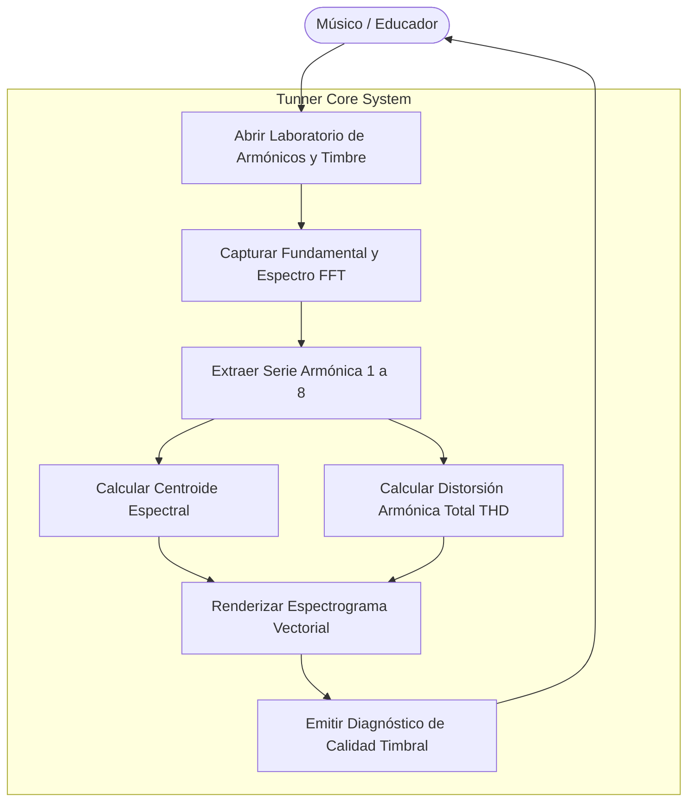
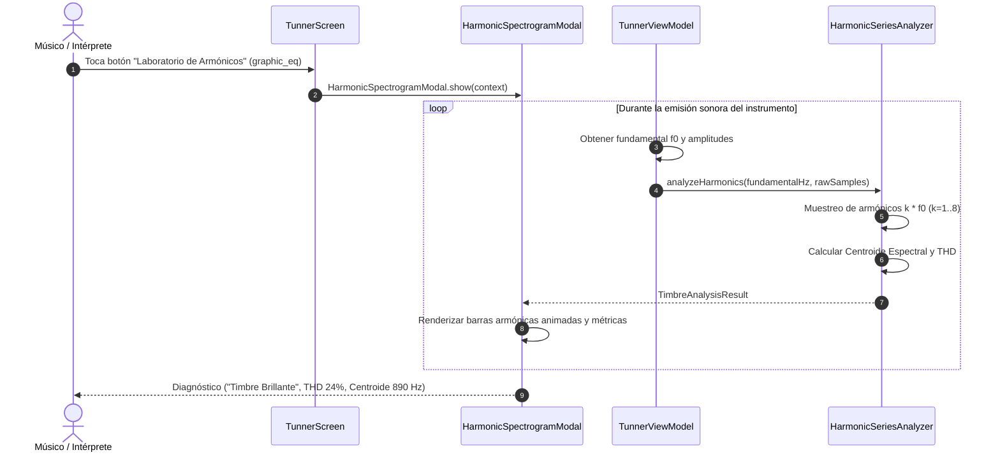

# Caso de Uso 20: Espectrograma de Armónicos y Análisis de Timbre FFT en Tiempo Real

Este documento formaliza el Caso de Uso para el análisis espectral de armónicos, centroide y pureza acústica en **Tunner**.

---

## 1. Diagrama de Caso de Uso (Mermaid)

---

## 2. Diagrama de Secuencia y Flujo Detallado (Mermaid)

---

## 3. Especificación Formal del Caso de Uso

### 3.1 Actores
* **Actor Principal:** Músico, cantante o maestro de conservatorio.

### 3.2 Precondiciones
1. El micrófono está activo captando la emisión acústica.
2. Existe un tono periódico detectado ($f_0 > 20\text{ Hz}$).

### 3.3 Postcondiciones
1. El usuario visualiza la energía de cada uno de los 8 armónicos superiores.
2. El sistema calcula en vivo el brillo y la pureza sonora del sonido emitido.

### 3.4 Flujo Principal
1. El usuario presiona el icono de espectrograma en la barra superior.
2. Se despliega el modal interactivo con el espectrograma vectorial.
3. El músico toca una nota sostenida.
4. Las barras vectoriales se animan en vivo reflejando las amplitudes relativas de la fundamental y los armónicos $2f_0, 3f_0, \dots, 8f_0$.
5. Se muestra el Centroide Espectral (brillo en Hz) y el THD (porcentaje de sobretonos).
6. El usuario ajusta su embocadura o pulsación y observa el cambio en el color del timbre.
