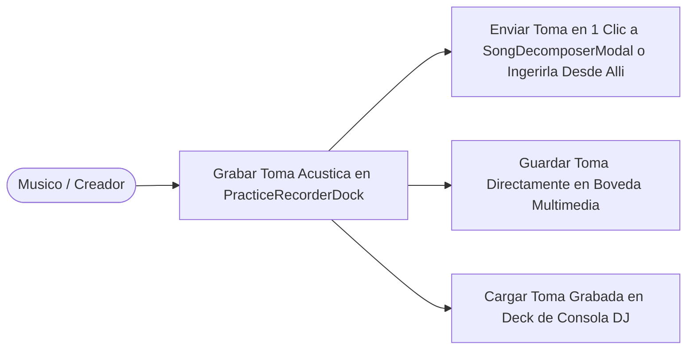
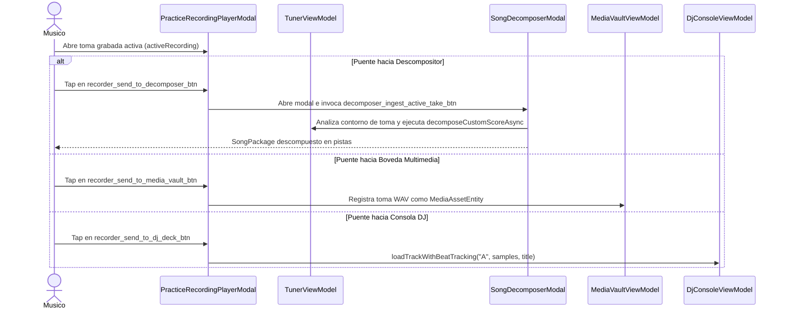

# Caso de Uso 210: Puentes de Grabadora en 1 Clic e Ingestion de Tomas en Descompositor (US-HC-08)

## Metadatos del Documento

- **ID del Documento:** `DOC-ARCH-2026-210`
- **ID del Caso de Uso:** `UC-210`
- **Historia de Usuario Asociada:** `US-HC-08`
- **Titulo Oficial:** Despacho Directo de Tomas de Practica hacia Descompositor de Canciones, Boveda Multimedia y Consola DJ e Ingestion en Vivo
- **Estado:** `Draft`
- **Fecha de Creacion:** `2026-11-26`
- **Ultima Modificacion:** `2026-11-26`
- **Fase Asociada:** `Fase 2 / Ola 6 Hiperconectividad Pro-Studio`
- **Autor / Revisor Principal:** `Nicolas Leon`
- **ADR Relacionado:** [ADR 0202](../04_adrs/0202_recorder_one_click_bridges_and_decomposer_take_ingestion.md)

---

## 1. Resumen Ejecutivo (Executive Summary)

Este caso de uso habilita flujos de transferencia en 1 clic desde `PracticeRecordingPlayerModal` y `PracticeRecorderDock` sobre `viewModel.activeRecording` hacia `SongDecomposerModal`, `MediaVaultViewModel` y `DjConsoleViewModel`, junto con un boton de ingestion directa de la toma activa dentro de `SongDecomposerModal` para transformarla en un arreglo multi-pista editable.

---

## 2. Diagramas Canonicos (Mermaid)

### 2.1 Diagrama de Casos de Uso

### 2.2 Diagrama de Secuencia Detallado

---

## 3. Precondiciones, Postcondiciones y Flujos

### 3.1 Precondiciones
- Existe una toma grabada valida en `TunerViewModel.activeRecording` con audio capturado.

### 3.2 Postcondiciones
- Segun el puente invocado: `SongDecomposerModal` genera un `SongPackage` descompuesto a partir de la toma; `MediaVaultViewModel` registra el nuevo `MediaAssetEntity`; o `DjConsoleViewModel` carga la toma en el deck seleccionado con BPM y analisis espectral.

### 3.3 Flujo Principal
1. El usuario concluye una grabacion en `PracticeRecorderDock` y abre `PracticeRecordingPlayerModal`.
2. El reproductor expone los botones puente `Key('recorder_send_to_decomposer_btn')`, `Key('recorder_send_to_media_vault_btn')` y `Key('recorder_send_to_dj_deck_btn')`.
3. Si el usuario abre directamente `SongDecomposerModal`, tambien dispone del boton `Key('decomposer_ingest_active_take_btn')` para importar `viewModel.activeRecording` en 1 clic sin volver al reproductor.
4. Al ejecutarse la accion elegida, la toma se convierte o registra deterministicamente y se muestra confirmacion visual no bloqueante.

### 3.4 Flujos Alternativos y Condiciones de Error
- **Sin Toma Activa o Toma Silenciosa:** Si `activeRecording == null` o su duracion es menor a $250\text{ ms}$, `decomposer_ingest_active_take_btn` aparece deshabilitado con texto explicativo y los puentes evitan insertar activos vacios.
- **Ausencia de `MediaVaultViewModel` o `DjConsoleViewModel` en el Arbol:** Si el modal se prueba de manera aislada sin alguno de esos ViewModels en el `Provider`, los callbacks opcionales o avisos de contexto manejan la ausencia sin excepciones no capturadas.

---

## 4. Trazabilidad Arquitectonica y Pruebas Automatizadas

- **Componentes:** `lib/features/practice_recorder/presentation/practice_recorder_dock.dart`, `lib/features/practice_recorder/presentation/practice_recording_player_modal.dart`, `lib/features/song_library/presentation/song_decomposer_modal.dart`, `lib/features/song_library/domain/song_decomposer_service.dart`.
- **Suite Planificada:** `test/features/practice_recorder/us_hc_08_recorder_bridges_and_decomposer_ingestion_test.dart`.
