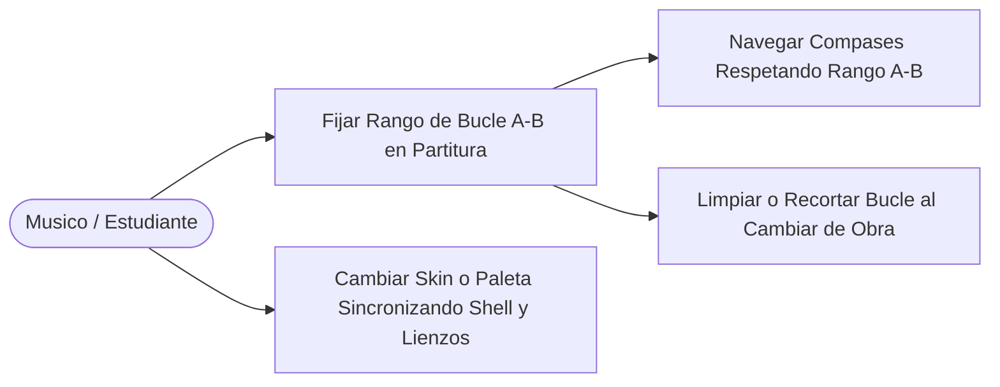
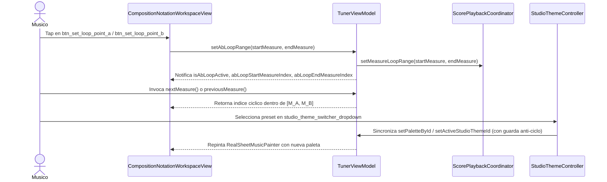

# Caso de Uso 211: Sincronizacion de Transporte de Bucle A-B en ViewModel y Paletas/Skins de Tema (US-UX-11)

## Metadatos del Documento

- **ID del Documento:** `DOC-ARCH-2026-211`
- **ID del Caso de Uso:** `UC-211`
- **Historia de Usuario Asociada:** `US-UX-11`
- **Titulo Oficial:** Transporte Unificado de Bucle A-B en TunerViewModel y Sincronizacion Bidireccional de Paletas y Skins de Tema
- **Estado:** `Draft`
- **Fecha de Creacion:** `2026-11-26`
- **Ultima Modificacion:** `2026-11-26`
- **Fase Asociada:** `Fase 2 / Ola 7 Segunda Auditoria UI/UX`
- **Autor / Revisor Principal:** `Nicolas Leon`
- **ADR Relacionado:** [ADR 0203](../04_adrs/0203_viewmodel_ab_loop_transport_and_theme_palette_sync.md)

---

## 1. Resumen Ejecutivo (Executive Summary)

Este caso de uso unifica el control del bucle de compases A-B directamente en `TunerViewModel` y `ScorePlaybackCoordinator` para que tanto la reproduccion automatica como la navegacion manual (`nextMeasure()`, `previousMeasure()`) y la interfaz `CompositionNotationWorkspaceView` operen sobre una unica fuente de verdad. Adicionalmente, sincroniza bidireccionalmente `StudioThemeController` y `TunerViewModel.currentPalette` para mantener coherencia cromatica total entre el shell, el pentagrama SMuFL y el afinador.

---

## 2. Diagramas Canonicos (Mermaid)

### 2.1 Diagrama de Casos de Uso

### 2.2 Diagrama de Secuencia Detallado

---

## 3. Precondiciones, Postcondiciones y Flujos

### 3.1 Precondiciones
- Existe un `SongPackage` cargado en `TunerViewModel` con al menos 1 compas (`totalMeasures >= 1`).
- `StudioThemeScope` provee una instancia activa de `StudioThemeController` en el arbol de widgets.

### 3.2 Postcondiciones
- `TunerViewModel` y `ScorePlaybackCoordinator` comparten el mismo rango `[M_A, M_B]` de bucle y `nextMeasure()` / `previousMeasure()` ciclan estrictamente dentro de ese rango mientras `isAbLoopActive == true`.
- Cualquier cambio de skin en `StudioThemeSwitcher` o de paleta en `TunerViewModel` actualiza ambos controladores sin reentrancia infinita.

### 3.3 Flujo Principal
1. El usuario abre `CompositionNotationWorkspaceView` y marca el compas inicial `A` con `Key('btn_set_loop_point_a')` y el compas final `B` con `Key('btn_set_loop_point_b')`.
2. `CompositionNotationWorkspaceView` invoca `viewModel.setAbLoopRange(...)`, que normaliza `start <= end`, configura `ScorePlaybackCoordinator` y actualiza `Key('chip_ab_loop_status')`.
3. Al ejecutar `viewModel.nextMeasure()` en `M_B` o `viewModel.previousMeasure()` en `M_A`, el cursor salta al extremo opuesto del bucle (`M_A` o `M_B`) sin escapar hacia el resto de la obra.
4. Al cambiar el tema desde `Key('studio_theme_switcher_dropdown')` en cualquier barra de herramientas, `MainAppShell` sincroniza `TunerViewModel.setPaletteById` y `setActiveStudioThemeId` manteniendo actualizados todos los lienzos `TunnerThemePalette`.

### 3.4 Flujos Alternativos y Condiciones de Error
- **Limpieza de Bucle:** Al pulsar `Key('btn_clear_ab_loop')`, `viewModel.clearAbLoop()` desactiva el bucle y `nextMeasure()` / `previousMeasure()` recuperan el ciclo completo `0 .. totalMeasures - 1`.
- **Cambio de Obra con Menos Compases:** Si `loadSongPackage` carga una partitura cuya longitud es menor a `M_B + 1`, `TunerViewModel` ajusta o limpia el rango A-B evitando `RangeError`.
- **Preset de Skin sin Coincidencia Exacta:** Si un tema personalizado no coincide exactamente con `TunnerThemePalette.allPresets`, se conserva el token activo sin lanzar excepciones y se evita recursividad mediante la guarda `_isSyncingTheme`.

---

## 4. Trazabilidad Arquitectonica y Pruebas Automatizadas

- **Componentes:** `lib/features/tuner/presentation/tuner_viewmodel.dart`, `lib/features/sheet_music/domain/score_playback_coordinator.dart`, `lib/features/workspaces/presentation/composition_notation_workspace_view.dart`, `lib/core/design_system/studio_theme_provider.dart`, `lib/features/navigation/presentation/main_app_shell.dart`.
- **Suite Planificada:** `test/features/tuner/us_ux_11_ab_loop_transport_and_theme_sync_test.dart`.
