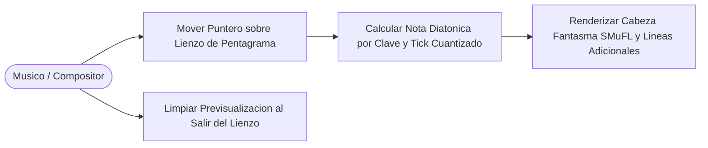
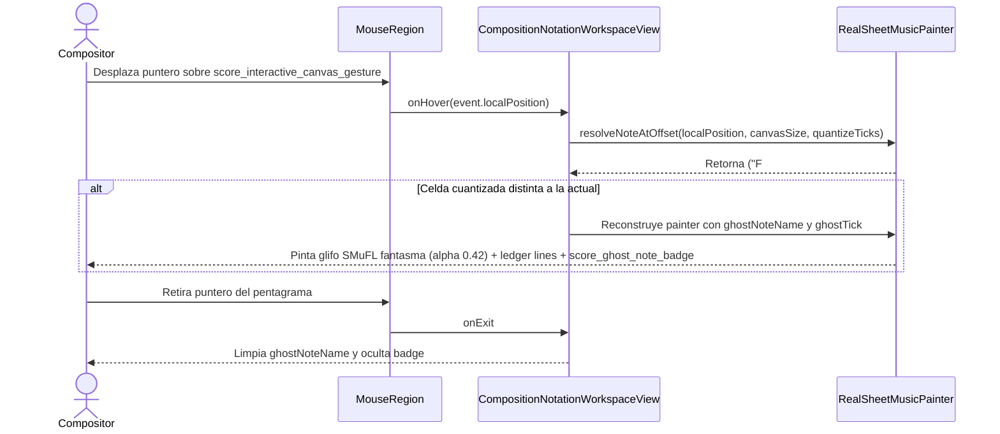

# Caso de Uso 212: Previsualizacion de Nota Fantasma SMuFL en Hover sobre Lienzo de Partitura (US-UX-12)

## Metadatos del Documento

- **ID del Documento:** `DOC-ARCH-2026-212`
- **ID del Caso de Uso:** `UC-212`
- **Historia de Usuario Asociada:** `US-UX-12`
- **Titulo Oficial:** Calculo Inverso de Altura/Tick y Renderizado de Nota Fantasma SMuFL durante Hover en Pentagrama
- **Estado:** `Draft`
- **Fecha de Creacion:** `2026-11-26`
- **Ultima Modificacion:** `2026-11-26`
- **Fase Asociada:** `Fase 2 / Ola 7 Segunda Auditoria UI/UX`
- **Autor / Revisor Principal:** `Nicolas Leon`
- **ADR Relacionado:** [ADR 0204](../04_adrs/0204_smufl_ghost_note_hover_preview_in_score_canvas.md)

---

## 1. Resumen Ejecutivo (Executive Summary)

Este caso de uso habilita la manipulacion directa predictiva sobre el lienzo de partitura (`RealSheetMusicPainter` en `CompositionNotationWorkspaceView`), mostrando una cabeza de nota fantasma SMuFL (`Ghost Note`), sus lineas adicionales y una etiqueta de lectura rapida al desplazar el puntero sobre el pentagrama antes de hacer clic para insertar.

---

## 2. Diagramas Canonicos (Mermaid)

### 2.1 Diagrama de Casos de Uso

### 2.2 Diagrama de Secuencia Detallado

---

## 3. Precondiciones, Postcondiciones y Flujos

### 3.1 Precondiciones
- `CompositionNotationWorkspaceView` muestra el lienzo interactivo `Key('score_interactive_canvas_gesture')` con un `RealSheetMusicPainter` activo.

### 3.2 Postcondiciones
- Mientras el cursor permanezca dentro del area util del compas, el usuario visualiza exactamente que nota diatonica (segun `InstrumentClef.treble`, `bass` o `alto`) y tick cuantizado se insertaran al pulsar.
- Al salir del `MouseRegion`, no quedan glifos fantasma residuales sobre el lienzo.

### 3.3 Flujo Principal
1. El usuario posiciona el cursor sobre el lienzo del pentagrama dentro de `CompositionNotationWorkspaceView`.
2. `MouseRegion.onHover` invoca `painter.resolveNoteAtOffset(event.localPosition, canvasSize)`.
3. `RealSheetMusicPainter` proyecta `dx` sobre los ticks del compas y `dy` sobre los semiespacios diatonicos relativos a la clave activa (`treble = 30`, `alto = 24`, `bass = 18`).
4. Si la combinacion `(ghostTick, ghostNoteName)` cambia respecto al cuadro previo, el widget actualiza su estado, muestra `Key('score_ghost_note_badge')` y `RealSheetMusicPainter.paint` dibuja la cabeza de nota fantasma SMuFL junto con sus lineas adicionales cuando corresponde.
5. Al retirar el cursor, `MouseRegion.onExit` restablece `ghostNoteName = null` y `ghostTick = null`.

### 3.4 Flujos Alternativos y Condiciones de Error
- **Cursor en Zona de Clave o Armadura (`dx < leftMargin`):** `resolveNoteAtOffset` retorna `null` y limpia la previsualizacion para evitar insertar o sugerir notas sobre la clave.
- **Modo Borrado Activo (`ScoreCanvasEditMode.erase`):** La previsualizacion de insercion fantasma se suprime o se muestra el cursor de precision indicando eliminacion sin confundir al usuario.
- **Misma Celda Cuantizada:** Si el movimiento del raton no cambia ni el tick ni el escalon diatonico, no se dispara `setState`, preservando 120 FPS estables.

---

## 4. Trazabilidad Arquitectonica y Pruebas Automatizadas

- **Componentes:** `lib/features/sheet_music/presentation/real_sheet_music_painter.dart`, `lib/features/workspaces/presentation/composition_notation_workspace_view.dart`, `lib/features/sheet_music/presentation/smufl/smufl_glyph_path_engine.dart`.
- **Suite Planificada:** `test/features/workspaces/us_ux_12_smufl_ghost_note_hover_preview_test.dart`.
