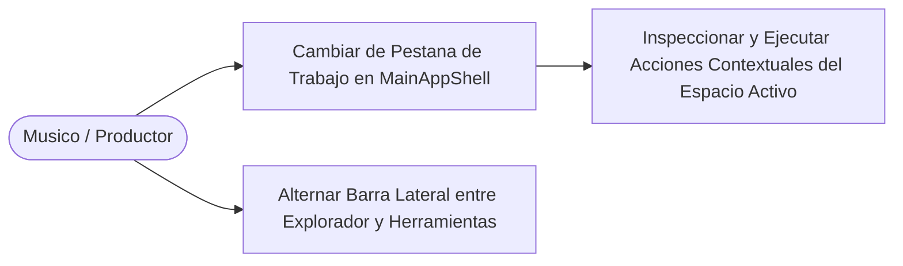
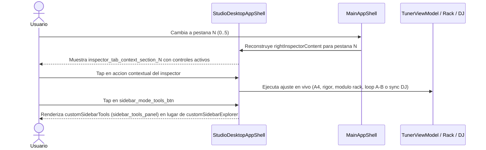

# Caso de Uso 213: Inspector Contextual Consciente de Pestana y Panel Lateral de Herramientas (US-UX-13)

## Metadatos del Documento

- **ID del Documento:** `DOC-ARCH-2026-213`
- **ID del Caso de Uso:** `UC-213`
- **Historia de Usuario Asociada:** `US-UX-13`
- **Titulo Oficial:** Especializacion por Pestana del Inspector Contextual Derecho y Separacion del Panel de Herramientas en Barra Lateral
- **Estado:** `Draft`
- **Fecha de Creacion:** `2026-11-26`
- **Ultima Modificacion:** `2026-11-26`
- **Fase Asociada:** `Fase 2 / Ola 7 Segunda Auditoria UI/UX`
- **Autor / Revisor Principal:** `Nicolas Leon`
- **ADR Relacionado:** [ADR 0205](../04_adrs/0205_tab_aware_contextual_inspector_and_sidebar_tools.md)

---

## 1. Resumen Ejecutivo (Executive Summary)

Este caso de uso elimina el contenido estatico y repetitivo del Inspector Contextual Derecho en `MainAppShell`, adaptando tanto las acciones rapidas como las metricas al espacio de trabajo activo (`0` Hub, `1` Afinador, `2` Practica, `3` Rack Modular, `4` Partituras, `5` Consola DJ). Asimismo, introduce el slot `customSidebarTools` en `StudioDesktopAppShell` para que el boton `'Herramientas'` (`sidebar_mode_tools_btn`) muestre un catalogo operativo dedicado en lugar de repetir el explorador de archivos del proyecto.

---

## 2. Diagramas Canonicos (Mermaid)

### 2.1 Diagrama de Casos de Uso

### 2.2 Diagrama de Secuencia Detallado

---

## 3. Precondiciones, Postcondiciones y Flujos

### 3.1 Precondiciones
- La aplicacion corre en modo escritorio (`width >= 900`) utilizando `StudioDesktopAppShell` dentro de `MainAppShell`.

### 3.2 Postcondiciones
- Cada pestana `0..5` presenta un panel contextual propio dentro del Inspector Derecho con acciones ejecutables pertinentes al dominio de esa pestana.
- La barra lateral izquierda distingue limpiamente entre `'Explorador'` (`customSidebarExplorer`) y `'Herramientas'` (`customSidebarTools` / `Key('sidebar_tools_panel')`).

### 3.3 Flujo Principal
1. El usuario abre el Inspector Contextual Derecho con `Key('btn_toggle_right_inspector')`.
2. Al navegar entre las pestanas `0` a `5`, `MainAppShell` renderiza el bloque `Key('inspector_tab_context_section_0')` .. `Key('inspector_tab_context_section_5')` con acciones y telemetria especificas de esa vista (por ejemplo: temperamento y rigor en Afinador; Ebbinghaus/metronomo en Practica; agregar modulo en Rack; compas/bucle A-B/exportacion en Partituras; BPM de Decks y centrado de crossfader en Consola DJ).
3. En la barra lateral izquierda, al pulsar `Key('sidebar_mode_tools_btn')`, `StudioDesktopAppShell` oculta el explorador de archivos y muestra `customSidebarTools` (`Key('sidebar_tools_panel')`) con lanzadores rapidos de herramientas de estudio.
4. Al volver a pulsar `Key('sidebar_mode_explorer_btn')`, se restaura inmediatamente el arbol VS Code de archivos y partituras.

### 3.4 Flujos Alternativos y Condiciones de Error
- **Uso Aislado de `StudioDesktopAppShell` sin `customSidebarTools`:** Si un consumidor o prueba no pasa `customSidebarTools`, el modo `'tools'` utiliza `StudioTreeView(sections: widget.navigationSections)` como respaldo seguro sin fallar.
- **Inspector Cerrado Inicialmente:** Si `initialInspectorVisible` es `false`, los widgets del inspector permanecen desmontados hasta que el usuario pulsa `btn_toggle_right_inspector`.

---

## 4. Trazabilidad Arquitectonica y Pruebas Automatizadas

- **Componentes:** `lib/core/design_system/organisms/studio_desktop_app_shell.dart`, `lib/features/navigation/presentation/main_app_shell.dart`.
- **Suite Planificada:** `test/core/design_system/us_ux_13_tab_aware_inspector_and_sidebar_tools_test.dart`.
