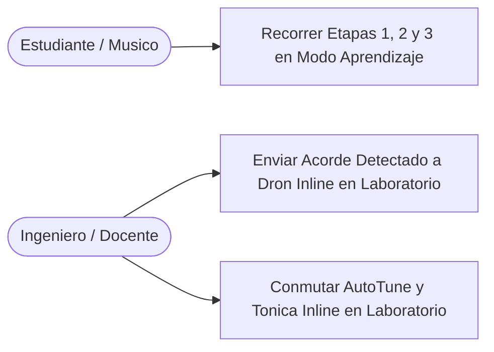
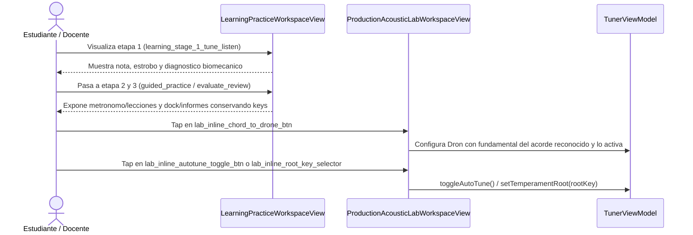

# Caso de Uso 214: Jerarquia de Aprendizaje en 3 Etapas y Puentes Inline de Laboratorio (US-UX-14)

## Metadatos del Documento

- **ID del Documento:** `DOC-ARCH-2026-214`
- **ID del Caso de Uso:** `UC-214`
- **Historia de Usuario Asociada:** `US-UX-14`
- **Titulo Oficial:** Reorganizacion Pedagogica en 3 Etapas en LearningPracticeWorkspaceView y Controles Inline en ProductionAcousticLabWorkspaceView
- **Estado:** `Draft`
- **Fecha de Creacion:** `2026-11-26`
- **Ultima Modificacion:** `2026-11-26`
- **Fase Asociada:** `Fase 2 / Ola 7 Segunda Auditoria UI/UX`
- **Autor / Revisor Principal:** `Nicolas Leon`
- **ADR Relacionado:** [ADR 0206](../04_adrs/0206_three_stage_learning_hierarchy_and_lab_inline_bridges.md)

---

## 1. Resumen Ejecutivo (Executive Summary)

Este caso de uso reduce la saturacion cognitiva de `LearningPracticeWorkspaceView` organizando sus controles en tres etapas pedagogicas explicitas (Afinar y Escuchar, Practicar con Guia, Evaluar y Revisar) y agrega puentes de accion inline sobre `ProductionAcousticLabWorkspaceView` para manipular Dron, Vocal AutoTune y raiz de temperamento sin abrir modales bloqueantes.

---

## 2. Diagramas Canonicos (Mermaid)

### 2.1 Diagrama de Casos de Uso

### 2.2 Diagrama de Secuencia Detallado

---

## 3. Precondiciones, Postcondiciones y Flujos

### 3.1 Precondiciones
- El usuario accede al espacio `LearningPracticeWorkspaceView` o `ProductionAcousticLabWorkspaceView` respaldado por `TunerViewModel`.

### 3.2 Postcondiciones
- En `LearningPracticeWorkspaceView`, todos los controles se agrupan bajo `Key('learning_stage_1_tune_listen')`, `Key('learning_stage_2_guided_practice')` y `Key('learning_stage_3_evaluate_review')`.
- En `ProductionAcousticLabWorkspaceView`, el usuario puede disparar el Dron desde el acorde detectado, alternar AutoTune y cambiar la tonica del temperamento sin salir de la vista principal.

### 3.3 Flujo Principal
1. En `LearningPracticeWorkspaceView`, el estudiante encuentra primero la Etapa 1 (`learning_stage_1_tune_listen`) con afinador estroboscopico, selector de instrumento/pedagogia y diagnostico en vivo.
2. En la Etapa 2 (`learning_stage_2_guided_practice`), accede al metronomo anti-bleed, Smart Wait, Lecciones Guiadas y Dron Armonico.
3. En la Etapa 3 (`learning_stage_3_evaluate_review`), accede al `PracticeRecorderDock`, Comparador Espectral, Vocal AutoTune, Generador de Ejercicios e Informe PDF.
4. En `ProductionAcousticLabWorkspaceView`, el docente pulsa `Key('lab_inline_chord_to_drone_btn')`, `Key('lab_inline_autotune_toggle_btn')` o selecciona una tonica en `Key('lab_inline_root_key_selector')`, actualizando `TunerViewModel` inmediatamente.

### 3.4 Flujos Alternativos y Condiciones de Error
- **Acorde No Reconocido al Pulsar Puente a Dron:** Si `recognizedChord.isRecognized` es `false`, `lab_inline_chord_to_drone_btn` aparece deshabilitado o utiliza la nota fundamental detectada actual con aviso no bloqueante.
- **Compatibilidad de Pruebas Previas:** Las tres etapas inician desplegadas o accesibles de forma que todas las keys preexistentes (`open_guided_lessons_chip`, `open_vocal_autotune_chip`, `essential_mic_toggle_btn`, etc.) sigan localizables.

---

## 4. Trazabilidad Arquitectonica y Pruebas Automatizadas

- **Componentes:** `lib/features/workspaces/presentation/learning_practice_workspace_view.dart`, `lib/features/workspaces/presentation/production_acoustic_lab_workspace_view.dart`, `lib/features/tuner/presentation/tuner_viewmodel.dart`.
- **Suite Planificada:** `test/features/workspaces/us_ux_14_three_stage_learning_and_lab_inline_bridges_test.dart`.
