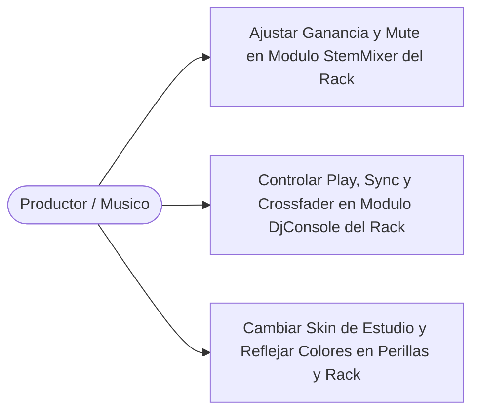
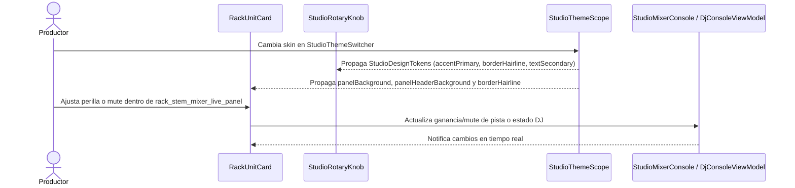

# Caso de Uso 215: Modulos Vivos en RackUnitCard y Tokenizacion de StudioRotaryKnob (US-UX-15)

## Metadatos del Documento

- **ID del Documento:** `DOC-ARCH-2026-215`
- **ID del Caso de Uso:** `UC-215`
- **Historia de Usuario Asociada:** `US-UX-15`
- **Titulo Oficial:** Reemplazo de Resumen Pasivo en Modulos stemMixer / djConsole del Rack y Consumo de StudioDesignTokens en StudioRotaryKnob
- **Estado:** `Draft`
- **Fecha de Creacion:** `2026-11-26`
- **Ultima Modificacion:** `2026-11-26`
- **Fase Asociada:** `Fase 2 / Ola 7 Segunda Auditoria UI/UX`
- **Autor / Revisor Principal:** `Nicolas Leon`
- **ADR Relacionado:** [ADR 0207](../04_adrs/0207_live_rack_unit_modules_and_tokenized_rotary_knob.md)

---

## 1. Resumen Ejecutivo (Executive Summary)

Este caso de uso transforma los modulos `RackModuleType.stemMixer` y `RackModuleType.djConsole` dentro de `RackUnitCard` de texto estatico a paneles operativos en vivo, tokeniza completamente `StudioRotaryKnob` y `RackUnitCard` mediante `StudioThemeScope.of(context)`, y corrige la visualizacion dinamica de la clave musical activa en el modulo `scoreNotation`.

---

## 2. Diagramas Canonicos (Mermaid)

### 2.1 Diagrama de Casos de Uso

### 2.2 Diagrama de Secuencia Detallado

---

## 3. Precondiciones, Postcondiciones y Flujos

### 3.1 Precondiciones
- `ModularStudioRackView` contiene tarjetas `RackUnitCard` montadas dentro de un `StudioThemeScope`.

### 3.2 Postcondiciones
- `StudioRotaryKnob` y `RackUnitCard` renderizan sus trazos, fondos y etiquetas utilizando los colores semanticos de `StudioThemeScope.of(context)`.
- Los modulos `stemMixer` (`Key('rack_stem_mixer_live_panel')`) y `djConsole` (`Key('rack_dj_console_live_panel')`) ofrecen controles interactivos reales en lugar de `_buildStudioAudioModuleSummary`.

### 3.3 Flujo Principal
1. El usuario monta o expande un modulo `RackModuleType.stemMixer` o `RackModuleType.djConsole` en `ModularStudioRackView`.
2. `RackUnitCard` consulta `StudioThemeScope.of(context)` para pintar su cabecera (`Key('rack_unit_card_header')`) y cuerpo sin colores hardcodeados.
3. Para `stemMixer`, muestra `Key('rack_stem_mixer_live_panel')` con `StudioRotaryKnob` de ganancia y controles de mute por pista conectados a `tuner.mixerConsole`.
4. Para `djConsole`, muestra `Key('rack_dj_console_live_panel')` con lecturas de BPM de Decks A/B, Play/Sync y ajuste de crossfader conectados a `DjConsoleViewModel`.
5. Para `scoreNotation`, muestra dinamicamente `tuner.activeInstrument.clef.displayName` en lugar de una clave fija.

### 3.4 Flujos Alternativos y Condiciones de Error
- **Ausencia de `DjConsoleViewModel` en el Arbol de Widgets:** Si `RackUnitCard` se instancia en pruebas unitarias aisladas sin `DjConsoleViewModel` en `Provider`, `_buildModuleContent` captura la ausencia de forma segura y muestra un panel informativo sin lanzar excepciones.
- **Override Explicito de `activeColor` en `StudioRotaryKnob`:** Si un consumidor pasa `activeColor` explicito, dicho color prevalece sobre `tokens.accentPrimary`, mientras pista inactiva y texto siguen usando tokens del tema.

---

## 4. Trazabilidad Arquitectonica y Pruebas Automatizadas

- **Componentes:** `lib/core/design_system/atoms/studio_rotary_knob.dart`, `lib/features/modular_rack/presentation/rack_unit_card.dart`, `lib/features/modular_rack/presentation/modular_studio_rack_view.dart`.
- **Suite Planificada:** `test/features/modular_rack/us_ux_15_live_rack_modules_and_tokenized_knob_test.dart`.
