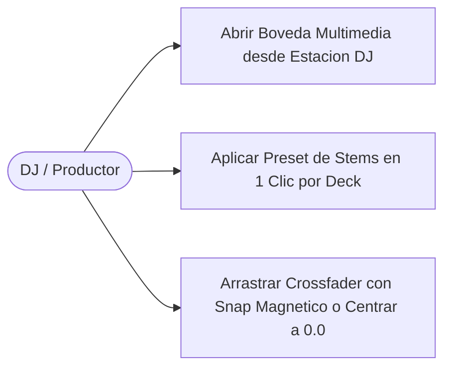
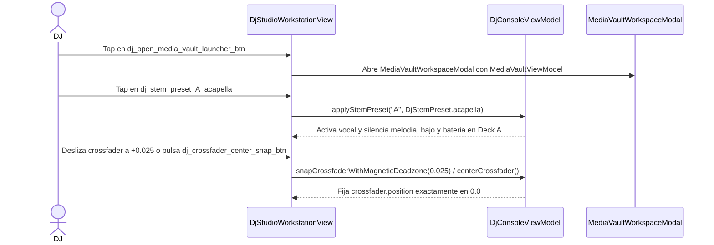

# Caso de Uso 216: Lanzador de Boveda, Presets de Stems y Snap de Crossfader en Consola DJ (US-UX-16)

## Metadatos del Documento

- **ID del Documento:** `DOC-ARCH-2026-216`
- **ID del Caso de Uso:** `UC-216`
- **Historia de Usuario Asociada:** `US-UX-16`
- **Titulo Oficial:** Acceso Directo a Boveda Multimedia, Presets de 4 Stems en 1 Clic y Snap Magnetico Central en Crossfader DJ
- **Estado:** `Draft`
- **Fecha de Creacion:** `2026-11-26`
- **Ultima Modificacion:** `2026-11-26`
- **Fase Asociada:** `Fase 2 / Ola 7 Segunda Auditoria UI/UX`
- **Autor / Revisor Principal:** `Nicolas Leon`
- **ADR Relacionado:** [ADR 0208](../04_adrs/0208_dj_workstation_vault_launcher_stem_presets_and_crossfader_snap.md)

---

## 1. Resumen Ejecutivo (Executive Summary)

Este caso de uso agiliza el rendimiento en vivo dentro de `DjStudioWorkstationView` y `DjConsoleViewModel` agregando un boton lanzador directo hacia la Boveda Multimedia, presets de aislamiento de 4 stems en 1 clic por deck (`Acapella`, `Instrumental`, `Solo Drums`, `Reset`) y un comportamiento de snap magnetico al centro (`0.0`) con boton dedicado en el crossfader principal.

---

## 2. Diagramas Canonicos (Mermaid)

### 2.1 Diagrama de Casos de Uso

### 2.2 Diagrama de Secuencia Detallado

---

## 3. Precondiciones, Postcondiciones y Flujos

### 3.1 Precondiciones
- `DjStudioWorkstationView` esta activa con un `DjConsoleViewModel` inicializado.

### 3.2 Postcondiciones
- Al pulsar un preset de stem en Deck A o B, las 4 bandas (`vocals`, `melody`, `bass`, `drums`) adoptan deterministicamente la mascara correspondiente sin requerir multiples toques.
- Cualquier desplazamiento del crossfader dentro de `[-0.04, 0.04]` o toque en `Key('dj_crossfader_center_snap_btn')` posiciona `crossfader.position` exactamente en `0.0`.

### 3.3 Flujo Principal
1. En la barra superior de `DjStudioWorkstationView`, el usuario dispone de `Key('dj_open_media_vault_launcher_btn')` para abrir `MediaVaultWorkspaceModal`.
2. En la seccion de 4 stems de cada deck (`A` y `B`), el usuario pulsa uno de los chips de preset (`Key('dj_stem_preset_A_acapella')`, `Key('dj_stem_preset_A_instrumental')`, `Key('dj_stem_preset_A_drums_only')`, `Key('dj_stem_preset_A_reset')`).
3. `DjConsoleViewModel.applyStemPreset(deckId, preset)` aplica la configuracion de mute/unmute en una unica transaccion y notifica a los oyentes.
4. Al mover el deslizador del crossfader cerca del centro (`|val| <= 0.04`) o al pulsar `Key('dj_crossfader_center_snap_btn')`, `DjConsoleViewModel` fija la posicion en `0.0` exacto.

### 3.4 Flujos Alternativos y Condiciones de Error
- **Estacion Montada Sin `MediaVaultViewModel` en `Provider`:** Si un test monta `DjStudioWorkstationView` de forma aislada, `dj_open_media_vault_launcher_btn` utiliza un callback inyectado o crea un `MediaVaultViewModel` temporal sin lanzar excepcion.
- **Crossfader Durante `Smart Automix`:** Si el usuario mueve manualmente el crossfader o pulsa el boton de centrado mientras `automix.isActive` es verdadero, se cancela o actualiza limpiamente la posicion sin estados inconsistentes.

---

## 4. Trazabilidad Arquitectonica y Pruebas Automatizadas

- **Componentes:** `lib/features/dj_console/domain/dj_stem_isolation_entity.dart`, `lib/features/dj_console/presentation/dj_console_view_model.dart`, `lib/features/dj_console/presentation/dj_studio_workstation_view.dart`.
- **Suite Planificada:** `test/features/dj_console/us_ux_16_dj_vault_launcher_stem_presets_and_crossfader_snap_test.dart`.
