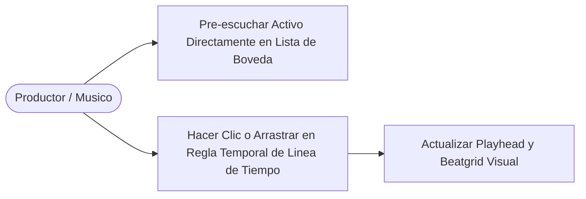
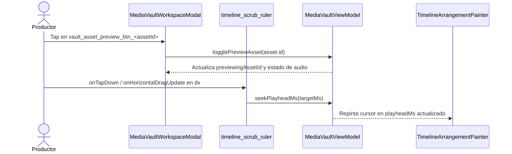

# Caso de Uso 217: Pre-escucha Inline de Activos y Regla de Scrubbing en Boveda Multimedia (US-UX-17)

## Metadatos del Documento

- **ID del Documento:** `DOC-ARCH-2026-217`
- **ID del Caso de Uso:** `UC-217`
- **Historia de Usuario Asociada:** `US-UX-17`
- **Titulo Oficial:** Conmutador Inline de Pre-escucha por Activo y Regla Temporal Interactiva de Scrubbing en Boveda Multimedia
- **Estado:** `Draft`
- **Fecha de Creacion:** `2026-11-26`
- **Ultima Modificacion:** `2026-11-26`
- **Fase Asociada:** `Fase 2 / Ola 7 Segunda Auditoria UI/UX`
- **Autor / Revisor Principal:** `Nicolas Leon`
- **ADR Relacionado:** [ADR 0209](../04_adrs/0209_media_vault_inline_asset_preview_and_timeline_scrub_ruler.md)

---

## 1. Resumen Ejecutivo (Executive Summary)

Este caso de uso conecta la interfaz de `MediaVaultWorkspaceModal` y `TimelineArrangementPainter` con las capacidades de reproduccion ya existentes en `MediaVaultViewModel`, exponiendo un boton inline de pre-escucha en cada fila de activo de la boveda y una regla superior interactiva sobre el secuenciador para mover el playhead (`seekPlayheadMs`) mediante clic o arrastre.

---

## 2. Diagramas Canonicos (Mermaid)

### 2.1 Diagrama de Casos de Uso

### 2.2 Diagrama de Secuencia Detallado

---

## 3. Precondiciones, Postcondiciones y Flujos

### 3.1 Precondiciones
- `MediaVaultWorkspaceModal` se encuentra abierto con al menos un `MediaAssetEntity` en `MediaVaultViewModel`.

### 3.2 Postcondiciones
- Pulsar `Key('vault_asset_preview_btn_${asset.id}')` alterna `vm.previewingAssetId` y dispara o detiene la audicion del activo.
- Interactuar sobre `Key('timeline_scrub_ruler')` actualiza `vm.playheadMs` proporcionalmente a `dx / pixelsPerSecond` (con snap opcional al beatgrid) y repinta el cabezal en `TimelineArrangementPainter`.

### 3.3 Flujo Principal
1. El usuario localiza un activo en el panel izquierdo de `MediaVaultWorkspaceModal` y pulsa `Key('vault_asset_preview_btn_${asset.id}')`.
2. `MediaVaultViewModel.togglePreviewAsset(asset.id)` inicia la pre-escucha y marca visualmente el boton como activo (icono de detencion y color `accentPrimary`).
3. En el panel derecho del secuenciador, `TimelineArrangementPainter` dibuja la franja superior de regla temporal con marcas en segundos y compases.
4. Al hacer clic o arrastrar horizontalmente sobre `Key('timeline_scrub_ruler')`, la posicion `dx` descontando la columna izquierda de cabecera (`155.0 px`) se convierte en milisegundos y se envia a `vm.seekPlayheadMs(targetMs)`.

### 3.4 Flujos Alternativos y Condiciones de Error
- **Clic en Zona de Cabecera de Pista (`dx < 155.0`):** Si el puntero cae dentro de la banda izquierda de nombres de pista, el tiempo resultante se acota limpiamente a `0 ms` sin producir valores negativos.
- **Snap al Beatgrid Activo:** Cuando `timeline.snapToBeatgrid` es `true`, `seekPlayheadMs` recibe el tiempo cuantizado al pulso mas cercano segun `timeline.masterBpm`.
- **Activo Sin Samples PCM:** Si el activo seleccionado es un documento de partitura sin `pcmSamples`, `togglePreviewAsset` actualiza `previewingAssetId` y el mensaje de estado sin lanzar excepciones.

---

## 4. Trazabilidad Arquitectonica y Pruebas Automatizadas

- **Componentes:** `lib/features/media_vault/presentation/media_vault_workspace_modal.dart`, `lib/features/media_vault/presentation/timeline_arrangement_painter.dart`, `lib/features/media_vault/presentation/media_vault_viewmodel.dart`.
- **Suite Planificada:** `test/features/media_vault/us_ux_17_vault_inline_preview_and_timeline_scrub_test.dart`.
