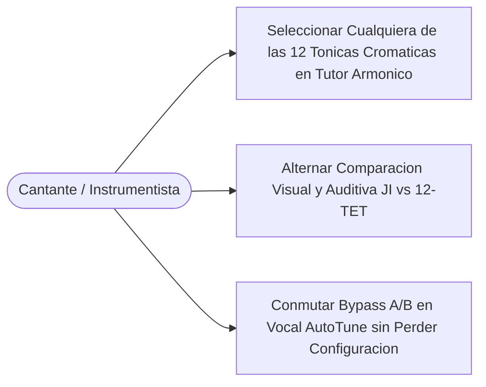
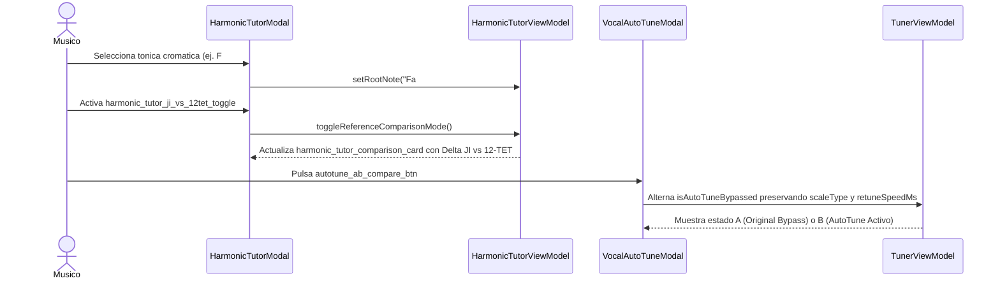

# Caso de Uso 218: 12 Tonicas Cromaticas en Tutor Armonico, Comparacion JI vs 12-TET y Bypass A/B en AutoTune (US-UX-18)

## Metadatos del Documento

- **ID del Documento:** `DOC-ARCH-2026-218`
- **ID del Caso de Uso:** `UC-218`
- **Historia de Usuario Asociada:** `US-UX-18`
- **Titulo Oficial:** Expansion Cromatica Completa (12 Tonicas) y Comparador JI vs 12-TET en Tutor Armonico y Conmutador Bypass A/B en Vocal AutoTune
- **Estado:** `Draft`
- **Fecha de Creacion:** `2026-11-26`
- **Ultima Modificacion:** `2026-11-26`
- **Fase Asociada:** `Fase 2 / Ola 7 Segunda Auditoria UI/UX`
- **Autor / Revisor Principal:** `Nicolas Leon`
- **ADR Relacionado:** [ADR 0210](../04_adrs/0210_harmonic_tutor_12_chromatic_roots_ji_compare_and_autotune_ab.md)

---

## 1. Resumen Ejecutivo (Executive Summary)

Este caso de uso elimina la restriccion a 7 notas naturales en `HarmonicTutorModal` ampliando el selector de tonicas a las 12 alturas cromaticas completas, introduce un modo comparativo directo entre Entonacion Justa (JI) y Temperamento Igual (12-TET) en `HarmonicTutorViewModel`, y agrega un conmutador rapido A/B Bypass en `VocalAutoTuneModal` para audicionar audio original frente a correccion tonal en 1 clic.

---

## 2. Diagramas Canonicos (Mermaid)

### 2.1 Diagrama de Casos de Uso

### 2.2 Diagrama de Secuencia Detallado

---

## 3. Precondiciones, Postcondiciones y Flujos

### 3.1 Precondiciones
- El usuario abre `HarmonicTutorModal` o `VocalAutoTuneModal` con sus respectivos ViewModels inicializados.

### 3.2 Postcondiciones
- `HarmonicTutorModal` expone los 12 chips de tonica (`Key('harmonic_tutor_root_chip_0')` .. `Key('harmonic_tutor_root_chip_11')`) cubriendo `C4` a `B4`.
- `Key('harmonic_tutor_ji_vs_12tet_toggle')` permite alternar la referencia comparativa y mostrar `Key('harmonic_tutor_comparison_card')` con frecuencias en Hz y desviacion en cents entre JI y 12-TET.
- `Key('autotune_ab_compare_btn')` conmuta entre modo `A (Bypass Original)` y `B (Procesado)` sin restablecer `retuneSpeedMs`, `scaleType` ni `rootNoteIndex`.

### 3.3 Flujo Principal
1. En `HarmonicTutorModal`, el musico elige cualquiera de las 12 tonicas cromaticas (incluyendo alteraciones como `Do#4`, `Mib4`, `Fa#4`, `Lab4`, `Sib4`).
2. Pulsa `Key('harmonic_tutor_ji_vs_12tet_toggle')` para comparar la diana de Entonacion Justa frente a 12-TET en `Key('harmonic_tutor_comparison_card')` y escuchar la diferencia de batimiento cuando el dron guia esta activo.
3. En `VocalAutoTuneModal`, con AutoTune configurado, el cantante pulsa `Key('autotune_ab_compare_btn')` para comparar instantaneamente la voz sin procesar (A) frente a la correccion cuantizada (B).

### 3.4 Flujos Alternativos y Condiciones de Error
- **AutoTune Maestro Apagado al Pulsar A/B:** Si el interruptor maestro estaba apagado, pulsar `autotune_ab_compare_btn` no rompe el estado ni sobreescribe los parametros guardados en `AutoTuneConfigEntity`.
- **Sin Senal de Microfono en Tutor Armonico:** Cuando aun no entra audio del microfono, `harmonic_tutor_comparison_card` calcula igualmente las frecuencias teoricas JI y 12-TET respecto al rol objetivo o la tercera mayor del acorde seleccionado.

---

## 4. Trazabilidad Arquitectonica y Pruebas Automatizadas

- **Componentes:** `lib/features/harmonic_tutor/presentation/harmonic_tutor_modal.dart`, `lib/features/harmonic_tutor/presentation/harmonic_tutor_view_model.dart`, `lib/features/harmonic_tutor/domain/just_intonation_calculator.dart`, `lib/features/vocal_autotune/domain/autotune_config_entity.dart`, `lib/features/vocal_autotune/presentation/vocal_autotune_modal.dart`.
- **Suite Planificada:** `test/features/harmonic_tutor/us_ux_18_chromatic_roots_ji_compare_and_autotune_ab_test.dart`.
