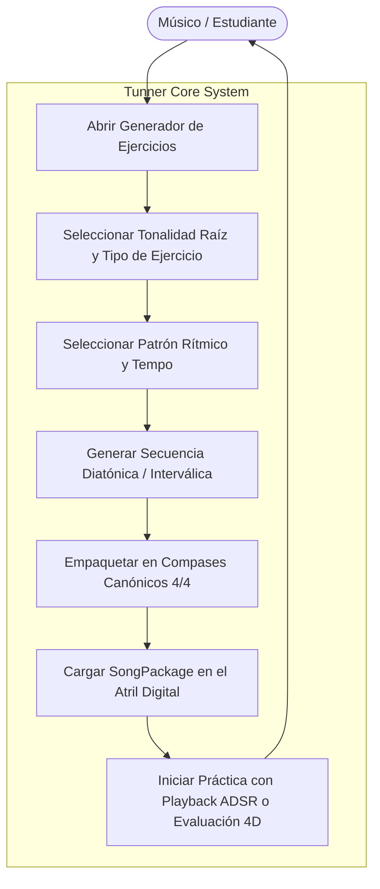
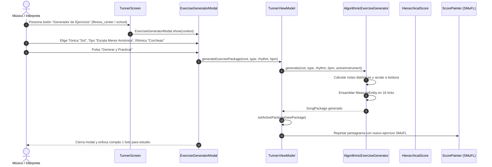

# Caso de Uso 21: Generador Algorítmico de Ejercicios y Escalas de Conservatorio

Este documento describe la especificación formal del generador procedural de escalas y rutinas técnicas en **Tunner**.

---

## 1. Diagrama de Caso de Uso (Mermaid)

---

## 2. Diagrama de Secuencia y Flujo Detallado (Mermaid)

---

## 3. Especificación Formal del Caso de Uso

### 3.1 Actores
* **Actor Principal:** Músico, docente o estudiante de conservatorio.

### 3.2 Precondiciones
1. Una sesión de afinación o estudio activa en Tunner.

### 3.3 Postcondiciones
1. Se crea un `SongPackage` completo con el título de la escala o ejercicio.
2. La partitura se muestra en el pentagrama vectorial y está lista para tocar, escuchar o exportar.

### 3.4 Flujo Principal
1. El usuario abre el modal del Generador de Ejercicios.
2. Selecciona la nota raíz (ej. Do, Re, Mi, Fa, Sol, La, Si con alteraciones $\sharp/\flat$).
3. Selecciona la categoría: Escala Mayor, Menor Armónica, Menor Melódica, Pentatónica, Arpegio Mayor/Menor, Terceras continuas o Notas Largas.
4. Selecciona la figura rítmica deseada (Negras, Corcheas o Semicorcheas).
5. Pulsa el botón "Generar y Practicar".
6. El sistema crea la partitura en milisegundos y la despliega en el atril de Tunner.
