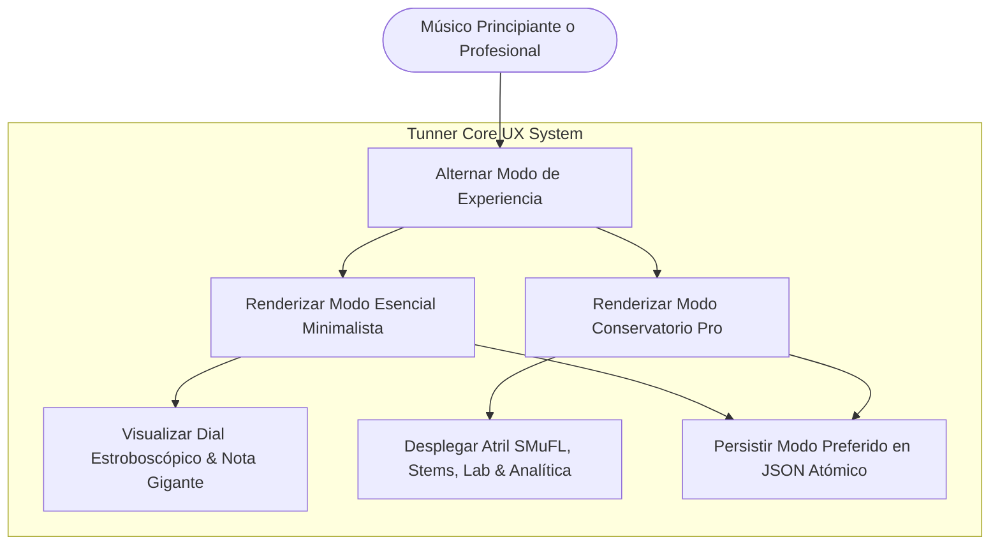
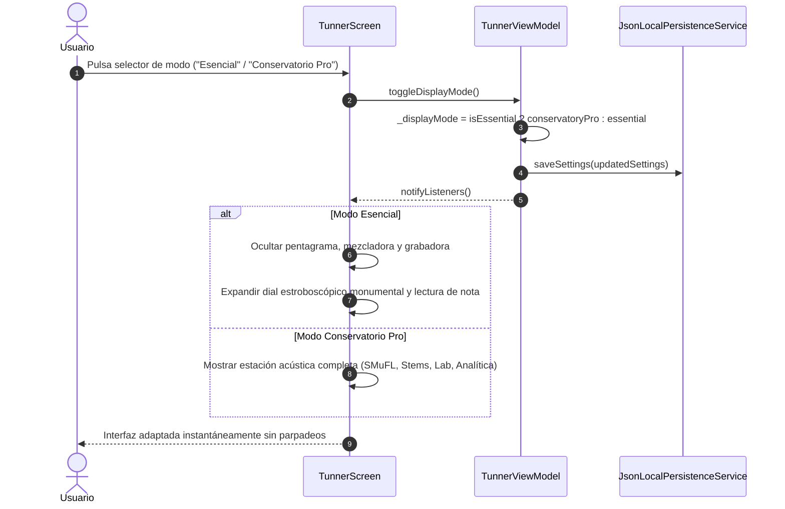

# Caso de Uso 22: Experiencia Dual Progresiva (Modo Esencial vs. Modo Conservatorio Pro)

Este documento define la especificación formal del modelo de interfaz adaptativa dual en **Tunner**.

---

## 1. Diagrama de Caso de Uso (Mermaid)

---

## 2. Diagrama de Secuencia y Flujo Detallado (Mermaid)

---

## 3. Especificación Formal del Caso de Uso

### 3.1 Actores
* **Músico Principiante / Aficionado:** Desea una afinación visual rápida, limpia, sin curva de aprendizaje ni saturación cognitiva.
* **Músico Avanzado / Maestro de Conservatorio:** Requiere partitura SMuFL interactiva, edición, reproducción ADSR, análisis espectral de armónicos y consola de pistas.

### 3.2 Precondiciones
* La aplicación se encuentra en ejecución en cualquier plataforma soportada (Linux, Android, macOS, Windows, iOS).

### 3.3 Postcondiciones
* La interfaz se reconfigura en el mismo frame a 60 FPS sin recargar el estado del motor de afinación.
* El modo seleccionado se almacena de forma persistente y atómica en `tunner_settings.json`.

---
## 8. Guía de Pruebas Manuales y Bitácora de Validación

### 8.1 Precondiciones y Preparación del Entorno
- Pantalla principal del afinador abierta.

### 8.2 Procedimiento de Ejecución Paso a Paso
1. Observar la pantalla en **Modo Esencial** (aguja principal, letra de nota de gran tamaño, centrado en simplicidad).
2. Tocar el interruptor o botón de cambio a **Modo Pro**.
3. Observar la aparición de los paneles avanzados: medidor de armónicos, visualizador FFT, transposición y cents exactos.
4. Volver a cambiar a Modo Esencial.
5. Probar la afinación de una nota en ambos modos.

### 8.3 Checklist de Validación Sensorial (Resultado Esperado)
- [ ] Transición fluida e instantánea entre ambos modos sin pérdida de estado acústico ni reinicio de captura.
- [ ] Modo Esencial limpio, intuitivo y libre de sobrecarga cognitiva para estudiantes novatos.
- [ ] Modo Pro brinda acceso exhaustivo a todos los parámetros técnicos sin congestión gráfica.
- [ ] El modo elegido se guarda y restaura de forma persistente.

### 8.4 Registro de Bitácora de Ejecución de Campo
| Fecha | Tester / Músico | Dispositivo / SO | Modo Evaluado | Resultado | Observaciones / Aspectos por Pulir |
| :---: | :---: | :---: | :---: | :---: | :--- |
| *Pendiente* | - | - | - | [ ] Pendiente | *Registrar observaciones del modo dual* |
