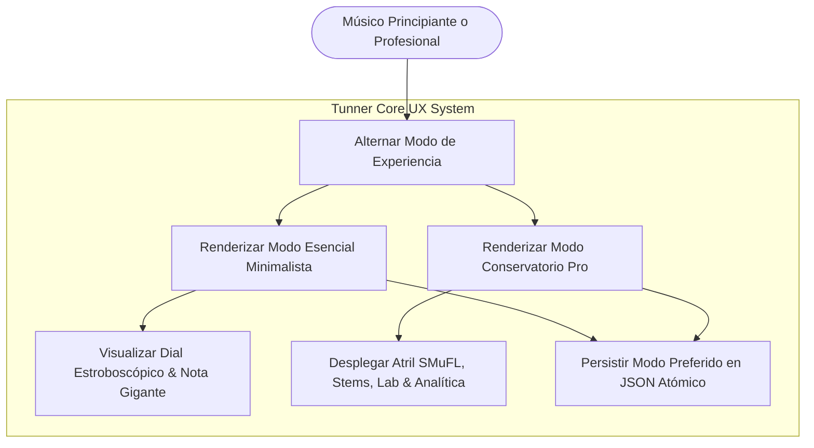
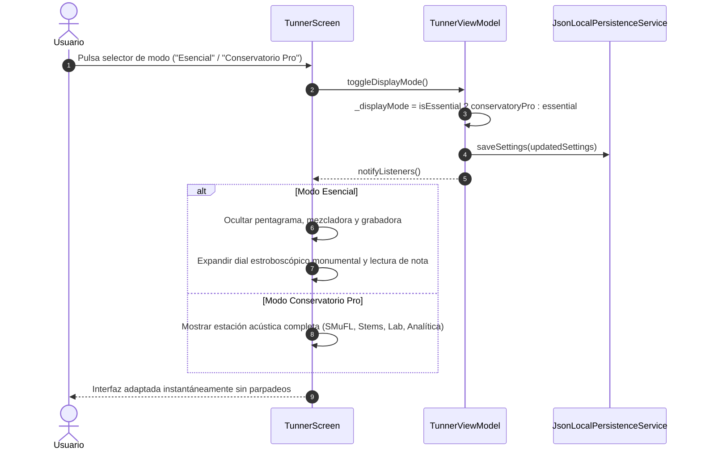

# Caso de Uso 22: Experiencia Dual Progresiva (Modo Esencial vs. Modo Conservatorio Pro)

Este documento define la especificación formal del modelo de interfaz adaptativa dual en **Tunner**.

---

## 1. Diagrama de Caso de Uso (Mermaid)

---

## 2. Diagrama de Secuencia y Flujo Detallado (Mermaid)

---

## 3. Especificación Formal del Caso de Uso

### 3.1 Actores
* **Músico Principiante / Aficionado:** Desea una afinación visual rápida, limpia, sin curva de aprendizaje ni saturación cognitiva.
* **Músico Avanzado / Maestro de Conservatorio:** Requiere partitura SMuFL interactiva, edición, reproducción ADSR, análisis espectral de armónicos y consola de pistas.

### 3.2 Precondiciones
* La aplicación se encuentra en ejecución en cualquier plataforma soportada (Linux, Android, macOS, Windows, iOS).

### 3.3 Postcondiciones
* La interfaz se reconfigura en el mismo frame a 60 FPS sin recargar el estado del motor de afinación.
* El modo seleccionado se almacena de forma persistente y atómica en `tunner_settings.json`.
