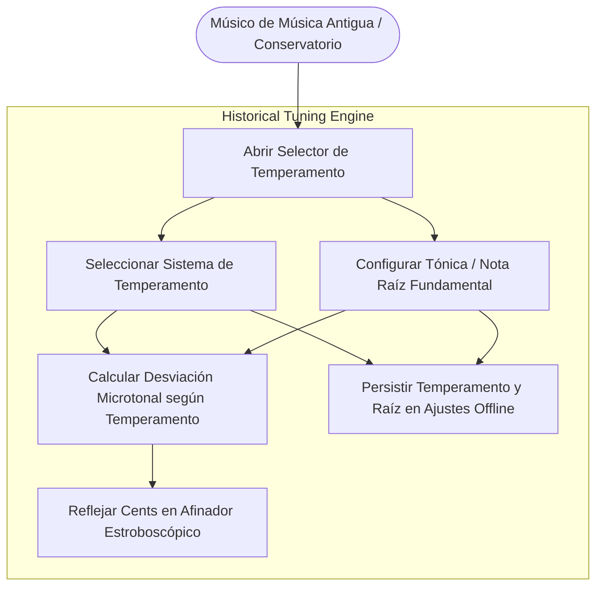
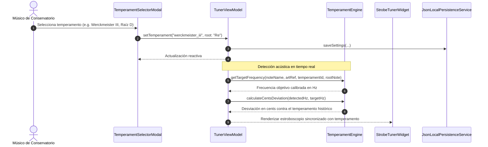

# Caso de Uso 23: Motor de Temperamentos Históricos y Microtonales

Este documento formaliza la especificación funcional, los diagramas de casos de uso y de secuencia del motor de afinación basado en temperamentos históricos no-iguales para **Tunner**.

---

## 1. Diagrama de Caso de Uso (Mermaid)

---

## 2. Diagrama de Secuencia y Flujo Detallado (Mermaid)

---

## 3. Especificación Formal del Caso de Uso

### 3.1 Precondiciones
1. El usuario tiene la aplicación activa en Modo Esencial o Modo Conservatorio Pro.
2. El motor de audio está capturando o listo para capturar muestras PCM.

### 3.2 Flujo Principal
1. El usuario abre el modal de temperamentos mediante el chip de temperamento o menú de herramientas.
2. La interfaz presenta la lista de temperamentos acústicos de conservatorio:
   - **Temperamento Igual (12-EDO):** 12 semitonos idénticos de 100 cents.
   - **Pitagórico (Pythagorean):** Quintas puras 3:2 (701.955 cents).
   - **Entonación Justa (Just Intonation 5-limit):** Terceras mayores puras 5:4 (386.31 cents) y quintas 3:2.
   - **Mesotónico de 1/4 de Coma (Meantone 1/4 Comma):** Terceras mayores puras, quintas atemperadas a 696.58 cents.
   - **Werckmeister III (1691):** Cuatro quintas atemperadas en 1/4 de coma pitagórica.
   - **Kirnberger III (1779):** Terceras mayores puras sobre C y cuatro quintas mesotónicas.
   - **Vallotti (1779):** Seis quintas atemperadas a 1/6 de coma y seis quintas justas.
   - **Young II (1800):** Transición hacia armonía clásica y romántica.
3. El usuario puede cambiar la nota fundamental/tónica (C, C#, D, Eb, E, F, F#, G, Ab, A, Bb, B).
4. El motor calcula dinámicamente los cents teóricos de cada nota y su frecuencia objetivo exacta:
   $$f_{\text{target}} = f_{\text{equal}} \times 2^{\frac{\Delta \text{cents}}{1200}}$$
5. El afinador visual y estroboscópico evalúa la afinación en tiempo real en función de los cents relativos a la escala elegida.

### 3.3 Postcondiciones
- El temperamento seleccionado y la tónica se guardan automáticamente en el almacenamiento local atómico offline.
