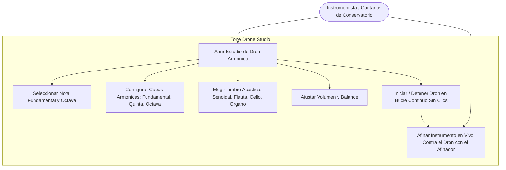
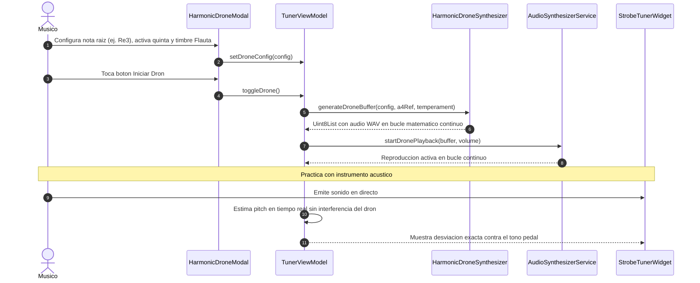

# Caso de Uso 24: Estudio de Dron Armónico de Referencia Continua (Tone Drone Studio)

Este documento formaliza la especificación funcional, los diagramas de casos de uso y de secuencia del generador procedural de notas pedal armónicas continuas para entrenamiento auditivo e intonación de conservatorio en **Tunner**.

---

## 1. Diagrama de Caso de Uso (Mermaid)

---

## 2. Diagrama de Secuencia y Flujo Detallado (Mermaid)

---

## 3. Especificacion Formal

### 3.1 Precondiciones
1. El usuario tiene Tunner abierto en Modo Esencial o Modo Conservatorio Pro.
2. Los servicios de salida de audio del sistema estan operativos.

### 3.2 Flujo Principal (Happy Path)
1. El usuario accede al modal del Estudio de Dron Armonico desde la barra de acciones o panel de afinacion.
2. Selecciona la nota fundamental deseada (Do a Si) y la octava de registro (Octava 2, 3 o 4).
3. Selecciona las componentes armonicas: Fundamental obligatoria ($1\times f_0$), Quinta armonica pura o temperada ($1.5\times f_0$) y Octava superior ($2\times f_0$).
4. Selecciona el timbre sintetizado (Senoidal Pura, Flauta Calida, Cello / Cuerda, Organo).
5. Pulsa el boton de reproduccion continua.
6. El motor genera en memoria RAM un buffer WAV sin costuras ni discontinuidades de fase (zero-crossing crossfade loop).
7. El dron suena de forma continua e ininterrumpida mientras el usuario practica con su instrumento.
8. El afinador visual estroboscopico continua operando simultaneamente, permitiendo al musico afinar sus intervalos en tiempo real.

### 3.3 Postcondiciones
1. El dron sonoro se reproduce de manera estable sin artefactos ni clicks percutivos.
2. Al pulsar detener, el audio cesa instantaneamente liberando los recursos de reproduccion.

### 3.4 Flujos Alternativos y Excepciones
- **Cambio de Parametros en Vivo:** Si el usuario modifica la frecuencia o el timbre mientras el dron esta sonando, el buffer se regenera en caliente y se actualiza suavemente sin necesidad de detener y reiniciar manualmente.

---
## 8. Guía de Pruebas Manuales y Bitácora de Validación

### 8.1 Precondiciones y Preparación del Entorno
- Altavoces o auriculares estéreo conectados.
- Módulo del Estudio de Drones Armónicos abierto.

### 8.2 Procedimiento de Ejecución Paso a Paso
1. Seleccionar la nota tónica base del drone (ej. $D_3$).
2. Presionar el botón de inicio del drone.
3. Activar los armónicos complementarios mediante sus interruptores: 5ª Justa ($A_3$), Octava ($D_4$) y 3ª Mayor Justa ($F\sharp_4$).
4. Ajustar el fader de textura / calidez tímbrica.
5. Tocar notas de una escala sobre el drone con un instrumento acústico para evaluar la resonancia por simpatía.

### 8.3 Checklist de Validación Sensorial (Resultado Esperado)
- [ ] Sonido continuo y envolvente sin cortes, clics ni interrupciones de bucle (*seamless sustain*).
- [ ] Control de volumen independiente por cada armónico sin saturación en el bus de salida.
- [ ] Los armónicos respetan las proporciones justas de afinación acústica (relaciones de enteros).
- [ ] Detención suave con desvanecimiento (*fade-out*) natural al apagar el drone.

### 8.4 Registro de Bitácora de Ejecución de Campo
| Fecha | Tester / Músico | Dispositivo / SO | Tónica y Armónicos | Resultado | Observaciones / Aspectos por Pulir |
| :---: | :---: | :---: | :---: | :---: | :--- |
| *Pendiente* | - | - | - | [ ] Pendiente | *Registrar observaciones del estudio de drones* |
