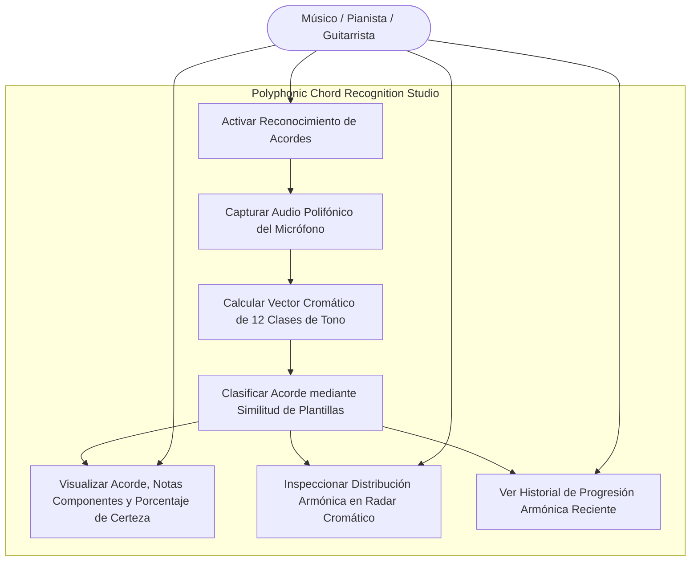
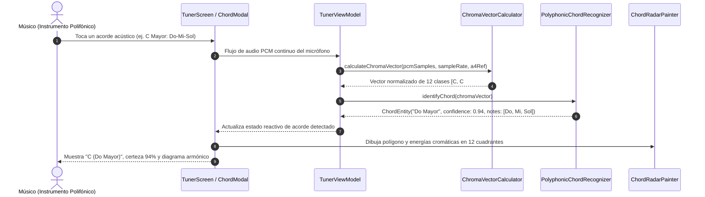

# Caso de Uso 25: Reconocimiento Polifónico de Acordes en Tiempo Real (Polyphonic Chord Recognizer)

Este documento formaliza la especificación funcional, los diagramas de casos de uso y de secuencia del reconocedor polifónico de armonías mediante vectores cromagrama (Chroma Vectors / Pitch Class Profile) en **Tunner**.

---

## 1. Diagrama de Caso de Uso (Mermaid)

---

## 2. Diagrama de Secuencia y Flujo Detallado (Mermaid)

---

## 3. Especificación Formal

### 3.1 Precondiciones
1. El usuario tiene abierto Tunner con permisos de micrófono activos.
2. El entorno acústico emite señales de instrumentos polifónicos (piano, guitarra, ensamble coral o de cámara) o monofónicos arpegiados con resonancia.

### 3.2 Flujo Principal (Happy Path)
1. El usuario toca notas polifónicas en su instrumento.
2. El pipeline de audio analiza el buffer PCM sin interrumpir la afinación monofónica del afinador estroboscópico.
3. El calculador extrae la energía distribuida a lo largo de las 12 clases de altura cromática (Pitch Class Profile) en las octavas musicales útiles.
4. El reconocedor compara el vector normalizado contra 108 plantillas armónicas precalculadas (9 tipos de acordes $\times$ 12 notas raíz).
5. Si la similitud de coseno supera el umbral de confianza ($> 0.62$), el acorde se clasifica y se añade al historial reciente de armonías.
6. La pantalla de Tunner muestra el nombre del acorde, su cifrado internacional, notas constitutivas y el radar de energía cromática.

### 3.3 Postcondiciones
1. La información armónica se actualiza de manera reactiva y fluida a 60 FPS.
2. Cero bloqueos en el hilo de audio o interfaz de usuario.

### 3.4 Flujos Alternativos y Excepciones
- **Silencio o Ruido Blanco:** Si la energía RMS del búfer es inferior al umbral de la puerta de ruido, o la máxima similitud es inferior a 0.50, el clasificador retorna `ChordEntity.none` sin falsos positivos.
- **Acorde Desconocido / Clúster Disidente:** Si se tocan notas disonantes que no corresponden a tríadas o cuatriadas canónicas, se visualizan las notas en el radar sin asignar un nombre forzado de acorde.

---
## 8. Guía de Pruebas Manuales y Bitácora de Validación

### 8.1 Precondiciones y Preparación del Entorno
- Micrófono activo en modo de reconocimiento polifónico de acordes.
- Piano, teclado o guitarra polifónica disponible.

### 8.2 Procedimiento de Ejecución Paso a Paso
1. Tocar un acorde tríada de Do Mayor ($C_4 - E_4 - G_4$) de forma clara.
2. Observar la pantalla del analizador de acordes.
3. Tocar un acorde menor (ej. La menor: $A_3 - C_4 - E_4$).
4. Tocar un acorde con séptima (ej. Sol dominante 7: $G_3 - B_3 - D_4 - F_4$).
5. Tocar una inversión de acorde (ej. Do Mayor con bajo en Mi: $C/E$).

### 8.3 Checklist de Validación Sensorial (Resultado Esperado)
- [ ] Reconocimiento exacto del cifrado del acorde (ej. "C Maj", "Am", "G7", "C/E").
- [ ] Desglose visual simultáneo de las notas detectadas que integran la armonía.
- [ ] Latencia de reconocimiento menor a $50\text{ ms}$ desde el ataque de las cuerdas/teclas.
- [ ] Discriminación adecuada frente a notas fantasma causadas por resonancia de la caja acústica.

### 8.4 Registro de Bitácora de Ejecución de Campo
| Fecha | Tester / Músico | Dispositivo / SO | Acordes Evaluados | Resultado | Observaciones / Aspectos por Pulir |
| :---: | :---: | :---: | :---: | :---: | :--- |
| *Pendiente* | - | - | - | [ ] Pendiente | *Registrar observaciones de acordes polifónicos* |
