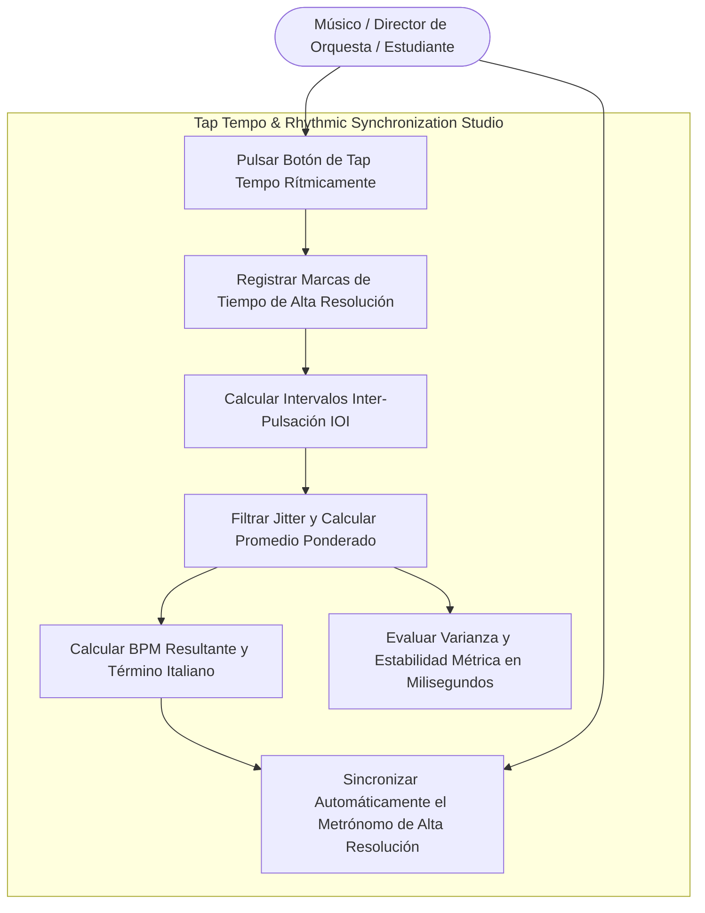
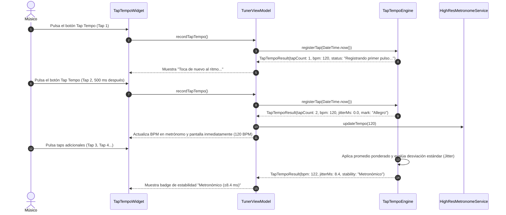

# Caso de Uso 26: Medición y Calibración Rítmica por Tap Tempo Determinista (Deterministic Tap Tempo)

Este documento formaliza la especificación funcional, los diagramas de casos de uso y de secuencia del motor de medición de tempo por pulsación táctil manual y diagnóstico de estabilidad rítmica en **Tunner**.

---

## 1. Diagrama de Caso de Uso (Mermaid)

---

## 2. Diagrama de Secuencia y Flujo Detallado (Mermaid)

---

## 3. Especificación Formal

### 3.1 Precondiciones
1. El usuario tiene abierto Tunner.
2. Los servicios de metrónomo acústico se encuentran disponibles.

### 3.2 Flujo Principal (Happy Path)
1. El usuario toca el botón de Tap Tempo de manera regular siguiendo el pulso deseado.
2. La primera pulsación inicializa el cronómetro y abre la ventana temporal de medición.
3. A partir de la segunda pulsación consecutiva, el motor calcula el intervalo entre pulsaciones consecutivas $\Delta t_i = t_i - t_{i-1}$.
4. El motor aplica un promedio móvil ponderado donde las pulsaciones más recientes tienen mayor peso relativo.
5. El valor de BPM resultante se actualiza en el metrónomo activo y en la interfaz de usuario.
6. El motor calcula la desviación estándar $\sigma$ en milisegundos y muestra una evaluación cualitativa de la precisión métrica del músico.

### 3.3 Postcondiciones
1. El metrónomo adopta la velocidad pulsada por el usuario.
2. Si transcurren más de 2.5 segundos sin pulsaciones, el acumulador se reinicia automáticamente sin afectar el BPM fijado.

### 3.4 Flujos Alternativos y Excepciones
- **Pulsación Aislada:** Si el usuario realiza una sola pulsación y se detiene, el tempo actual no se altera y tras 2500 ms el estado vuelve a reposo.
- **Pulsaciones Fuera de Rango:** Si la velocidad pulsada es menor a 30 BPM o mayor a 300 BPM, el resultado se trunca al rango válido $[30, 300]$ BPM.
