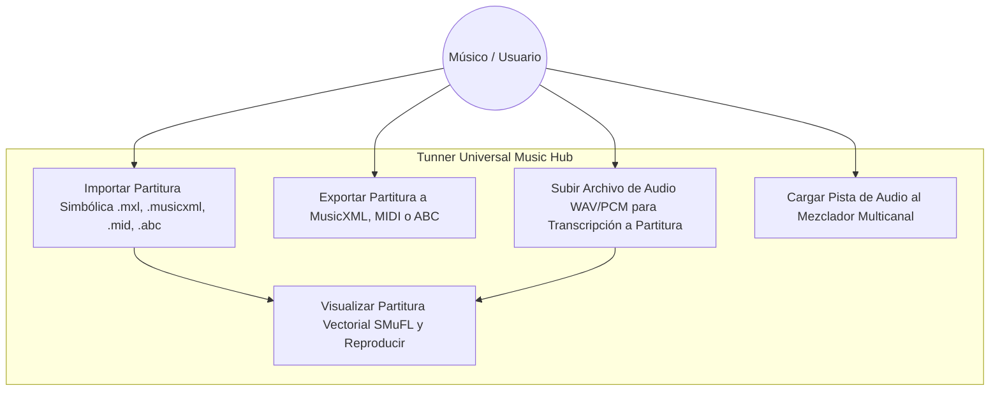
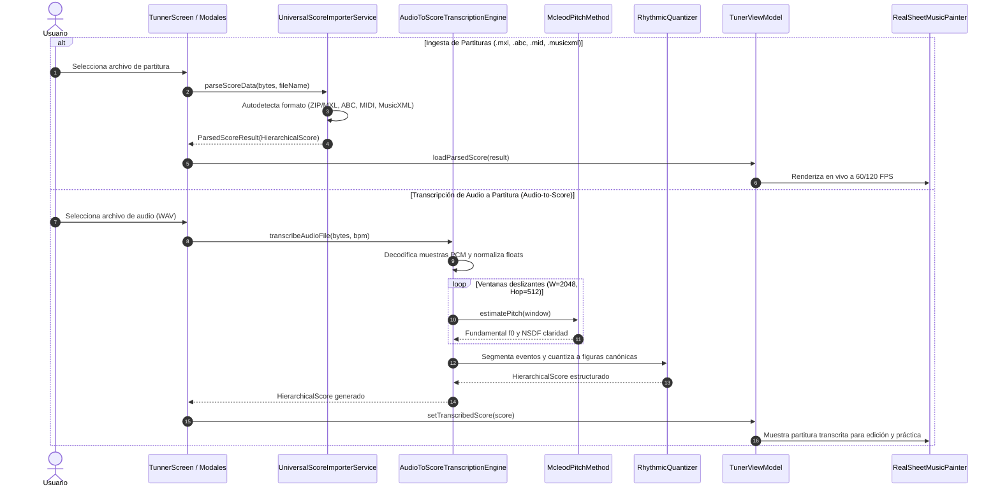

# Caso de Uso 27: Centro Universal de Ingesta, Exportación y Transcripción de Audio a Partitura

## 1. Identificación y Actores

- **ID del Caso de Uso:** `UC-27`
- **Nombre:** Centro Universal de Ingesta, Exportación Multi-Formato y Transcripción Offline de Audio a Partitura
- **Actores:**
  - **Músico / Estudiante de Conservatorio:** Desea importar partituras en múltiples formatos (.mxl, .musicxml, .mid, .abc), exportar su trabajo, o transcribir automáticamente un archivo de audio grabado a partitura visible.
  - **Motor Acústico Tunner:** Orquesta la decodificación, el análisis de tono por ventanas deslizantes y la construcción vectorial de la partitura.
- **Nivel:** Resumen / Nivel de Usuario

---

## 2. Diagrama de Casos de Uso (Mermaid)

---

## 3. Diagrama de Secuencia y Flujo de Datos (Mermaid)

---

## 4. Precondiciones, Postcondiciones y Flujos

### 4.1 Precondiciones
1. El usuario tiene acceso a archivos de música (.mxl, .musicxml, .mid, .abc, .wav) en el almacenamiento local.
2. La plataforma no requiere conectividad a internet ni servidores remotos.

### 4.2 Flujo Principal de Transcripción de Audio
1. El usuario selecciona la acción "Transcribir Audio a Partitura".
2. Selecciona un archivo `.wav` de su dispositivo.
3. El motor `AudioToScoreTranscriptionEngine` procesa el buffer de muestras PCM mediante ventana deslizante MPM.
4. Se agrupan los tonos en notas contiguas y silencios con cuantización rítmica basada en el tempo.
5. Se genera un `HierarchicalScore` con título, compases de 4/4 y figuras (negras, corcheas, blancas, etc.).
6. La partitura se despliega de inmediato en el visor SMuFL y en el editor interactivo.

### 4.3 Flujos Alternativos y Excepciones
- **Archivo corrupto o vacío:** El importador arroja una excepción controlada `FormatException` indicando el motivo sin provocar cierres inesperados.
- **Audio en silencio total:** La transcripción detecta un nivel RMS por debajo del umbral de ruido y genera una partitura de silencios o notifica al usuario.

---
## 8. Guía de Pruebas Manuales y Bitácora de Validación

### 8.1 Precondiciones y Preparación del Entorno
- Archivo de audio monofónico grabado en formato WAV o MP3 almacenado en el dispositivo.

### 8.2 Procedimiento de Ejecución Paso a Paso
1. Seleccionar la opción **Importar Audio para Transcripción**.
2. Elegir el archivo de audio local.
3. Configurar los parámetros de cuantización y compás (ej. 4/4, subdivisión mínima en semicorcheas).
4. Iniciar el procesamiento y observar la barra de progreso.
5. Revisar la partitura generada y presionar reproducir para cotejar con el audio.

### 8.3 Checklist de Validación Sensorial (Resultado Esperado)
- [ ] Segmentación temporal correcta: detección de inicios de nota (*onsets*) precisa.
- [ ] Las alturas tonales transcritas coinciden con la melodía cantada o tocada.
- [ ] Ausencia de notas extremadamente cortas parásitas en transitorios de ataque.
- [ ] Posibilidad de editar manualmente la partitura resultante tras la importación.

### 8.4 Registro de Bitácora de Ejecución de Campo
| Fecha | Tester / Músico | Dispositivo / SO | Archivo de Audio | Resultado | Observaciones / Aspectos por Pulir |
| :---: | :---: | :---: | :---: | :---: | :--- |
| *Pendiente* | - | - | - | [ ] Pendiente | *Registrar observaciones de transcripción desde archivo* |
