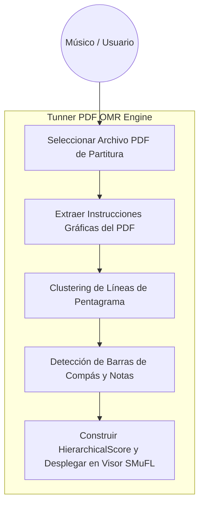
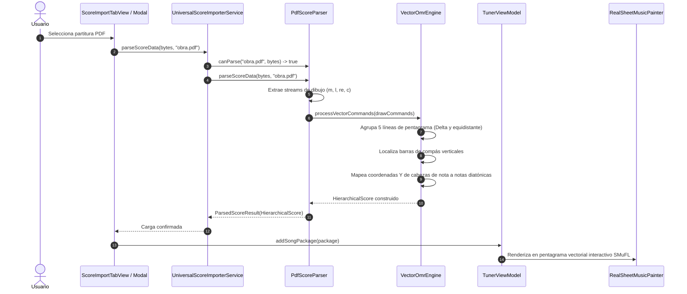

# Caso de Uso 28: Ingesta de Partituras en PDF mediante OMR Vectorial

## 1. Identificación y Actores

- **ID del Caso de Uso:** `UC-28`
- **Nombre:** Importación y Reconocimiento Óptico de Partituras en PDF (Vector OMR Pipeline)
- **Actores:**
  - **Músico / Usuario:** Desea cargar una partitura en formato PDF para tocarla, practicarla con metrónomo interactivo o editarla.
  - **Motor Vectorial OMR Tunner:** Decodifica las primitivas gráficas del PDF, localiza pentagramas, extrae notas y construye un `HierarchicalScore`.
- **Nivel:** Resumen / Nivel de Usuario

---

## 2. Diagrama de Casos de Uso (Mermaid)

---

## 3. Diagrama de Secuencia y Flujo de Procesamiento (Mermaid)

---

## 4. Precondiciones, Postcondiciones y Flujos

### 4.1 Precondiciones
1. El usuario tiene un archivo PDF local disponible en el sistema de archivos del dispositivo.
2. La ejecución es completamente autónoma y 100% offline.

### 4.2 Flujo Principal
1. El usuario presiona "Seleccionar Archivo Local" o el botón de muestra de partitura PDF.
2. El sistema valida la cabecera `%PDF-`.
3. El motor `VectorOmrEngine` detecta los sistemas de pentagramas y las notas asociadas.
4. Se calcula la duración de cada figura y se empaquetan en compases estándar.
5. La partitura se monta en el visor principal con playback, stems y aguja estroboscópica.

### 4.3 Flujos de Error
- **PDF protegido con contraseña o dañado:** El sistema captura el error y emite una `FormatException` amigable en la interfaz.
- **PDF sin gráficos vectoriales reconocibles:** Informa al usuario que el documento no contiene vectores musicales legibles.

---
## 8. Guía de Pruebas Manuales y Bitácora de Validación

### 8.1 Precondiciones y Preparación del Entorno
- Documento PDF con una partitura musical legible (un pentagrama simple o lección melódica).

### 8.2 Procedimiento de Ejecución Paso a Paso
1. Abrir el Importador de PDF Musical (Pipeline OMR).
2. Seleccionar el archivo PDF desde el gestor de archivos.
3. Observar la visualización previa de la página del PDF.
4. Ejecutar el análisis OMR de detección de pentagramas y notas.
5. Verificar la partitura interactiva renderizada en el motor nativo de Tunner.

### 8.3 Checklist de Validación Sensorial (Resultado Esperado)
- [ ] Detección correcta de las líneas de los pentagramas en la página escaneada.
- [ ] Reconocimiento de cabezas de nota, plicas y claves principales.
- [ ] Mensajes claros en caso de escaneos de baja resolución o iluminación deficiente.
- [ ] La partitura convertida permite reproducción y seguimiento de cursor de lectura.

### 8.4 Registro de Bitácora de Ejecución de Campo
| Fecha | Tester / Músico | Dispositivo / SO | Documento PDF | Resultado | Observaciones / Aspectos por Pulir |
| :---: | :---: | :---: | :---: | :---: | :--- |
| *Pendiente* | - | - | - | [ ] Pendiente | *Registrar observaciones de importación PDF/OMR* |
