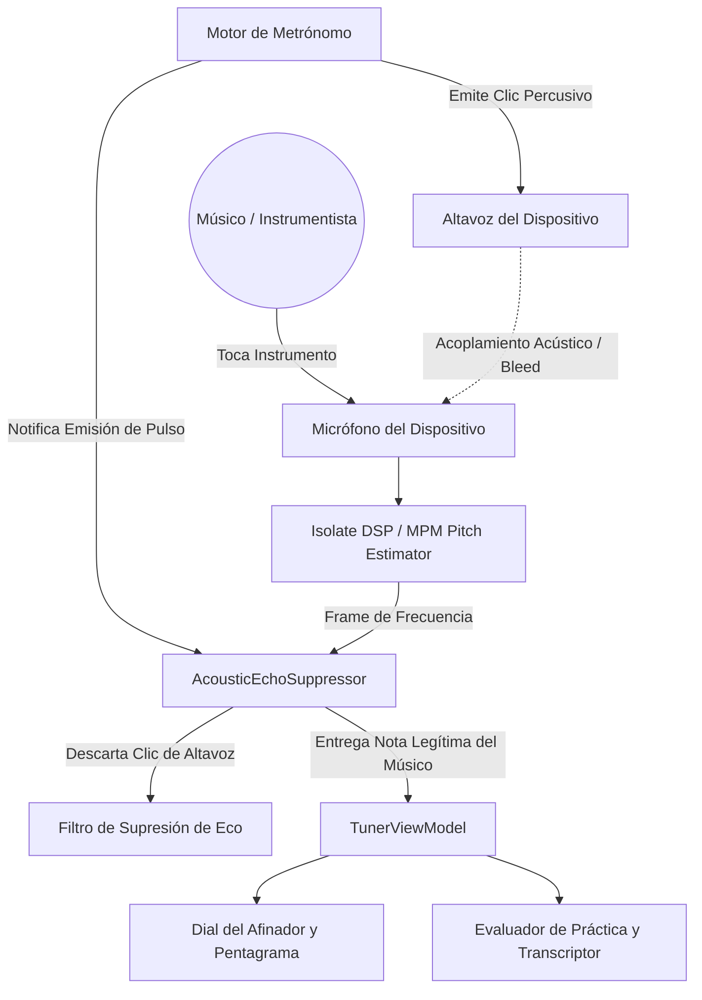
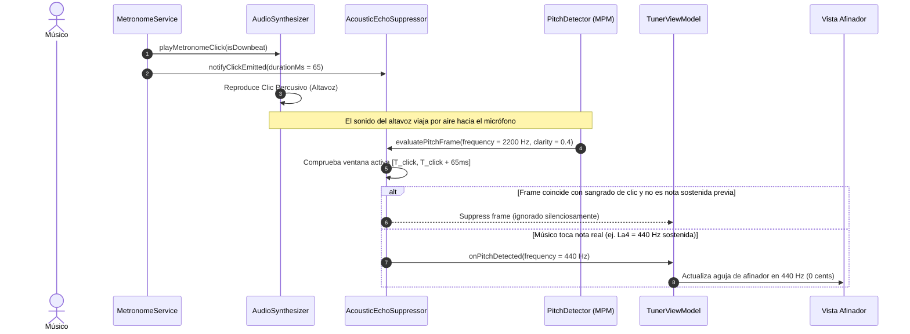

# Caso de Uso 29: Supresión de Eco Acústico y Eliminación de Sangrado de Metrónomo

## Metadatos
- **ID del Caso de Uso:** `UC-29`
- **Nombre:** Supresión de Eco Acústico y Aislamiento de Clic de Metrónomo en Detección de Afinación
- **Fase:** Fase 10 (Acoustic Hardening)
- **Actores:** Músico / Estudiante, Motor de Metrónomo, Supresor de Eco Acústico, Motor DSP (MPM), Afinador y Evaluador

---

## 1. Descripción
Permite al usuario utilizar el metrónomo sonoro a través de los altavoces integrados del dispositivo mientras toca su instrumento musical, asegurando que el detector de tono y el evaluador de práctica ignoren totalmente los impulsos sonoros del metrónomo y capturen con fidelidad únicamente las notas ejecutadas por el instrumento.

---

## 2. Diagrama de Caso de Uso

---

## 3. Diagrama de Secuencia y Flujo Temporal

---

## 4. Especificación de Flujos

### 4.1 Precondiciones
1. El usuario tiene activo el afinador o el modo de práctica musical.
2. El metrónomo sonoro está reproduciendo clics a través del altavoz integrado del dispositivo.

### 4.2 Flujo Principal
1. El temporizador del metrónomo alcanza el pulso (beat).
2. Se envía la orden de reproducción del clic percusivo al sintetizador de audio.
3. El `AcousticEchoSuppressor` registra la marca temporal de emisión del clic $T_{\text{click}}$.
4. El micrófono capta la señal acústica combinada (instrumento + clic de altavoz).
5. El algoritmo MPM genera una estimación de tono y claridad.
6. Si el frame llega dentro de los $65\text{ ms}$ posteriores al clic y no corresponde a una frecuencia continua previa del instrumento, el `AcousticEchoSuppressor` bloquea el frame.
7. La interfaz gráfica del afinador permanece estable sin registrar notas espurias de alta frecuencia ($C\#_7$ o $F_6$).

### 4.3 Flujos Alternativos y Casos de Borde
- **Instrumentista sosteniendo una nota simultáneamente con el clic:**  
  Si el músico está tocando $La_4$ ($440\text{ Hz}$) de forma continua antes del clic, el supresor reconoce la nota previa y permite que el tono de $440\text{ Hz}$ continúe sin interrupciones ni tartamudeos visuales.
- **Uso con Auriculares:**  
  Cuando no hay sangrado acústico por altavoces, el filtro actúa con transparencia total y cero penalización de latencia ($< 0.1\text{ ms}$).

---
## 8. Guía de Pruebas Manuales y Bitácora de Validación

### 8.1 Precondiciones y Preparación del Entorno
- Dispositivo utilizando su altavoz integrado a volumen medio-alto (sin auriculares).
- Micrófono integrado del dispositivo activo para el afinador.

### 8.2 Procedimiento de Ejecución Paso a Paso
1. Abrir la pantalla del afinador y poner en marcha el metrónomo sonando por el altavoz a $120\text{ BPM}$.
2. Permanecer en completo silencio durante 10 segundos: observar si el afinador detecta alguna nota producida por el golpe del clic.
3. Comenzar a tocar una nota sostenida (ej. $A_4$ en flauta o guitarra) mientras el clic del metrónomo sigue sonando fuerte.
4. Tocar notas staccato que coincidan exactamente en el mismo instante del clic del metrónomo.

### 8.3 Checklist de Validación Sensorial (Resultado Esperado)
- [ ] En silencio, el clic del metrónomo es completamente suprimido (cero notas fantasma provocadas por el sangrado acústico).
- [ ] Las notas musicales reales del usuario se detectan con sub-cent precisión incluso cuando el clic suena en simultáneo.
- [ ] La ventana de silenciamiento temporal (*blanking window*) de 28 ms es inaudible e invisible para la afinación musical.
- [ ] Cero retraso o degradación en la aguja de afinación.

### 8.4 Registro de Bitácora de Ejecución de Campo
| Fecha | Tester / Músico | Dispositivo / SO | Nivel de Volumen | Resultado | Observaciones / Aspectos por Pulir |
| :---: | :---: | :---: | :---: | :---: | :--- |
| *Pendiente* | - | - | - | [ ] Pendiente | *Registrar observaciones de supresión de clic* |
