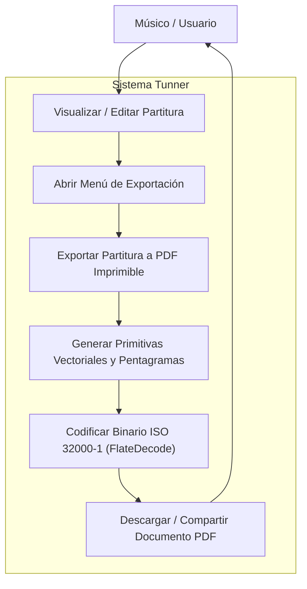
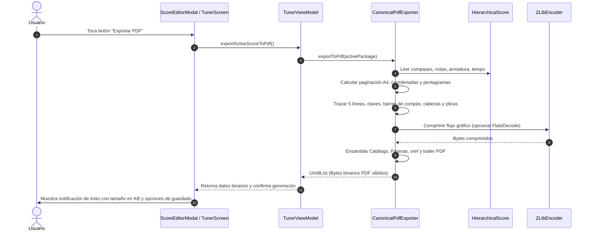

# Caso de Uso 30: Exportación Canónica de Partituras a PDF Imprimible (Vector Sheet Music Exporter)

---

## Metadatos del Documento

- **ID del Caso de Uso:** `UC-PDF-EXP-030`
- **Nombre Formal:** Exportación de Partituras a Documento PDF Vectorial Imprimible (ISO 32000-1)
- **Fase Asociada:** `Fase 9.1`
- **Actor Principal:** Músico / Estudiante de Conservatorio / Educador
- **Estado:** `Approved`
- **Fecha de Creación:** 2026-10-28

---

## 1. Descripción del Caso de Uso

El usuario compone, transcribe o edita una partitura en Tunner y desea exportarla a un documento PDF vectorial de estándar profesional para imprimirlo físicamente, compartirlo con directores de orquesta o visualizarlo en lectores universales sin pérdida de resolución.

---

## 2. Diagrama de Casos de Uso (Mermaid)

---

## 3. Diagrama de Secuencia (Mermaid)

---

## 4. Flujo de Eventos

### 4.1 Precondiciones
- El usuario tiene una partitura activa cargada en `TunerViewModel`.
- La partitura contiene al menos un compás válido con figuras o silencios.

### 4.2 Flujo Principal (Éxito)
1. El usuario accede a la vista de partitura o al editor interactivo.
2. El usuario presiona el botón de exportación "PDF".
3. `TunerViewModel` invoca `CanonicalPdfExporter.exportToPdf()`.
4. El exportador procesa la partitura, distribuye 4 compases por sistema en una cuadrícula proporcional A4 ($595.28 \times 841.89\text{ pt}$).
5. Se generan las instrucciones vectoriales: líneas de pentagrama, barras de compás, cabezas de nota según duración (huecas o sólidas), plicas, líneas adicionales y silencios.
6. Se ensamblan los objetos del documento PDF (Catálogo, Páginas, Fuentes Type 1 Helvetica, Contenido vectorial, tabla `xref` y trailer).
7. Se genera un array de bytes binarios `Uint8List` que representa el archivo PDF canónico.
8. La interfaz notifica al usuario el éxito de la operación.

### 4.3 Flujos Alternativos y Excepciones
- **A1: Partitura vacía o sin notas:**
  - El sistema genera un PDF con un sistema de pentagrama vacío conteniendo un silencio de redonda de 4 tiempos por defecto.
- **A2: Partitura de múltiples páginas:**
  - Si el número de compases excede la altura de una página A4, el exportador añade dinámicamente nuevas páginas en el árbol `/Pages`, redistribuyendo los sistemas de forma continua.

---
## 8. Guía de Pruebas Manuales y Bitácora de Validación

### 8.1 Precondiciones y Preparación del Entorno
- Partitura abierta en pantalla lista para exportación.
- Lector de PDF externo instalado en el dispositivo o visor del sistema.

### 8.2 Procedimiento de Ejecución Paso a Paso
1. Presionar el botón **Exportar Partitura a PDF**.
2. Configurar metadatos: Título, Compositor, Tonalidad, Formato de hoja (A4 / Carta).
3. Confirmar la exportación y abrir el archivo generado en el visor PDF.
4. Realizar zoom al 400% sobre las notas y líneas del pentagrama.

### 8.3 Checklist de Validación Sensorial (Resultado Esperado)
- [ ] Renderizado vectorial puro: nitidez infinita sin pixelado en ningún nivel de zoom.
- [ ] Tipografía musical SMuFL perfectamente alineada con los estándares editoriales profesionales.
- [ ] Inclusión de márgenes apropiados para encuadernación e impresión física.
- [ ] Tamaño del archivo PDF optimizado y ligero ($< 1\text{ MB}$ para partituras típicas).

### 8.4 Registro de Bitácora de Ejecución de Campo
| Fecha | Tester / Músico | Dispositivo / SO | Formato Hoja | Resultado | Observaciones / Aspectos por Pulir |
| :---: | :---: | :---: | :---: | :---: | :--- |
| *Pendiente* | - | - | - | [ ] Pendiente | *Registrar observaciones de exportación PDF* |
