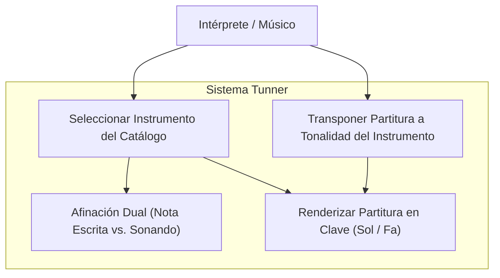
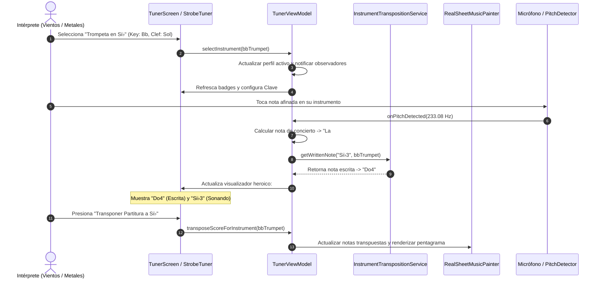

# Caso de Uso 31: Motor de Transposición Tonal, Instrumentos Transpositores y Claves Musicales

---

## Metadatos del Documento

- **ID del Caso de Uso:** `UC-TRANS-031`
- **Nombre Formal:** Transposición Acústica de Instrumentos, Visualización Dual de Afinador y Soporte de Clave de Fa
- **Fase Asociada:** `Fase 11`
- **Actor Principal:** Músico / Estudiante de Vientos / Metales / Cuerdas Graves
- **Estado:** `Approved`
- **Fecha de Creación:** 2026-10-28

---

## 1. Descripción del Caso de Uso

Un instrumentista (por ejemplo, clarinetista en Si♭ o saxofonista en Mi♭) utiliza Tunner para afinar su instrumento y practicar partituras. El sistema calcula y muestra instantáneamente la nota que el intérprete debe leer en sus dedos (nota escrita) mientras verifica la frecuencia acústica física (nota de concierto sonando), además de renderizar la clave correspondiente (Clave de Fa para instrumentos graves o Clave de Sol para agudos) y permitir transponer partituras completas a la afinación de su instrumento.

---

## 2. Diagrama de Casos de Uso (Mermaid)

---

## 3. Diagrama de Secuencia (Mermaid)

---

## 4. Flujo de Eventos

### 4.1 Precondiciones
- El usuario ha iniciado Tunner.
- El micrófono se encuentra habilitado para captura de audio.

### 4.2 Flujo Principal
1. El usuario abre el selector de instrumentos desde la barra superior o pedagógica.
2. Selecciona un instrumento transpositor (e.g. Clarinete en Si♭, Saxofón Alto en Mi♭ o Violonchelo en Clave de Fa).
3. El ViewModel actualiza el instrumento activo y recalcula las notas escritas.
4. Si el usuario toca su instrumento:
   - El micrófono estima la frecuencia física fundamental $f_0$.
   - El sistema calcula la nota física sonando.
   - El servicio de transposición aplica el offset de semitonos inverso para proyectar la nota escrita exacta que el instrumentista leyó en su método.
   - La pantalla muestra la nota escrita en tamaño grande y la nota física en subtítulo.
5. Si el instrumento tiene configurada Clave de Fa, el visor de partituras dibuja automáticamente la Clave de Fa y ajusta las posiciones verticales de las notas.

### 4.3 Flujos Alternativos
- **A1: Instrumento en tono de concierto (Flauta, Violín, Voz):**
  - El offset de transposición es 0. El afinador muestra la nota directamente sin etiqueta dual.
- **A2: Instrumento de clave de Fa en partitura de clave de Sol:**
  - El usuario puede conmutar manualmente la clave de visualización si desea leer en clave de Sol o transponer la octava.
