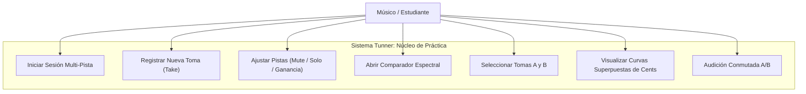
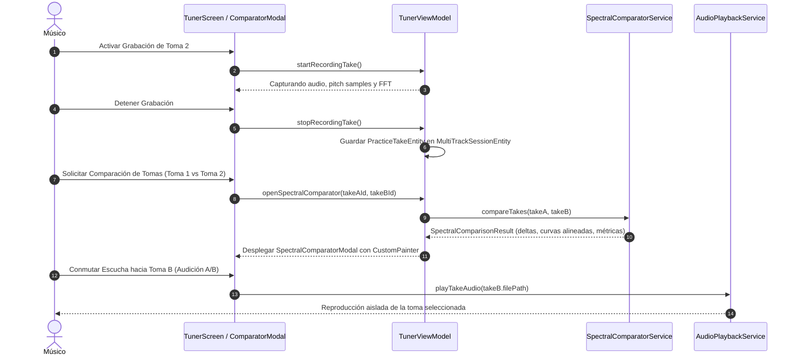

# Caso de Uso 32: Grabación Multi-Pista y Comparador Visual Espectral de Tomas de Ensayo

---

## Metadatos del Caso de Uso

- **ID del Caso de Uso:** `UC-32`
- **Título Oficial:** Registro Multi-Toma y Comparación Visual Espectral de Afinación y Timbre
- **Fase Asociada:** Fase 12
- **Actor Principal:** Estudiante / Músico de Conservatorio
- **Actores Secundarios:** Motor DSP de Detección de Tono, Analizador FFT de Espectro, Sistema de Audio Local

---

## 1. Descripción del Caso de Uso

El caso de uso describe la interacción mediante la cual un músico graba múltiples tomas consecutivas de una obra o ejercicio técnico, gestiona sus pistas (Mute, Solo, Ganancia) y abre el Comparador Visual Espectral para contrastar superpuestas las curvas de desviación microtonal (cents) y brillo timbral (centroide espectral en Hz) entre dos tomas seleccionadas (Toma A vs. Toma B), recibiendo analítica objetiva de la evolución pedagógica.

---

## 2. Diagramas Mermaid Canónicos

### 2.1 Diagrama de Casos de Uso

### 2.2 Diagrama de Secuencia

---

## 3. Especificación Formal de Flujos

### 3.1 Precondiciones
1. El usuario tiene configurada una sesión de práctica o partitura activa en `TunerViewModel`.
2. Existen al menos dos tomas registradas en la sesión (o se provee una toma de referencia de fábrica).
3. El micrófono o archivo de audio se procesa a frecuencias de muestreo estándares (44.1 kHz o 48 kHz).

### 3.2 Postcondiciones
1. Las tomas quedan registradas y accesibles en memoria con sus muestras de afinación y espectro.
2. El usuario visualiza la superposición gráfica de las curvas de entonación y deltas de estabilidad.
3. Se puede audicionar cualquiera de las tomas de manera sincronizada.

### 3.3 Flujo Principal (Happy Path)
1. El músico inicia la grabación de la Toma 1 mientras interpreta el pasaje musical.
2. El sistema almacena la forma de onda, las desviaciones microtonales en cents y el centroide espectral.
3. El músico detiene la Toma 1 y procede a registrar la Toma 2.
4. El músico abre el modal del Comparador Visual Espectral.
5. El sistema selecciona por defecto las dos últimas tomas (Toma 1 como A, Toma 2 como B).
6. El servicio `SpectralComparatorService` calcula:
   - Desviación de afinación promedio de cada toma.
   - Delta de estabilidad microtonal.
   - Curva temporal superpuesta con zona de tolerancia ($\pm 5$ cents).
   - Variación del centroide espectral en Hz.
7. El `SpectralComparatorPainter` renderiza las dos curvas vectoriales sobre el lienzo musical.
8. El usuario presiona el botón "Audicionar Toma B" y escucha la reproducción aislada para corroborar auditivamente el análisis visual.

### 3.4 Flujos Alternativos y Excepciones
- **FA-01: Duraciones desiguales entre tomas:**
  - El sistema ajusta la escala temporal al intervalo temporal común o añade padding de silencio para mantener la sincronización de compases.
- **FA-02: Una sola toma registrada:**
  - El comparador ofrece contrastar la Toma 1 contra la "Pista Guía / Afinación Ideal" (curva de 0 cents derivada de la partitura original).
- **FE-01: Error de lectura del archivo de audio:**
  - Si el archivo WAV local no se encuentra disponible, se mantiene la visualización espectral y de tono basada en los metadatos en memoria y se notifica al usuario que la reproducción auditiva está deshabilitada para esa toma.
