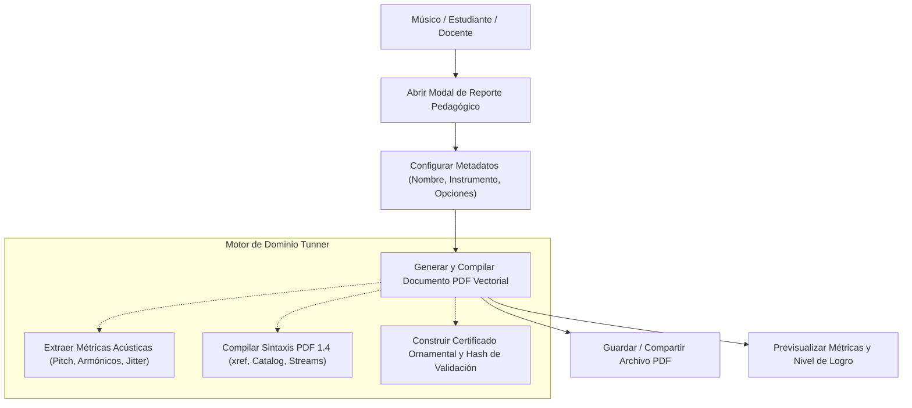
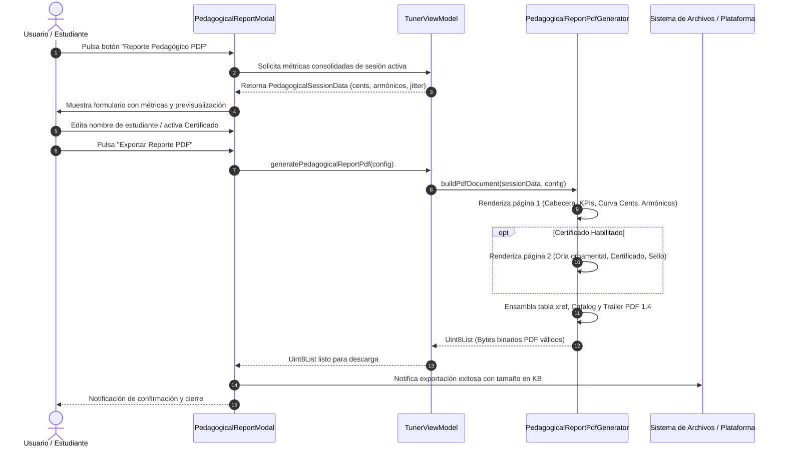

# Caso de Uso 33: Generador de Reportes y Certificados de Progreso Pedagógico en PDF

---

## Metadatos del Caso de Uso

- **ID del Caso de Uso:** `UC-33`
- **Nombre:** Generación y Exportación de Reportes de Progreso Acústico y Certificados Pedagógicos en PDF (ISO 32000-1)
- **Fase Asociada:** Fase 13 (Analítica Pedagógica y Certificación Formal)
- **Actor Principal:** Músico, Estudiante de Conservatorio o Docente
- **Estado:** Approved

---

## 1. Descripción Breve

El usuario solicita la generación de un informe pedagógico formal en formato PDF estándar internacional (ISO 32000-1) a partir de las métricas acústicas capturadas durante sus sesiones de práctica en Tunner. El sistema compila de manera determinista y 100% offline un documento vectorial de hasta dos páginas conteniendo:
1. Resumen ejecutivo de afinación microtonal ($\le 5$ cents), desviación media, centroide espectral y jitter rítmico.
2. Curva vectorial de estabilidad de micro-entonación con bandas de tolerancia de conservatorio.
3. Histograma de distribución de energía en armónicos superiores ($h_1$ a $h_8$).
4. Diagnóstico formativo pedagógico con pautas técnicas personalizadas.
5. Certificado de Logro de Conservatorio con orla ornamental geométrica, identificador criptográfico local y nivel de aprovechamiento.

---

## 2. Diagrama de Caso de Uso (Mermaid)

---

## 3. Diagrama de Secuencia y Flujo de Interacción (Mermaid)

---

## 4. Precondiciones

1. La aplicación Tunner se encuentra en ejecución activa.
2. Se dispone de datos acústicos de sesión (registrados en vivo por el micrófono o inicializados con valores predeterminados de ensayo).
3. No se requiere conexión a internet ni permisos de red (100% Offline-First).

---

## 5. Postcondiciones

1. Se genera un buffer binario `Uint8List` conforme a la especificación ISO 32000-1 (PDF-1.4).
2. El documento generado puede abrirse en cualquier visor PDF estándar del sistema operativo o enviarse a impresión física sin degradación vectorial.
3. El estado de la sesión musical y afinador en vivo permanece intacto sin pérdida de sincronía.

---

## 6. Flujo Principal (Camino Básico)

1. El usuario abre el diálogo modal de reporte pedagógico desde el chip de herramientas o el panel de práctica.
2. El sistema presenta el formulario de personalización con los campos:
   - Nombre del estudiante.
   - Instrumento acústico.
   - Institución / Maestro.
   - Casillas de verificación: Incluir gráfico de entonación, radar de armónicos, análisis de jitter y Certificado de Logro.
3. El usuario revisa las métricas de afinación de la sesión activa y ajusta los campos deseados.
4. El usuario presiona el botón "Exportar Reporte PDF".
5. El generador vectorial procesa la estructura de páginas y genera el flujo de bytes binarios.
6. El sistema confirma la generación exitosa con el tamaño resultante en kilobytes y permite al usuario guardar o visualizar el archivo.

---

## 7. Flujos Alternativos y Excepciones

### Flujo Alternativo A1: Sesión sin muestras de audio suficientes
- Si el usuario abre el reporte inmediatamente tras iniciar la aplicación sin haber cantado o tocado notas:
  - El sistema utiliza los valores de referencia calibrados del afinador y genera un diagnóstico preventivo recomendando realizar una rutina de notas tenidas antes de la evaluación final.

### Flujo Alternativo A2: Desactivación voluntaria del Certificado
- Si la casilla "Incluir Certificado de Logro" está desmarcada:
  - El generador omite la página 2 y compila exclusivamente el reporte analítico de 1 página, reduciendo el tamaño del archivo y optimizando la impresión ejecutiva.

### Flujo de Error E1: Error de I/O en la persistencia del archivo
- Si el almacenamiento del dispositivo está bloqueado o sin espacio:
  - El sistema captura la excepción, presenta un diálogo de error no destructivo y mantiene los bytes en memoria permitiendo un reintento.
