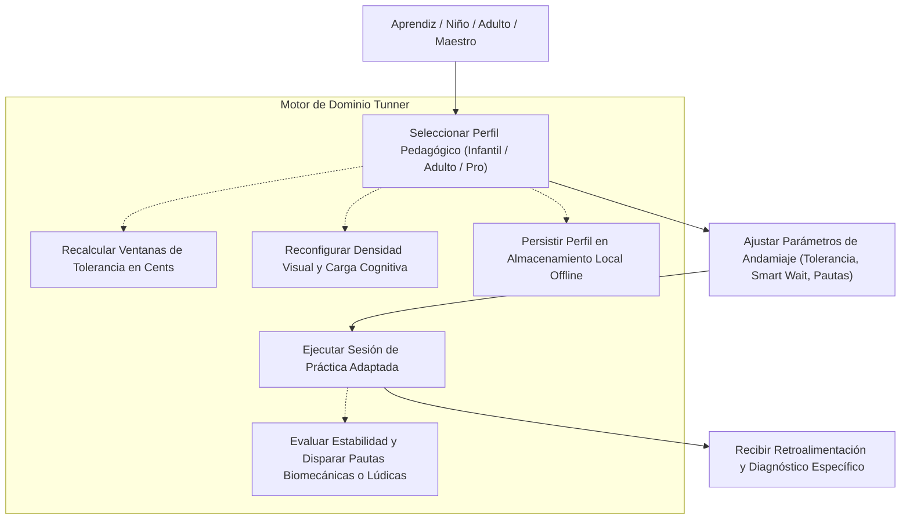
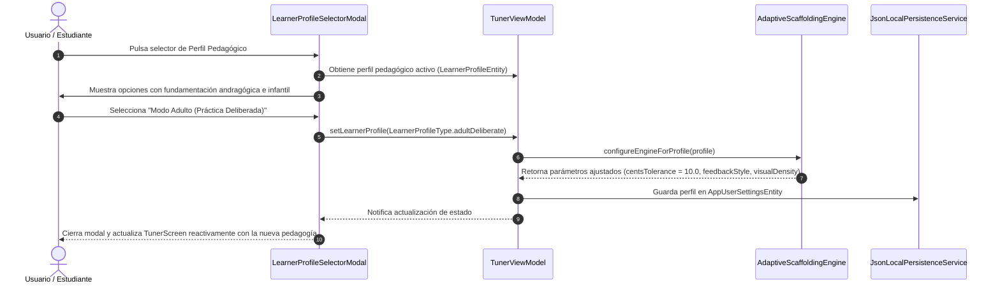

# Caso de Uso 34: Perfiles Pedagógicos Adaptativos y Andamiaje Instruccional Dinámico

---

## Metadatos del Caso de Uso

- **ID del Caso de Uso:** `UC-34`
- **Nombre:** Configuración y Adaptación Dinámica del Sistema según Perfiles Cognitivos (Infantil, Adulto Deliberado y Conservatorio)
- **Fase Asociada:** Fase 13 (Analítica Pedagógica y Adaptación al Usuario)
- **Actor Principal:** Estudiante Infantil, Adulto Autodidacta, Músico de Conservatorio o Docente
- **Estado:** Approved

---

## 1. Descripción Breve

El usuario o docente selecciona o calibra su perfil de aprendizaje pedagógico dentro de Tunner:
1. **Modo Lúdico Infantil (Child Playful):** Enfocado en la reducción de la ansiedad, exploración sensoriomotriz, tolerancia amplia de entonación ($\pm 25\text{ cents}$), retroalimentación icónica de aliento y simplificación visual de la notación.
2. **Modo Práctica Deliberada para Adultos (Adult Deliberate):** Enfocado en la minimización de la carga cognitiva extraña, explicaciones biomecánicas del sonido, tolerancia intermedia ($\pm 10\text{ cents}$), pautas constructivas orientadas a la física del instrumento y metas de estudio segmentadas (chunking).
3. **Modo Conservatorio / Maestría (Conservatory Mastery):** Enfocado en el rigor acústico absoluto, tolerancia estricta ($\pm 3-5\text{ cents}$), análisis de serie armónica FFT completa, métricas de jitter en tiempo real y doble pentagrama vectorial SMuFL.

El motor de andamiaje (`AdaptiveScaffoldingEngine`) reconfigura de forma transparente las tolerancias microtonales, la presentación de datos, las alertas formativas y el comportamiento del afinador para armonizar con el perfil activo.

---

## 2. Diagrama de Caso de Uso (Mermaid)

---

## 3. Diagrama de Secuencia y Flujo de Interacción (Mermaid)

---

## 4. Precondiciones

1. La aplicación Tunner se encuentra en ejecución en cualquier dispositivo soportado.
2. El motor de audio y afinador estroboscópico están disponibles para responder a las nuevas tolerancias microtonales.
3. No se requiere conexión a internet (100% Offline-First).

---

## 5. Postcondiciones

1. El sistema adapta de inmediato:
   - Los umbrales de afinación correcta ($\Delta c$) en el afinador estroboscópico y el evaluador de notas.
   - Los mensajes formativos emitidos tras cada nota o sesión.
   - El nivel de detalle técnico visible en pantalla para prevenir la parálisis por análisis.
2. La preferencia queda respaldada en el archivo de configuración local del usuario.

---

## 6. Flujo Principal (Camino Básico)

1. El usuario abre el diálogo de Selección de Perfil Pedagógico desde el chip de herramientas o el menú superior.
2. El sistema despliega las 3 filosofías formativas con su respectivo propósito pedagógico:
   - *Infantil (Lúdico, tolerante, motivador).*
   - *Adulto (Práctica deliberada, constructivo, baja carga cognitiva).*
   - *Conservatorio (Máximo rigor, acústico, microtonal).*
3. El usuario pulsa sobre su perfil deseado.
4. El sistema reconfigura en caliente los márgenes de cents y las reglas de retroalimentación formativa.
5. El sistema confirma visualmente el cambio y ajusta el estilo de visualización.

---

## 7. Flujos Alternativos y Excepciones

### Flujo Alternativo A1: Ajuste Personalizado de Parámetros (Modo Custom)
- Si el usuario es un docente o músico avanzado que desea una combinación específica (e.g. tolerancia estricta de $\pm 5\text{ cents}$ pero con interfaz minimalista de baja carga):
  - El sistema permite activar el perfil personalizado (`custom`) y ajustar manualmente el umbral de cents y la visualización.

### Flujo de Error E1: Error de persistencia en disco
- Si el archivo de configuración no puede escribirse en almacenamiento:
  - El sistema aplica el perfil en memoria RAM durante la sesión activa y emite un registro de depuración no intrusivo sin bloquear la práctica.
