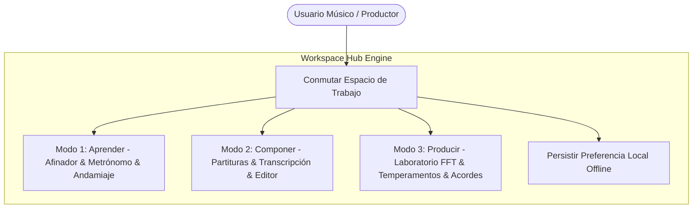
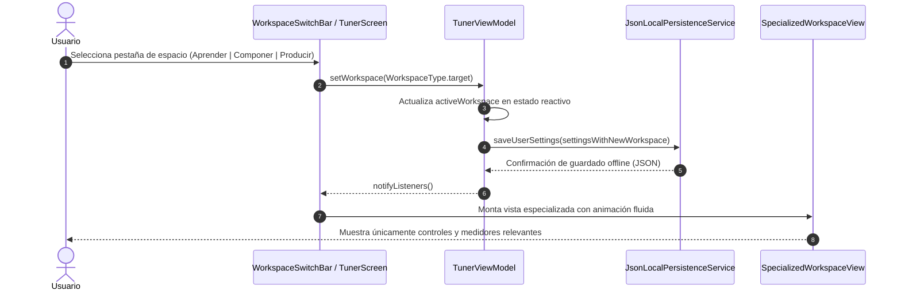

# Caso de Uso 35: Selector y Hub de Espacios de Trabajo (Workspaces Hub & Mode Division)

## Metadatos
- **ID del Caso de Uso:** `UC-35`
- **Nombre:** Selector y Hub de Espacios de Trabajo Especializados
- **Dominio:** Arquitectura de Interfaz y Experiencia de Usuario (UI/UX)
- **Actor Principal:** Usuario (Estudiante, Compositor, Productor / Ingeniero Acústico)
- **Actores Secundarios:** `TunerViewModel`, `AppUserSettingsEntity`, `JsonLocalPersistenceService`
- **Fase Asociada:** Fase 3 (Plataforma y Experiencia Integral)

---

## 1. Descripción
Permite al usuario segmentar la interfaz de **Tunner** en tres espacios de trabajo independientes, especializados y libres de sobrecarga cognitiva:
1. **Modo Aprender (Práctica & Pedagogía):** Enfocado en afinación, metrónomo, andamiaje adaptativo, ejercicios, dron armónico y evaluación de práctica.
2. **Modo Componer (Notación & Partituras):** Enfocado en lienzo de partituras (SMuFL), transcripción de audio a partituras, descomposición de temas, teclado de notas y edición/exportación MusicXML.
3. **Modo Producir (Laboratorio Acústico & Audio):** Enfocado en espectrograma FFT armónico en tiempo real, analizador de acordes, calibración de temperamentos históricos, cámara A4 y mezclador de pistas (stems).

El sistema recuerda el último espacio utilizado de manera persistente y permite conmutar entre ellos en un solo toque sin interrumpir procesos de fondo.

---

## 2. Diagrama de Casos de Uso (Mermaid)

---

## 3. Diagrama de Secuencia / Flujo (Mermaid)

---

## 4. Precondiciones, Postcondiciones y Flujos

### 4.1 Precondiciones
- La aplicación está iniciada en memoria.
- `TunerViewModel` ha cargado los ajustes de usuario persistentes.

### 4.2 Postcondiciones
- La pantalla activa refleja el espacio de trabajo seleccionado.
- Los controles irrelevantes para ese modo se ocultan para reducir la carga cognitiva.
- La preferencia del espacio de trabajo queda guardada en el almacenamiento local.

### 4.3 Flujo Principal
1. El usuario visualiza la barra de espacios en la cabecera o selector.
2. El usuario toca la opción deseada (ej. *Componer*).
3. El sistema conmuta la vista activa sin recrear ni reiniciar el motor de audio.
4. El usuario interactúa con las herramientas exclusivas del modo seleccionado.

### 4.4 Flujos Alternativos y Excepciones
- **Cambio de Modo durante Audio Activo:** Si el metrónomo o el afinador están activos al cambiar a *Componer*, el proceso continúa en segundo plano sin cortes acústicos ni desbordamiento de memoria.
- **Fallo de Persistencia Local:** Si la escritura en disco falla por falta de espacio, el estado en memoria se mantiene y el usuario continúa trabajando normalmente.
