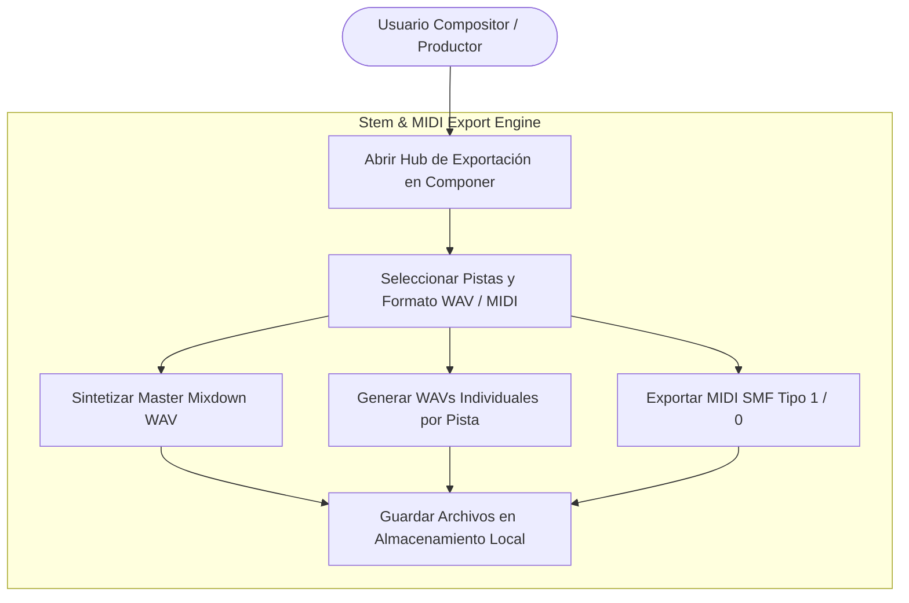
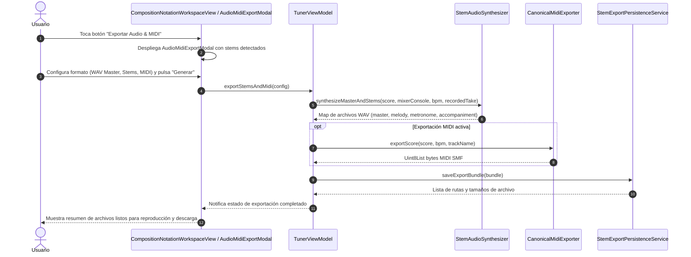

# Caso de Uso 36: Exportación de Stems de Audio Multicanal y Síntesis MIDI

## Metadatos
- **ID del Caso de Uso:** `UC-36`
- **Nombre:** Exportación de Stems de Audio Multicanal y Síntesis MIDI Local
- **Dominio:** Síntesis de Audio, Procesamiento Digital de Señales (DSP) y Notación Musical
- **Actor Principal:** Usuario (Compositor, Productor, Estudiante de Música)
- **Actores Secundarios:** `TunerViewModel`, `StemAudioSynthesizer`, `CanonicalMidiExporter`, `MixerConsoleEntity`
- **Fase Asociada:** Fase 3 (Plataforma y Experiencia Integral de Producción)

---

## 1. Descripción
Permite al usuario en el espacio de trabajo de **Componer** exportar las pistas de la obra musical activa (`SongPackage` / `HierarchicalScore`), los canales del mezclador multitrack y las tomas de práctica en paquetes descargables y reproducibles:
1. **Master Mixdown WAV (16-bit PCM 44.1/48 kHz):** Renderizado balanceado de todas las pistas activas respetando los volúmenes, silencios (mute) y solos del mezclador virtual, aplicando suma en punto flotante y limitación suave anti-clipping.
2. **Stems de Audio Separados (WAV):** Archivos individuales para la melodía sintetizada de la partitura (`melody_stem.wav`), el acompañamiento armónico (`accompaniment_stem.wav`), el clic percusivo del metrónomo (`metronome_stem.wav`) y la toma grabada por el micrófono (`user_take_stem.wav`).
3. **Archivo Estándar MIDI Multitrack (SMF Tipo 1):** Archivo binario con pistas independientes para el conductor de tempo/métrica, la pista melódica y el acompañamiento armónico, compatible con cualquier estación de trabajo de audio digital (DAW).
4. **Persistencia y Exportación Local Offline:** Empaquetado local atómico en almacenamiento de dispositivo sin requerir conexión a internet ni servidores externos.

---

## 2. Diagrama de Casos de Uso (Mermaid)

---

## 3. Diagrama de Secuencia / Flujo (Mermaid)

---

## 4. Precondiciones, Postcondiciones y Flujos

### 4.1 Precondiciones
- La aplicación se encuentra en el espacio de trabajo **Componer** o con una partitura/paquete de obra cargada.
- El usuario dispone de espacio de almacenamiento suficiente en el dispositivo.

### 4.2 Postcondiciones
- Se generan los archivos binarios canónicos (WAV RIFF y/o Standard MIDI File).
- Los archivos se almacenan en el directorio de exportación local offline de la aplicación.
- Se presenta al usuario la confirmación visual de bytes exportados con opción de preescucha o consulta.

### 4.3 Flujo Principal
1. El usuario navega al espacio **Componer**.
2. Pulsa la acción "Exportar Audio & MIDI" en la barra de herramientas.
3. En el modal interactivo, selecciona los stems deseados (Melodía, Acompañamiento, Clic de Metrónomo, Toma Micrófono) y el formato (Master WAV, Stems WAV, MIDI .mid).
4. El motor sintetiza los búferes PCM en punto flotante a 44.1 kHz, aplicando la cabecera canónica RIFF de 44 bytes y serializando la secuencia MIDI.
5. El sistema reporta el éxito de la operación con los pesos en KB/MB y las rutas generadas.

### 4.4 Flujos Alternativos y de Error
- **Partitura Vacía:** Si la partitura no contiene compases con notas válidas, el sistema genera únicamente el clic de metrónomo y notifica que la pista melódica carece de eventos.
- **Canales Silenciados (Muted):** Si un canal está silenciado en el mezclador, el Master Mixdown excluye su señal, pero el stem individual puede generarse si el usuario lo marca explícitamente.
- **Saturación Digital (Clipping):** Cuando la suma de múltiples pistas supera 0 dBFS (32767 en int16), se aplica compresión suave con tangente hiperbólica (`tanh`) para evitar distorsión armónica por recorte abrupto.

---
## 8. Guía de Pruebas Manuales y Bitácora de Validación

### 8.1 Precondiciones y Preparación del Entorno
- Proyecto con partitura y pistas de práctica listo en el sistema.

### 8.2 Procedimiento de Ejecución Paso a Paso
1. Abrir el menú **Exportación Avanzada de Audio y MIDI**.
2. Seleccionar la opción de exportar **Archivo MIDI Estándar (.mid)**.
3. Seleccionar la opción de exportar **Stems WAV Separados** (Pista Guía, Acompañamiento, Clic).
4. Verificar los archivos descargados o almacenados en la carpeta del proyecto.
5. Importar el archivo MIDI y los stems en un software externo (DAW o reproductor multimedia) para comprobar coherencia.

### 8.3 Checklist de Validación Sensorial (Resultado Esperado)
- [ ] El archivo MIDI contiene las notas, duraciones, canales y mensajes de cambio de tempo exactos.
- [ ] Los stems de audio exportados coinciden al milisegundo en su punto de inicio (fase alineada).
- [ ] Ningún archivo exportado presenta ruidos, cortes bruscos o silencios truncados.
- [ ] La interfaz muestra una barra de progreso que no congela la aplicación durante el renderizado.

### 8.4 Registro de Bitácora de Ejecución de Campo
| Fecha | Tester / Músico | Dispositivo / SO | Tipo de Exportación | Resultado | Observaciones / Aspectos por Pulir |
| :---: | :---: | :---: | :---: | :---: | :--- |
| *Pendiente* | - | - | - | [ ] Pendiente | *Registrar observaciones de exportación stem/MIDI* |
