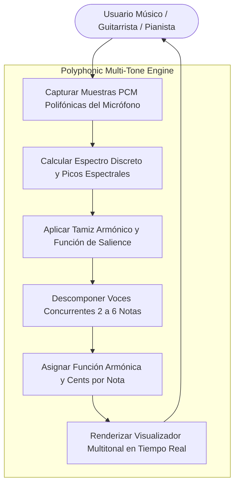
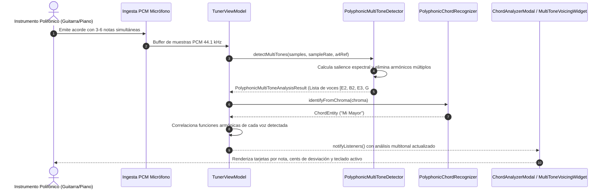

# Caso de Uso 37: Detección Polifónica Multitonal en Vivo

## Metadatos
- **ID del Caso de Uso:** `UC-37`
- **Nombre:** Detección Polifónica Multitonal en Vivo y Descomposición de Voces
- **Dominio:** Procesamiento Digital de Señales (DSP), Acústica y Armonía Musical
- **Actor Principal:** Usuario (Músico, Guitarrista, Pianista, Productor Acústico)
- **Actores Secundarios:** `TunerViewModel`, `PolyphonicMultiToneDetector`, `ChromaVectorCalculator`, `PolyphonicChordRecognizer`
- **Fase Asociada:** Fase 3 (Laboratorio Acústico y Análisis Polifónico Profesional)

---

## 1. Descripción
Permite al usuario en el espacio de trabajo de **Producir** (Laboratorio Acústico y Analizador de Acordes) descomponer señales sonoras polifónicas complejas (como rasgueos de guitarra de 6 cuerdas o acordes de piano de 3 a 6 notas simultáneas) en tiempo real, identificando:
1. **Separación de Voces Simultáneas:** Lista ordenada de notas fundamentales concurrentes ($f_0$) desde el bajo hasta la voz superior con su nombre de nota, octava acústica, frecuencia fundamental exacta en Hertz y desviación en cents.
2. **Cálculo de Función Armónica de Cada Nota:** Identificación del rol armónico de cada voz respecto a la fundamental del acorde (Fundamental/Raíz, Tercera, Quinta justa, Séptima o extensión).
3. **Función de Salience y Tamiz Armónico (Harmonic Sieve):** Agrupamiento de armónicos superiores ($2f_0, 3f_0, 4f_0, 5f_0$) para discriminar notas independientes de timbres ricos en armónicos y evitar duplicación de octavas artificiales.
4. **Visualización de Voicing Multitonal:** Representación gráfica interactiva de teclas presionadas en teclado y chips de entonación simultánea por voz.

---

## 2. Diagrama de Casos de Uso (Mermaid)

---

## 3. Diagrama de Secuencia / Flujo (Mermaid)

---

## 4. Precondiciones, Postcondiciones y Flujos

### 4.1 Precondiciones
- El micrófono está activo y transmitiendo muestras PCM en el espacio **Producir** o modal de acordes.
- El nivel RMS de la señal supera el umbral del Noise Gate (acorde audible).

### 4.2 Postcondiciones
- Se genera un `PolyphonicMultiToneAnalysisResult` inmutable con el desglose de 2 a 6 notas concurrentes.
- Cada nota descompuesta reporta su frecuencia $f_0$, nombre con octava, desviación en cents y salience.
- La interfaz visualiza las voces identificadas sin bloqueos de la UI (60 FPS).

### 4.3 Flujo Principal
1. El usuario toca un acorde en guitarra o piano.
2. El detector extrae los picos espectrales y aplica la función de salience para evaluar candidatos fundamentales.
3. El tamiz armónico sustrae la energía de los sobretonos de las fundamentales dominantes ya confirmadas.
4. Las notas secundarias (voces interiores) son detectadas sin ser enmascaradas por los armónicos del bajo.
5. El sistema entrega la lista ordenada de voces con su función armónica y desviación microtonal.

### 4.4 Flujos Alternativos y de Error
- **Monofonía Detectada:** Si el usuario toca una sola nota, el resultado contiene exactamente 1 voz con 100% de salience.
- **Ruido Percusivo / Golpes:** Si la señal carece de periodicidad tonal, el analizador reporta 0 voces y confianza cero.
