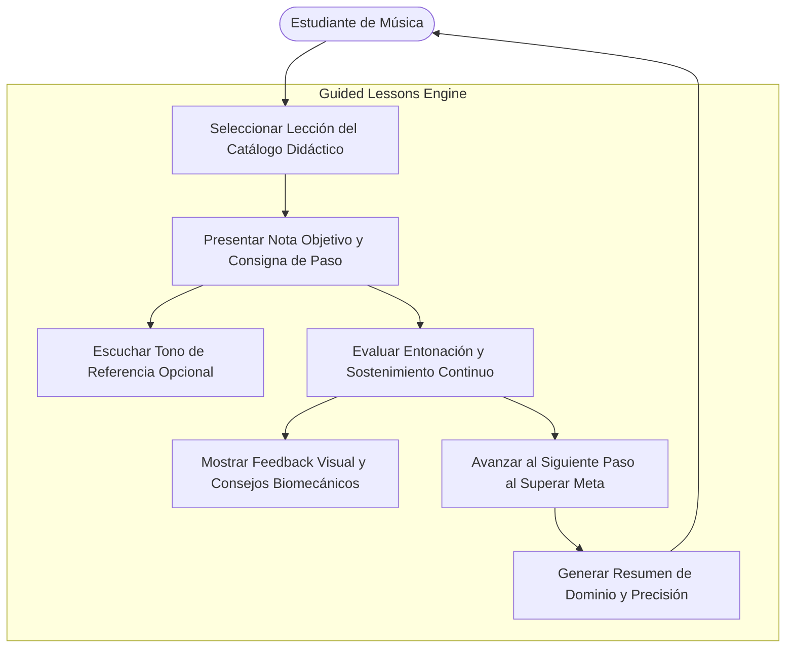
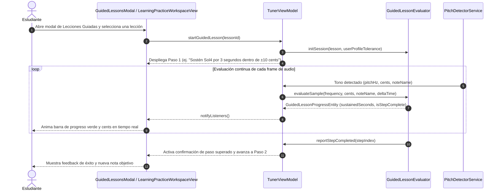

# Caso de Uso 38: Módulo de Lecciones Guiadas Interactivas y Práctica Paso a Paso

## Metadatos
- **ID del Caso de Uso:** `UC-38`
- **Nombre:** Módulo de Lecciones Guiadas Interactivas con Feedback Nota a Nota
- **Dominio:** Pedagogía Musical, Andragogía y Práctica Asistida por Audio Digital
- **Actor Principal:** Estudiante / Instrumentista (Adulto o Joven en etapa formativa)
- **Actores Secundarios:** `TunerViewModel`, `GuidedLessonEvaluator`, `AdaptiveScaffoldingEngine`
- **Fase Asociada:** Fase 3 (Plataforma y Experiencia Integral de Aprendizaje)

---

## 1. Descripción
Permite al usuario en el espacio de trabajo de **Aprender** acceder a un catálogo de lecciones pedagógicas estructuradas paso a paso (ej. iniciación tímbrica, notas largas centradas, saltos de intervalo, afinación de arpegios y escalas). 
A diferencia de la práctica libre, cada lección guía al instrumentista a través de una secuencia de pasos obligatorios:
1. **Consigna Clara:** Cada paso indica la nota objetivo ($f_0$), la duración requerida de sostenimiento (ej. 3.0 segundos continuos) y la tolerancia en cents calibrada por el perfil pedagógico adaptativo del estudiante.
2. **Feedback Visual Nota a Nota en Tiempo Real:** Medidor circular y barra de progreso que acumula tiempo exclusivamente cuando la nota emitida por el micrófono coincide con la altura esperada y se encuentra dentro de la tolerancia de cents.
3. **Andamiaje y Diagnóstico Acústico:** Si la nota se desvía constantemente (bemol o sostenido), el sistema despliega consejos biomecánicos correctivos inmediatos (presión del aire, embocadura, relajación laríngea).
4. **Validación de Paso y Transición Automática:** Al completar el sostenimiento exitoso de la nota, el sistema valida el paso, reproduce el tono de referencia del siguiente paso y avanza en la lección hasta emitir el resumen de dominio de la sesión.

---

## 2. Diagrama de Casos de Uso (Mermaid)

---

## 3. Diagrama de Secuencia / Flujo (Mermaid)

---

## 4. Precondiciones, Postcondiciones y Flujos

### 4.1 Precondiciones
- La aplicación se encuentra en el espacio de trabajo **Aprender**.
- El micrófono está activo y calibrado con el afinador.

### 4.2 Postcondiciones
- El avance de cada paso se calcula de forma determinista y sin retardos perceptuales.
- Al culminar la lección, la precisión promedio y el tiempo total quedan registrados para el informe pedagógico.

### 4.3 Flujo Principal
1. El estudiante pulsa "Lecciones Guiadas" en la barra de herramientas de práctica.
2. Selecciona una lección (ej. "Estabilidad de Embocadura: Notas Largas").
3. El sistema muestra la nota objetivo (ej. "Sol4"), el tono de referencia y la barra de sostenimiento vacía (0 / 3.0s).
4. El estudiante toca la nota requerida. Mientras la afinación se mantenga en el centro, la barra se llena de forma continua.
5. Al completar los 3.0 segundos requeridos, el paso se marca como superado y se activa el siguiente paso de la secuencia.
6. Al concluir todos los pasos, el modal despliega la pantalla de felicitación con porcentaje de precisión global.

### 4.4 Flujos Alternativos y de Error
- **Desviación de Afinación:** Si el estudiante desafina durante el sostenimiento, el temporizador de sostenimiento se pausa o retrocede suavemente según el perfil pedagógico, y se muestra una sugerencia correctiva.
- **Nota Incorrecta Emitida:** Si el estudiante toca una nota diferente a la solicitada, la barra no avanza y se indica la nota que está sonando en comparación con la nota esperada.

---
## 8. Guía de Pruebas Manuales y Bitácora de Validación

### 8.1 Precondiciones y Preparación del Entorno
- Módulo de Lecciones Guiadas abierto con micrófono activo.

### 8.2 Procedimiento de Ejecución Paso a Paso
1. Seleccionar la **Lección 1: Emisión y Estabilidad de Tono**.
2. Leer la indicación en pantalla: "Sostén la nota $G_4$ afinada durante 3 segundos continuos".
3. Tocar la nota $G_4$ en el instrumento manteniendo la afinación estable dentro del margen de tolerancia.
4. Observar la barra de progreso temporal llenándose mientras la nota se sostiene.
5. Comprobar la transición automática al siguiente paso pedagógico al cumplir el objetivo.

### 8.3 Checklist de Validación Sensorial (Resultado Esperado)
- [ ] Detección interactiva del cumplimiento del objetivo en tiempo real sin requerir pulsar la pantalla.
- [ ] Reinicio inmediato del temporizador si la nota se desafina o se interrumpe la emisión antes de tiempo.
- [ ] Animación de felicitación y desbloqueo del siguiente paso al superar el reto.
- [ ] Indicaciones claras de postura, embocadura o digitación en pantalla.

### 8.4 Registro de Bitácora de Ejecución de Campo
| Fecha | Tester / Músico | Dispositivo / SO | Lección Evaluada | Resultado | Observaciones / Aspectos por Pulir |
| :---: | :---: | :---: | :---: | :---: | :--- |
| *Pendiente* | - | - | - | [ ] Pendiente | *Registrar observaciones de lecciones guiadas* |
