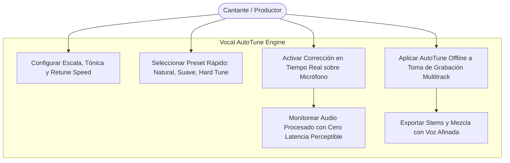
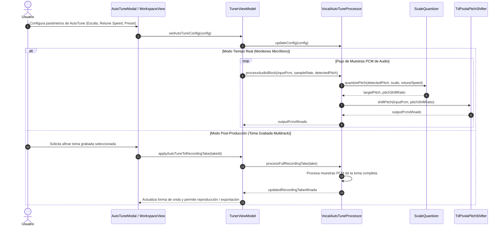

# Caso de Uso 39: Corrección de Tono Vocal en Tiempo Real y Post-Producción (Vocal AutoTune)

## Metadatos
- **ID del Caso de Uso:** `UC-39`
- **Nombre:** Corrección de Tono Vocal en Tiempo Real y Post-Producción (Vocal AutoTune)
- **Dominio:** Procesamiento Digital de Señales (DSP), Producción Musical y Afinación Vocal Asistida
- **Actor Principal:** Cantante / Productor Musical / Estudiante Vocal
- **Actores Secundarios:** `TunerViewModel`, `VocalAutoTuneProcessor`, `ScaleQuantizer`, `TdPsolaPitchShifter`, `PracticeRecorderService`
- **Fase Asociada:** Fase 3 (Plataforma y Experiencia Integral de Aprendizaje y Producción)

---

## 1. Descripción
Permite al usuario activar y configurar la corrección de afinación vocal tanto en **tiempo real** (sobre el flujo de audio del micrófono durante la escucha o monitoreo en vivo) como en **post-producción** (sobre tomas grabadas en la grabadora multitrack y en la fase de exportación de stems).

El motor opera bajo los siguientes principios acústicos:
1. **Detección y Cuantización a Escala Musical (Scale Snapping):** A partir de la frecuencia fundamental detectada ($f_0$), el motor determina la nota y frecuencia objetivo más cercana dentro de la escala seleccionada (Cromática, Mayor, Menor Natural, Pentatónica, etc.) con respecto a la tónica de afinación elegida.
2. **Velocidad de Corrección (Retune Speed):** Controla el tiempo de inercia o transición hacia la frecuencia cuantizada:
   - *0 ms (Hard Tune):* Salto instantáneo de altura que genera el efecto robótico característico de la música urbana y pop moderno.
   - *10 a 50 ms (Natural / Pro Studio):* Deslizamiento suave que preserva los portamentos expresivos y vibratos naturales sin alterar la organicidad de la interpretación.
3. **Resíntesis Temporal TD-PSOLA (Time-Domain Pitch Synchronous Overlap-Add):** Modifica el espaciamiento entre los instantes de cierre glótico (GCI) sin alterar la envolvente espectral del tracto vocal (formantes), evitando artefactos tímbricos de desnaturalización.
4. **Modos de Operación Dual:**
   - *Tiempo Real:* Procesa bloques de audio PCM con latencia inferior a 10 ms para monitoreo por auriculares.
   - *Post-Producción:* Aplica el procesamiento offline con precisión matemática sobre tomas grabadas (`PracticeRecordingTake`) en la sesión multitrack.

---

## 2. Diagrama de Casos de Uso (Mermaid)

---

## 3. Diagrama de Secuencia / Flujo (Mermaid)

---

## 4. Precondiciones
1. El motor de audio y la configuración de frecuencias del sistema se encuentran inicializados con frecuencia de referencia calibrada (A4 = 440 Hz por defecto).
2. Para el modo tiempo real, el micrófono debe estar habilitado y recibiendo muestras de audio PCM.
3. Para el modo post-producción, debe existir al menos una toma de grabación guardada en la sesión multitrack.

---

## 5. Flujo Principal
1. El usuario abre el panel interactivo de Vocal AutoTune desde el espacio de Producción o Práctica.
2. Selecciona la tónica (ej. Do, Re, Fa#) y la escala objetivo (ej. Mayor, Menor Natural, Cromática).
3. Ajusta la velocidad de corrección (`retuneSpeedMs`) o elige un preset prediseñado (*Estudio Natural*, *Pop Suave*, *Hard Tune Urbano*).
4. El motor cuantiza en tiempo real cada fundamental detectada y genera los bloques de audio procesados mediante el algoritmo TD-PSOLA.
5. El usuario escucha la voz afinada en tiempo real o aplica la afinación sobre la toma de audio grabada en la consola multitrack.

---

## 6. Flujos Alternativos y Casos de Borde
- **Sonidos No Vocales o Ruido Transitorio:** Si la señal detectada tiene baja claridad o nivel de silencios ($f_0 \le 20$ Hz), el algoritmo mantiene la señal original sin aplicar distorsión (*bypass* transparente).
- **Desviación en Cents Fuera de Rango:** Si la nota original se aleja más de 200 cents de la nota de la escala más próxima, el interpolador aplica un filtro suave para evitar transiciones audibles abruptas o clics mecánicos.
- **Voz con Formantes Invariables:** Cuando `formantPreservation` está habilitado, el algoritmo preserva las características timbrales del cantante evitando la modificación artificial del tracto resonador.

---

## 7. Flujos de Error
- **Error de Ingesta de Audio:** Si el buffer de audio recibido es nulo o contiene ceros absolutos, el procesador devuelve el buffer sin procesar registrando el estado sin arrojar excepciones no controladas.

---

## 8. Postcondiciones
1. La señal vocal procesada refleja la afinación cuantizada hacia la escala seleccionada con la inercia temporal establecida.
2. En post-producción, la toma grabada procesada queda almacenada en el estado local inmutable disponible para mezcla y exportación de stems.

---
## 8. Guía de Pruebas Manuales y Bitácora de Validación

### 8.1 Precondiciones y Preparación del Entorno
- Auriculares conectados (con cable preferentemente para evaluar latencia mínima) y micrófono activo.

### 8.2 Procedimiento de Ejecución Paso a Paso
1. Abrir la pantalla del procesador de afinación vocal (Autotune).
2. Seleccionar la escala musical objetivo (ej. Do Mayor).
3. Ajustar el potenciómetro de **Velocidad de Corrección (Speed)** a nivel medio (corrección natural).
4. Cantar una melodía por el micrófono y escuchar el retorno corregido por los auriculares en tiempo real.
5. Cambiar la velocidad de corrección a cero (efecto de afinación robótica instantánea / hard-tune).
6. Evaluar la perilla de **Preservación de Formantes**.

### 8.3 Checklist de Validación Sensorial (Resultado Esperado)
- [ ] Latencia de ida y vuelta imperceptible ($< 15\text{ ms}$) evitando el efecto de eco molesto al cantar.
- [ ] Corrección suave y musical al semitono de la escala elegida en modo natural.
- [ ] Efecto hard-tune marcado e instantáneo en modo rápido sin clics de fase en las transiciones de nota.
- [ ] Mantenimiento del timbre vocal auténtico sin deformaciones indeseadas (*chipmunk effect*).

### 8.4 Registro de Bitácora de Ejecución de Campo
| Fecha | Tester / Músico | Dispositivo / SO | Escala y Velocidad | Resultado | Observaciones / Aspectos por Pulir |
| :---: | :---: | :---: | :---: | :---: | :--- |
| *Pendiente* | - | - | - | [ ] Pendiente | *Registrar observaciones de autotune vocal* |
