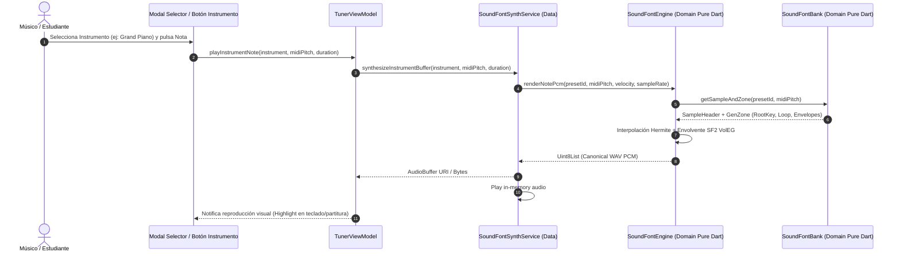

# UC-40: Motor de Síntesis SoundFont SF2 y Modelado Acústico Instrumental

---

## Metadatos del Caso de Uso

- **ID del Caso de Uso:** `UC-40-SOUNDFONT-SF2-INSTRUMENT-SYNTHESIS`
- **Nombre Canónico:** `Sintetizar Timbres Instrumentales Realistas (Piano, Flauta, Violín, Cello) con SoundFont SF2 y Modelado Físico`
- **Fase Asociada:** `Fase 3`
- **Actor Principal:** `Estudiante / Músico / Docente`
- **Actores Secundarios:** `Motor de Síntesis PCM/WAV (Data/Domain), Parser SF2 RIFF In-Memory, Audio Player Local`
- **Estado:** `Approved`

---

## 1. Descripción Breve y Propósito

Permite al estudiante y docente seleccionar instrumentos acústicos de referencia (*Grand Piano*, *Concert Flute*, *Violin*, *Cello*, *Classical Guitar*) para reproducir partituras, notas guía y ejercicios pedagógicos con timbres reales de alta fidelidad. 

El sistema implementa un parser y sintetizador SoundFont (SF2 / SoundFont 2.04) en **Dart Puro**, capaz de:
1. Parsear contenedores RIFF/sfArk/SF2 (chunks `INFO`, `sdta`, `pdta`) extrayendo muestras PCM y zonas de presets/instrumentos.
2. Interpolar muestras de audio en tiempo real con remuestreo cúbico/hermite para transposición cromática continua sin aliasing.
3. Modelar envolventes de amplitud y filtro resonante bicuadrático (biquad low-pass) definidos en la especificación SF2.
4. Incluir un banco SoundFont canónico embebido y ligero (*Tunner Acoustic Essentials*) que no requiera descargas externas y funcione 100% offline.

---

## 2. Diagrama de Caso de Uso (Mermaid)

```mermaid
flowchart LR
    Musician(("Músico / Estudiante"))

    subgraph TunnerSystem ["Sistema Tunner (Monolito Local)"]
        UC40(["UC-40: Síntesis SoundFont SF2"])
        SF2Parser(["Parser SF2 RIFF Chunks (Domain)"])
        WavetableOsc(["Oscilador Wavetable & Resampler Cúbico (Domain)"])
        FilterEnvEngine(["Envolvente EG & Filtro Biquad (Domain)"])
        PresetManager(["Gestor de Presets Instrumentales (Domain)"])
        AudioBufferGen(["Generador de Audio PCM/WAV (Domain)"])
        LocalAudioPlayer(["Reproductor de Audio en Memoria (Data)"])
    end

    Musician -->|Selecciona instrumento y nota o partitura| UC40
    UC40 --> PresetManager
    PresetManager --> SF2Parser
    SF2Parser --> WavetableOsc
    WavetableOsc --> FilterEnvEngine
    FilterEnvEngine --> AudioBufferGen
    AudioBufferGen --> LocalAudioPlayer
    LocalAudioPlayer -->|Audio acústico de alta fidelidad| Musician
```

---

## 3. Precondiciones y Postcondiciones

### 3.1 Precondiciones
1. El usuario tiene activo el estudio, afinador o reproductor de partituras.
2. El banco SoundFont esencial está disponible en memoria o cargado desde assets locales.
3. El motor de audio está configurado a la frecuencia de muestreo canónica ($44100\text{ Hz}$, 16-bit mono/estéreo).

### 3.2 Postcondiciones
1. Se genera un buffer de audio digital PCM 16-bit canónico con rampa anti-pop.
2. Cero latencia de red; el proceso de síntesis se ejecuta en $< 5\text{ ms}$ por evento de nota.
3. Preservación estricta de memoria: los samples se cargan bajo demanda o con mapeo eficiente en memoria.

---

## 4. Diagrama de Flujo y Secuencia (Mermaid)

---

## 5. Flujos del Sistema

### 5.1 Flujo Principal (Happy Path)
1. El usuario abre el selector de instrumento o activa la reproducción con SoundFont.
2. El sistema consulta las zonas del instrumento seleccionado (*Piano*, *Flute*, *Violin*, *Cello*).
3. Se localiza la muestra PCM más cercana al $f_0$ solicitado.
4. El motor calcula la relación de remuestreo $R = \frac{f_{\text{target}}}{f_{\text{sample}}}$.
5. El oscilador interpola las muestras aplicando la envolvente de volumen exponencial y filtro.
6. El audio sintetizado se entrega al reproductor local de bajo retardo.
7. El sonido se percibe con realismo tímbrico e inmediatez.

### 5.2 Flujos Alternativos y Excepciones
- **A1: Nota fuera del rango nativo del sample:** El motor transpone mediante interpolación matemática sin distorsionar el timbre dentro de un rango de $\pm 2$ octavas.
- **E1: Banco SF2 corrupto o incompleto:** El sistema realiza *fallback* transparente al sintetizador aditivo de armónicos (`StemAudioSynthesizer`), garantizando que la reproducción nunca falle.

---
## 8. Guía de Pruebas Manuales y Bitácora de Validación

### 8.1 Precondiciones y Preparación del Entorno
- Teclado virtual o partitura interactiva activa con motor SoundFont habilitado.
- Altavoces o auriculares estéreo conectados.

### 8.2 Procedimiento de Ejecución Paso a Paso
1. Seleccionar el banco acústico SoundFont SF2.
2. Elegir el instrumento **Piano de Cola Acústico**.
3. Tocar notas staccato y notas con sustain largo mediante el teclado táctil en pantalla.
4. Cambiar el instrumento a **Flauta Traversa** y posteriormente a **Sección de Cuerdas**.
5. Evaluar la respuesta en graves profundos y en agudos extremos.

### 8.3 Checklist de Validación Sensorial (Resultado Esperado)
- [ ] Reproducción fiel de las muestras PCM muestreadas del instrumento real.
- [ ] Envolvente ADSR natural: decaimiento suave y liberación limpia sin chasquidos al soltar la tecla.
- [ ] Interpolación de tono limpia al transponer muestras a lo largo del registro.
- [ ] Polifonía sin caídas de voces ni clics de saturación en el mezclador de audio.

### 8.4 Registro de Bitácora de Ejecución de Campo
| Fecha | Tester / Músico | Dispositivo / SO | Instrumento Evaluado | Resultado | Observaciones / Aspectos por Pulir |
| :---: | :---: | :---: | :---: | :---: | :--- |
| *Pendiente* | - | - | - | [ ] Pendiente | *Registrar observaciones de síntesis SoundFont* |
