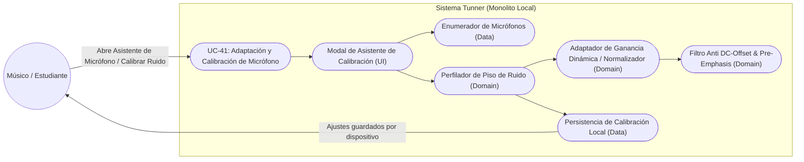
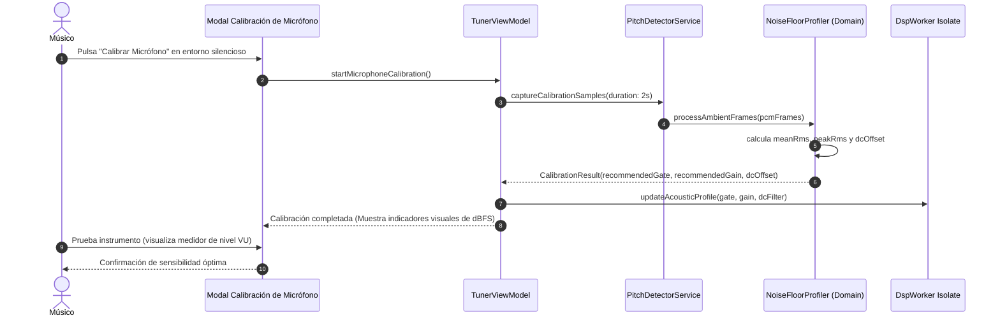

# UC-41: Calibración y Adaptación Acústica del Micrófono en Tiempo Real

---

## Metadatos del Caso de Uso

- **ID del Caso de Uso:** `UC-41-MICROPHONE-CALIBRATION-AND-ADAPTATION`
- **Nombre Canónico:** `Calibrar y Adaptar el Sistema al Hardware de Micrófono, Piso de Ruido y Ganancia Automática (AGC)`
- **Fase Asociada:** `Fase 1 / Fase 3`
- **Actor Principal:** `Estudiante / Músico / Docente`
- **Actores Secundarios:** `Hardware de Micrófono, AudioRecorder Platform Interface, DSP Noise Floor Profiler (Domain)`
- **Estado:** `Approved`

---

## 1. Descripción Breve y Propósito

Los micrófonos de los dispositivos móviles (Android/iOS) y computadoras de escritorio (Linux/macOS/Windows) varían drásticamente en sensibilidad, respuesta en frecuencia, ganancia de entrada y algoritmos nativos del sistema operativo (cancelación de eco, reducción de ruido y control automático de ganancia o AGC que a menudo distorsionan los armónicos de instrumentos musicales).

Este caso de uso dota a **Tunner** de un **Sistema de Calibración y Adaptación Acústica de Hardware**:
1. **Perfilador de Piso de Ruido (Noise Floor Profiler):** Calibra el umbral de silencio (Noise Gate RMS) analizando 1..2 segundos de ruido de fondo ambiental del entorno local, evitando que el ventilador de la PC o ruidos lejanos falseen la afinación.
2. **Control de Ganancia de Entrada Digital (Digital Input Gain):** Ajusta la amplificación matemática de la señal PCM antes del análisis MPM (0.2x a 5.0x) para micrófonos con bajo nivel de captura o saturación por instrumentos potentes (trompeta, violín agudo).
3. **Selector y Detección de Dispositivos de Entrada (Input Device Discovery):** Consulta los micrófonos físicos disponibles (auriculares con cable, micrófonos USB de condensador, micrófono interno) con selección inmediata.
4. **Filtro de Relevancia Espectral (DC-Offset Removal & Pre-Emphasis):** Elimina cualquier polarización de corriente directa (DC bias) típica de tarjetas de audio económicas que descalibra los cruces por cero en la correlación acústica.

---

## 2. Diagrama de Caso de Uso (Mermaid)

---

## 3. Precondiciones y Postcondiciones

### 3.1 Precondiciones
1. Permisos de captura de micrófono concedidos por el usuario en el sistema operativo.
2. Dispositivo de audio disponible e inicializado.

### 3.2 Postcondiciones
1. El umbral de silencio (silence threshold) del algoritmo MPM se fija con precisión matemática ($RMS_{\text{ambient}} \times 1.6$).
2. La polarización DC es removida con un filtro paso alto IIR de un polo a $10\text{ Hz}$.
3. El ajuste de sensibilidad queda persistido localmente y se aplica de forma transparente al motor DSP en el Isolate.

---

## 4. Diagrama de Flujo y Secuencia (Mermaid)

---

## 5. Fórmulas Matemáticas y Filtros

### 5.1 Eliminación de Polarización DC (DC-Blocker IIR Filter)
$$y[n] = x[n] - x[n-1] + R \cdot y[n-1]$$
donde $R = 1 - \frac{2\pi \cdot f_c}{f_s}$, con $f_c = 15\text{ Hz}$ y $f_s = 44100\text{ Hz}$ ($R \approx 0.9978$). Elimina completamente el desplazamiento de cero sin alterar las frecuencias musicales ($A_0 = 27.5\text{ Hz}$).

### 5.2 Determinación Automática del Noise Gate
$$\text{NoiseGate}_{\text{RMS}} = \max\left(0.003, \quad \overline{\text{RMS}}_{\text{ambient}} \times 1.8\right)$$
Previene falsas detecciones por ruido de piso de micrófonos de baja calidad o ventiladores de computadoras.
