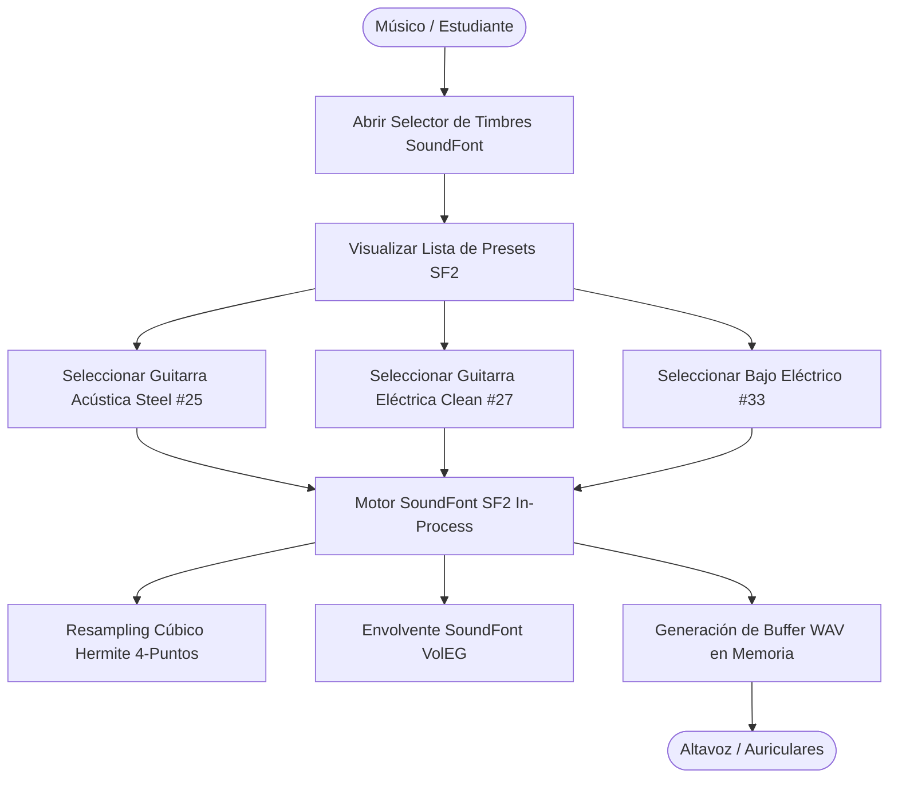
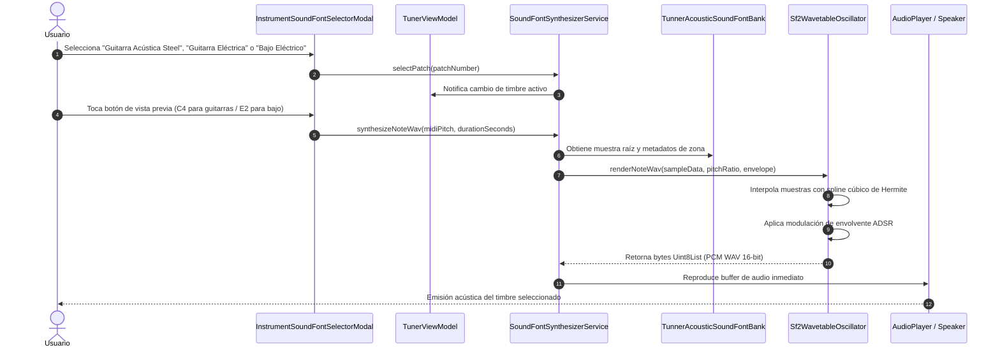

# Caso de Uso Canónico: UC-42 - Síntesis SoundFont de Guitarras Modernas y Bajo Eléctrico

---

## 1. Metadatos del Caso de Uso

- **ID del Caso de Uso:** `UC-42`
- **Nombre Canónico:** `Síntesis SoundFont SF2 de Guitarras Modernas (Acústica Steel, Eléctrica Clean) y Bajo Eléctrico`
- **Fase Asociada:** `Fase 3 (Laboratorio Armónico & Síntesis)`
- **Prioridad:** `Alta (Requerimiento de Extensión de Instrumentación Contemporánea)`
- **Autor / Arquitecto:** `Equipo de Arquitectura e Ingeniería de Tunner`

---

## 2. Resumen y Alcance (Summary & Scope)

Este caso de uso expande el motor de síntesis SoundFont SF2 de **Tunner** incorporando tres familias de timbres fundamentales de la música contemporánea, popular y moderna:
1. **Guitarra Acústica Cuerdas de Acero (Acoustic Guitar - Steel Strings)** (General MIDI #25): Brillo armónico metálico superior y respuesta percusiva rápida de púa.
2. **Guitarra Eléctrica Limpia (Electric Guitar - Clean)** (General MIDI #27): Resonancia magnética de pastillas (*pickups*) con compresión analógica suave basada en saturación no lineal $\tanh$.
3. **Bajo Eléctrico (Electric Bass - Fingerstyle)** (General MIDI #33): Fundamental profunda en el registro grave ($E_1$ - $G_3$), con ataque definido de yema y cuerpo resonante sin distorsión.

Permite al estudiante y músico escuchar notas de referencia, acordes y partituras completas con timbres realistas de cuerda pulsada moderna, superando la limitación a timbres orquestales clásicos.

---

## 3. Diagramas Formales de Casos de Uso y Secuencia

### 3.1 Diagrama de Casos de Uso (Mermaid)

### 3.2 Diagrama de Flujo y Secuencia (Mermaid)

---

## 4. Precondiciones y Postcondiciones

### 4.1 Precondiciones
1. La aplicación **Tunner** se encuentra en ejecución en cualquier dispositivo móvil o de escritorio soportado.
2. El sistema de audio local tiene el volumen configurado por encima de cero.

### 4.2 Postcondiciones
1. El patch activo se actualiza en el `SoundFontSynthesizerService`.
2. Las reproducciones de notas guía de afinación, acordes del analizador y partituras interactivas utilizan el nuevo timbre seleccionado.

---

## 5. Fundamento Físico y Fórmulas Acústicas

### 5.1 Guitarra Acústica con Cuerdas de Acero (Patch 25)
A diferencia de las cuerdas de nylon (clásica), las cuerdas de bronce/acero poseen mayor rigidez a la flexión y alta dispersión armónica:
$$s_{\text{steel}}(\phi) = 0.60 \sin(\phi) + 0.45 \sin(2\phi) + 0.30 \sin(3\phi) + 0.18 \sin(4\phi) + 0.10 \sin(5\phi)$$
La envolvente VolEG utiliza un ataque de púa ultrarrápido ($t_{\text{att}} = 0.006\text{ s}$) y un decaimiento percusivo largo ($t_{\text{dec}} = 1.0\text{ s}$).

### 5.2 Guitarra Eléctrica Limpia (Patch 27)
El transductor electromagnético (pastilla magnética) atenúa armónicos de muy alta frecuencia e introduce una sutil compresión no lineal al excitar el circuito:
$$s_{\text{raw}}(\phi) = 0.75 \sin(\phi) + 0.35 \sin(2\phi) + 0.20 \sin(3\phi) + 0.08 \sin(4\phi)$$
$$s_{\text{electric}}(\phi) = \tanh(1.2 \cdot s_{\text{raw}}(\phi))$$

### 5.3 Bajo Eléctrico Fingerstyle (Patch 33)
Centrado en el registro sub-grave con fundamental dominante ($E_1 \approx 41.2\text{ Hz}$ a $G_3 \approx 196\text{ Hz}$):
$$s_{\text{bass}}(\phi) = 0.85 \sin(\phi) + 0.40 \sin(2\phi) + 0.15 \sin(3\phi) + 0.05 \sin(4\phi)$$
Envolvente con ataque redondeado de yema ($t_{\text{att}} = 0.008\text{ s}$) y cuerpo sostenido ($L_{\text{sus}} = 0.35$).

---

## 6. Guía de Pruebas Manuales y Bitácora de Validación

### 6.1 Precondiciones y Preparación del Entorno
- Dispositivo móvil o PC con auriculares estéreo o altavoz de buena respuesta en graves.
- Afinador abierto con acceso al botón de Timbres SoundFont (ícono de instrumento en barra superior).

### 6.2 Procedimiento de Ejecución Paso a Paso
1. Abrir el modal de **Timbres Acústicos SoundFont**.
2. Verificar que en la lista aparezcan:
   - **Steel String Guitar** (Patch #25).
   - **Electric Guitar Clean** (Patch #27).
   - **Electric Bass Finger** (Patch #33).
3. Seleccionar **Steel String Guitar**: presionar el botón de prueba de nota $C_4$.
4. Evaluar el brillo metálico del ataque y el decaimiento de cuerda de acero.
5. Seleccionar **Electric Guitar Clean**: probar notas y evaluar el sustain cálido y la respuesta analógica.
6. Seleccionar **Electric Bass Finger**: probar en registro grave ($E_2$) y verificar la solidez del sub-grave sin distorsión.

### 6.3 Checklist de Validación Sensorial (Resultado Esperado)
- [ ] Presencia visible y seleccionable de los 3 nuevos instrumentos en el modal.
- [ ] Timbres distintivos: diferenciación acústica clara entre Guitarra Española (nylon #24), Acústica de Acero (#25), Eléctrica (#27) y Bajo Eléctrico (#33).
- [ ] Ausencia de distorsión digital o chasquidos de bucle (*loop clicks*) en la síntesis del bajo.
- [ ] Tiempo de generación instantáneo ($< 20\text{ ms}$) al tocar cualquier botón de nota.

### 6.4 Registro de Bitácora de Ejecución de Campo
| Fecha | Tester / Músico | Dispositivo / SO | Transductor / Audífonos | Resultado | Observaciones / Aspectos por Pulir |
| :---: | :---: | :---: | :---: | :---: | :--- |
| *Pendiente* | - | - | - | [ ] Pendiente | *Registrar observaciones tras la primera prueba de guitarras y bajo* |
