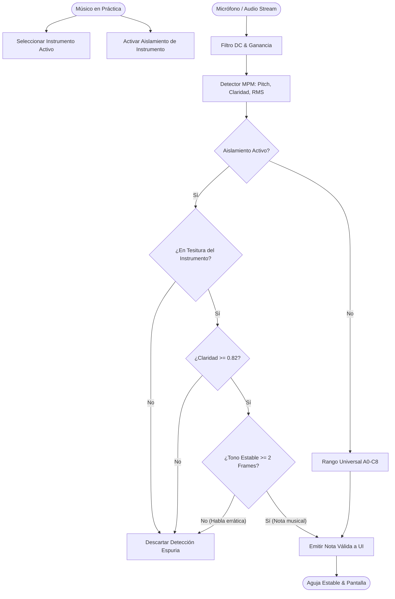

# Caso de Uso Canónico: UC-43 - Aislamiento Acústico de Instrumento y Rechazo de Voz Hablada (Speech Rejection & Tone Lock)

---

## 1. Metadatos del Caso de Uso

- **ID del Caso de Uso:** `UC-43`
- **Nombre Canónico:** `Aislamiento Acústico de Instrumento, Filtrado de Tesitura y Rechazo de Habla Humana en Tiempo Real`
- **Fase Asociada:** `Fase 1 / Fase 3 (DSP & Acústica Instrumental)`
- **Prioridad:** `Crítica (Calidad Acústica, Eliminación de Detecciones Espurias)`
- **Autor / Arquitecto:** `Equipo de Arquitectura e Ingeniería de Tunner`

---

## 2. Resumen y Alcance (Summary & Scope)

Al afinar o practicar con un instrumento musical en una sala real, el usuario suele hablar, respirar cerca del micrófono o enfrentar ruidos de fondo. Debido a que la voz humana posee formantes con periodicidad local, los detectores de tono estándar interpretan erróneamente las sílabas habladas y ruidos como notas musicales, haciendo que la aguja y el indicador de nota oscilen caóticamente.

Este caso de uso introduce el subsistema de **Aislamiento Acústico de Instrumento y Rechazo de Voz Hablada (`InstrumentAcousticFilter`)**, que combina tres mecanismos complementarios:
1. **Filtro de Tesitura Instrumental:** Confinamiento estricto a las frecuencias fundamentales del instrumento seleccionado (`minFrequencyHz` a `maxFrequencyHz` con tolerancia de armónicos $\pm 8\%$). Por ejemplo, si se selecciona Guitarra ($82.4\text{ Hz} - 1175\text{ Hz}$), se descartan sonidos graves de pasos o ruidos agudos fuera de su tesitura.
2. **Discriminador de Claridad Armónica Elevada:** Los instrumentos musicales poseen resonancia armónica periódica con claridad MPM $c \ge 0.82$, mientras que el habla ordinaria y las consonantes fricativas/oclusivas oscilan con claridad baja o errática ($c < 0.75$).
3. **Enganche de Estabilidad Tonal (Tone Lock Hysteresis):** La voz hablada modula constantemente de frecuencia (variaciones $> 80\text{ cents}$ en $30\text{ ms}$). Los instrumentos musicales sostienen el centro tonal con desviaciones menores a $25\text{ cents}$. El discriminador exige estabilidad temporal mínima ($N \ge 2$ frames consecutivos) antes de alterar la nota activa.

---

## 3. Diagramas Formales de Casos de Uso y Secuencia

### 3.1 Diagrama de Casos de Uso (Mermaid)



### 3.2 Diagrama de Flujo y Secuencia (Mermaid)

```mermaid
sequenceDiagram
    autonumber
    actor Musico
    participant UI as TunerScreen
    participant VM as TunerViewModel
    participant Service as PitchDetectorService
    participant Isolate as DSP Worker Isolate
    participant Filter as InstrumentAcousticFilter

    Musico->>UI: Selecciona "Guitarra Clásica / Eléctrica"
    UI->>VM: setInstrumentProfile(guitar)
    VM->>Service: setInstrumentFilter(minHz: 75.0, maxHz: 1250.0, clarityMin: 0.82)
    Service->>Isolate: Envía perfil de aislamiento acústico
    
    Note over Musico,Service: El músico habla: "Hola, probando afinador..."
    Isolate->>Filter: Evalúa frecuencia de voz (ej: 140 Hz, claridad 0.68, inestable)
    Filter-->>Isolate: Rechazado (Claridad < 0.82 y variación prosódica > 80 cents)
    Note over Isolate,UI: Cero parpadeo en UI; la aguja permanece inmóvil
    
    Note over Musico,Service: El músico pulsa la 5ª cuerda de guitarra (La2 = 110.0 Hz)
    Isolate->>Filter: Evalúa frame 1 (110.1 Hz, claridad 0.94) -> Candidato
    Isolate->>Filter: Evalúa frame 2 (110.0 Hz, claridad 0.96) -> Estable
    Filter-->>Isolate: Aprobado (Tone Lock confirmado)
    Isolate->>Service: Emite pitch fundamental 110.0 Hz
    Service->>VM: onPitchDetected(110.0)
    VM->>UI: Actualiza aguja en centro exacto La2 (0 cents)
```

---

## 4. Precondiciones y Postcondiciones

### 4.1 Precondiciones
1. Micrófono capturando audio en tiempo real.
2. Un instrumento musical seleccionado en el perfil del afinador (ej. Guitarra, Bajo, Violín, Flauta, Trompeta).

### 4.2 Postcondiciones
1. La voz hablada ordinaria no produce notas musicales falsas en la aguja ni en el visor de nota.
2. Las notas del instrumento se reconocen con inmediatez tan pronto como se sostiene la emisión por al menos $40\text{ ms}$.
3. Al cambiar a "Voz / Canto Universal", el filtro adapta su rango automáticamente para permitir afinación vocal entonada.

---

## 5. Formulación Matemática de Rechazo

### 5.1 Confinamiento de Tesitura con Margen de Extensión
Dada la frecuencia mínima teórica $f_{\text{min}}$ y máxima $f_{\text{max}}$ del instrumento:
$$f_{\text{lower}} = f_{\text{min}} \times 0.92, \quad f_{\text{upper}} = f_{\text{max}} \times 1.08$$
Toda detección con $f < f_{\text{lower}}$ o $f > f_{\text{upper}}$ se marca como fuera de banda.

### 5.2 Criterio de Estabilidad Tonal (Tone Lock)
Sean $f_n$ y $f_{n-1}$ dos estimaciones de frecuencia en frames consecutivos:
$$\Delta \text{cents} = \left| 1200 \cdot \log_2\left(\frac{f_n}{f_{n-1}}\right) \right|$$
Si $\Delta \text{cents} \le 30\text{ cents}$ y $\text{claridad}_n \ge 0.82$, el contador de estabilidad se incrementa ($k = k + 1$).
Una nota solo se emite a la UI cuando $k \ge 2$, garantizando que la fluctuación errática del habla sea suprimida.

---

## 6. Guía de Pruebas Manuales y Bitácora de Validación

### 6.1 Precondiciones y Preparación del Entorno
- Dispositivo físico con micrófono activo en entorno de práctica o habitación.
- Instrumento acústico disponible (guitarra, bajo, flauta, violín).

### 6.2 Procedimiento de Ejecución Paso a Paso
1. Abrir **Tunner** y seleccionar el instrumento activo (ej. **Guitarra**).
2. Asegurar que el interruptor o chip **Aislamiento de Instrumento** esté activo.
3. Hablar normalmente frente al micrófono a volumen moderado (decir frases como "Probando el afinador", "Un, dos, tres").
4. Observar la pantalla del afinador: la aguja no debe parpadear ni mostrar notas falsas.
5. Tocar la cuerda al aire del instrumento (ej. $A_2 = 110\text{ Hz}$ en guitarra).
6. Observar que la nota $A_2$ se reconozca de inmediato en cuanto la cuerda suena.
7. Desactivar el aislamiento de instrumento y comprobar que el afinador vuelve a modo universal abierto.

### 6.3 Checklist de Validación Sensorial (Resultado Esperado)
- [ ] Silencio y estabilidad absoluta del display de afinación durante el habla ordinaria.
- [ ] Detección fluida e inmediata de notas reales del instrumento al tocarlas.
- [ ] Cero retraso perceptible en la aguja al tocar notas staccato o legato.
- [ ] El chip en la interfaz permite alternar fácilmente entre aislamiento estricto y modo abierto.

### 6.4 Registro de Bitácora de Ejecución de Campo
| Fecha | Tester / Músico | Dispositivo / SO | Instrumento Evaluado | Resultado | Observaciones / Aspectos por Pulir |
| :---: | :---: | :---: | :---: | :---: | :--- |
| *Pendiente* | - | - | - | [ ] Pendiente | *Registrar observaciones tras la primera prueba de rechazo de voz* |
