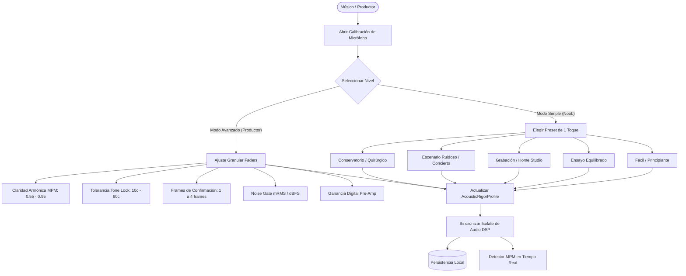
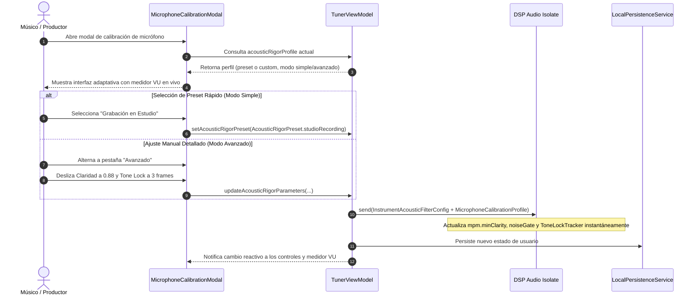

# Caso de Uso Canónico: UC-44 - Presets de Rigurosidad Acústica y Controles Avanzados de Ingesta de Micrófono (Noob vs. Pro)

---

## 1. Metadatos del Caso de Uso

- **ID del Caso de Uso:** `UC-44`
- **Nombre Canónico:** `Presets de Rigurosidad Acústica por Contexto (Ensayo, Grabación, Concierto) y Controles Granulares de Micrófono de Doble Nivel`
- **Fase Asociada:** `Fase 1 / Fase 3 (DSP & Ergonomía Acústica)`
- **Prioridad:** `Alta (Ergonomía, Adaptabilidad a Niveles Técnicos y Entornos Acústicos)`
- **Autor / Arquitecto:** `Equipo de Arquitectura e Ingeniería de Tunner`

---

## 2. Resumen y Alcance (Summary & Scope)

El uso de un afinador y analizador acústico varía drásticamente dependiendo del contexto y de la experiencia del usuario:
- Un **estudiante principiante ("noob")** no cuenta con una técnica de emisión o pulsación perfectamente estable, por lo que un afinador hiper-riguroso causará frustración al descartar notas temblorosas. Requiere máxima tolerancia y respuesta inmediata.
- Un músico en una **sala de ensayo ruidosa** requiere filtrar la batería y los instrumentos de fondo sin perder reactividad.
- Un **productor o ingeniero de grabación** necesita compuertas de ruido milimétricas para eliminar ruidos de ventilador, así como umbrales armónicos elevados ($c \ge 0.88$) para garantizar tomas con afinación perfecta.
- Un músico de **conservatorio** exige tolerancia quirúrgica ($\le 15\text{ cents}$) y pureza tonal absoluta.

Este caso de uso formaliza el subsistema de **Presets de Rigurosidad Acústica y Controles de Micrófono de Doble Nivel (`AcousticRigorProfile`)**, garantizando:
1. **Modo Simplificado ("Para Principiantes / Presets de 1 Toque"):** Ofrece presets pre-calibrados acústicamente:
   - *Fácil / Principiante:* Tolerante a imperfecciones de embocadura, alta sensibilidad, 1 frame de enganche.
   - *Ensayo Equilibrado:* Balance estándar para la práctica diaria.
   - *Grabación en Estudio:* Rechazo de ruido ambiental y alta claridad armónica.
   - *Escenario Ruidoso / En Vivo:* Puerta de ruido elevada y Tone Lock reforzado contra fugas de monitores o batería.
   - *Conservatorio / Máxima Precisión:* Tolerancia en cents mínima y pureza espectral.
2. **Modo Avanzado ("Para Técnicos y Productores"):** Despliega faders y controles numéricos independientes para ajustar la claridad armónica MPM ($c_{\text{min}}$), la desviación máxima en cents ($\Delta_{\text{cents}}$), los frames de confirmación de Tone Lock ($N_{\text{frames}}$), el Noise Gate (mRMS / dBFS), la ganancia digital y el filtrado de corriente continua (DC).
3. **Persistencia y Reactividad In-Process:** Los ajustes se transfieren inmediatamente al Isolate de DSP de audio y se persisten en el almacenamiento local del dispositivo.

---

## 3. Diagramas Formales de Casos de Uso y Secuencia

### 3.1 Diagrama de Casos de Uso (Mermaid)

### 3.2 Diagrama de Flujo y Secuencia (Mermaid)

---

## 4. Precondiciones, Postcondiciones y Flujos

### 4.1 Precondiciones
1. El motor de audio y el Isolate de DSP están inicializados y capturando audio PCM de 16 bits.
2. `TunerViewModel` cuenta con acceso al servicio `IPitchDetectorService`.

### 4.2 Postcondiciones
1. El detector MPM y el Tone Lock aplican los nuevos umbrales de rigurosidad armónica y temporal de inmediato.
2. El perfil seleccionado se almacena en el estado persistente del usuario.
3. El medidor VU y los indicadores visuales reflejan visualmente los nuevos límites acústicos.

### 4.3 Flujo Principal (Happy Path)
1. El usuario abre el modal de Calibración de Micrófono desde el afinador.
2. Observa el selector superior conmutador entre **Presets Sencillos** y **Controles Avanzados**.
3. En la vista sencilla, pulsa el preset deseado (ej. *Fácil / Principiante* para clases iniciales o *Escenario Ruidoso* para ensayo con amplificadores).
4. El sistema configura todos los parámetros de DSP transparentemente.
5. Si el usuario desea mayor control, activa el **Modo Avanzado** y calibra al detalle cada parámetro con feedback auditivo y visual.

---

## 5. Parámetros de los Presets Canónicos

| Preset | Claridad ($c_{\text{min}}$) | Tone Lock ($\Delta_{\text{cents}}$) | Frames de Confirmación | Multiplicador Noise Gate | Caso de Uso Típico |
| :--- | :---: | :---: | :---: | :---: | :--- |
| **Fácil / Principiante** | $0.65$ | $50.0\text{ c}$ | $1\text{ frame}$ (~$23\text{ ms}$) | $0.7\times$ | Principiantes, niños, emisión inestable. |
| **Ensayo Equilibrado** | $0.80$ | $35.0\text{ c}$ | $2\text{ frames}$ (~$46\text{ ms}$) | $1.0\times$ | Práctica individual o en salón silencioso. |
| **Grabación / Estudio** | $0.86$ | $25.0\text{ c}$ | $2\text{ frames}$ (~$46\text{ ms}$) | $1.4\times$ | Microfonía cercana, homestudio, sin ruidos de PC. |
| **Escenario / En Vivo** | $0.88$ | $25.0\text{ c}$ | $3\text{ frames}$ (~$70\text{ ms}$) | $2.0\times$ | Banda en vivo, monitores de retorno, batería cercana. |
| **Conservatorio** | $0.92$ | $15.0\text{ c}$ | $2\text{ frames}$ (~$46\text{ ms}$) | $1.2\times$ | Afinación quirúrgica, luthería, entonación pura. |

---

## 6. Runbook de Pruebas Manuales (Bitácora de QA)

1. **Prueba de Preset Fácil:**
   - Seleccionar preset *Fácil*. Tocar una nota suave o cantar con vibrato amplio.
   - *Resultado esperado:* La aguja reacciona al instante sin perder el tono ante ligeras oscilaciones.
2. **Prueba de Preset Escenario Ruidoso:**
   - Seleccionar preset *Escenario Ruidoso*. Hablar o aplaudir cerca del micrófono.
   - *Resultado esperado:* Los aplausos o ruidos percusivos de menos de 3 frames son bloqueados por completo. Al tocar una nota sostenida del instrumento, se bloquea con estabilidad perfecta.
3. **Prueba de Conmutación Avanzada:**
   - Alternar al switch *Modo Avanzado*. Modificar la claridad a $0.94$.
   - *Resultado esperado:* El preset cambia automáticamente a "Personalizado" y el Isolate exige pureza armónica extrema.
