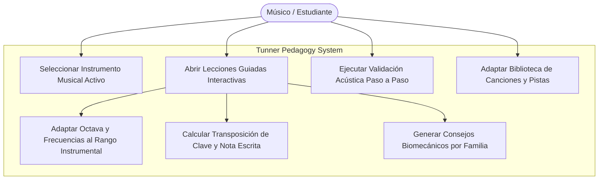
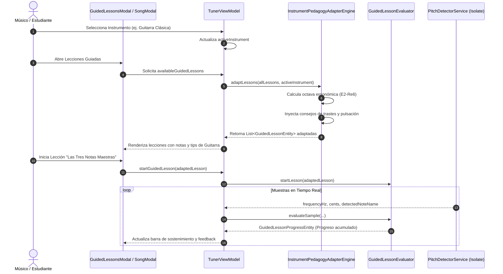

# Caso de Uso 45: Adaptación Universal de Lecciones y Repertorio a Cualquier Instrumento

## Metadatos
- **ID:** `UC-45`
- **Nombre Canónico:** `Adaptación Universal de Lecciones Guiadas y Repertorio Didáctico al Rango y Familia de Cualquier Instrumento`
- **Fase:** Fase 3 (Educación Musical Universal y Monolito Modular)
- **Actores:** Músico / Estudiante (Primario), Motor Pedagógico Multi-Instrumento (Sistema), Afinador Acústico Isolate (Sistema)
- **ADR Relacionado:** `docs/04_adrs/0041_multi_instrument_pedagogy_adaptation_engine.md`
- **Plan de Implementación:** `docs/05_implementation_plans/plan_multi_instrument_lesson_and_repertoire_adaptation.md`

---

## 1. Descripción
Permite que el sistema pedagógico interactivo de **Tunner** (tanto las lecciones estructuradas paso a paso como la biblioteca y descompositor de canciones) se adapte automáticamente al instrumento seleccionado por el músico (Guitarras, Bajos, Violines, Cellos, Trompetas, Saxofones, Trombón, Tuba, Voz, Flautas, etc.).

El motor recalcula en tiempo real:
1. **Tesitura y Octava Óptima:** Desplaza las notas objetivo a una octava cómoda dentro del registro acústico del instrumento sin alterar la armonía ni los intervalos.
2. **Transposición de Tono:** Muestra las notas escritas correspondientes a instrumentos en Si♭, Mi♭, Fa o La, manteniendo la validación acústica en frecuencias de concierto reales ($A_4 = 440\text{ Hz}$).
3. **Consejos Biomecánicos Adaptados:** Reemplaza instrucciones específicas de vientos por consejos adecuados a la familia del instrumento (digitación en trastes para guitarras/bajos, uso y peso del arco para cuerdas frotadas, columna de aire y boquilla para metales y maderas, apoyo costodiafragmático para cantantes).

---

## 2. Diagrama de Casos de Uso (Mermaid)

---

## 3. Diagrama de Secuencia (Mermaid)

---

## 4. Flujo de Trabajo Detallado

### 4.1 Precondiciones
1. El usuario tiene acceso al catálogo de lecciones o al repertorio de canciones.
2. Un perfil de instrumento está seleccionado (por defecto Flauta, o Guitarra, Trompeta, Bajo, etc.).

### 4.2 Flujo Principal (Happy Path)
1. El músico selecciona su instrumento (ej. *Bajo Eléctrico* o *Guitarra*).
2. El músico abre el modal de lecciones guiadas.
3. El sistema identifica la familia (`strings`) y la tesitura grave ($E_1-G_3$ o $E_2-E_4$).
4. El sistema adapta automáticamente los pasos:
   - Las notas se reubican en octavas 2 y 3.
   - Las frecuencias meta se recalculan matemáticamente con precisión de sub-hertz.
   - El consejo pedagógico cambia a recomendaciones de trastes, pulsación con dedos índice/medio y evitar el bending involuntario.
5. El músico toca las notas en su instrumento real; el afinador valida la entonación con la tolerancia establecida.
6. Al completar los pasos requeridos, el sistema felicita al músico con métricas de su instrumento.

### 4.3 Flujos Alternativos y Excepcionales
- **FA-1 (Instrumento Transpositor - ej. Trompeta en Si♭):**
  - El sistema muestra la nota que el músico debe leer en su partitura (ej. $La_4$) junto a la nota de concierto que sonará en el afinador ($Sol_4$, $392.00\text{ Hz}$), evitando confusiones entre lo escrito y lo acústico.
- **FA-2 (Cambio de Instrumento con Lección en Curso):**
  - Si el músico cambia de instrumento mientras una lección está abierta, el ViewModel detecta el cambio, re-adapta la lección al vuelo y conserva el progreso de sostenimiento si la nueva nota meta coincide, o reinicia el paso limpiamente.

---

## 5. Criterios de Aceptación y DoD
1. Todas las lecciones guiadas funcionan y son interpretables en cualquier instrumento de la lista estándar (21 instrumentos).
2. Cero frecuencias inalcanzables o fuera de rango ergonómico.
3. Consejos biomecánicos diferenciados y pertinentes para las 5 familias instrumentales.
4. Cero dependencias externas (Pure Dart en dominio).
5. 100% pruebas automatizadas pasando con 0 lints.

---

## 6. Runbook de Pruebas Manuales (QA Checklist)

| Paso | Acción de Prueba | Resultado Esperado | Estado |
| :---: | :--- | :--- | :---: |
| **01** | Seleccionar *Guitarra Clásica* y abrir lecciones guiadas | La Lección 1 muestra notas en registro de guitarra y consejos de pulsación en trastes | [ ] |
| **02** | Seleccionar *Bajo Eléctrico* o *Contrabajo* | Las notas objetivo se transportan a octavas 1-2 con frecuencias sub-100 Hz y consejos de bajo | [ ] |
| **03** | Seleccionar *Trompeta en Si♭* | Se muestra la nota escrita y la nota de concierto transpuesta con consejos de vibración labial | [ ] |
| **04** | Seleccionar *Violín* o *Violonchelo* | Consejos específicos de arco, afinación sin trastes y articulación de cerdas | [ ] |
| **05** | Tocar notas en el instrumento real | La barra de progreso acumula tiempo sostenido y valida el paso correctamente | [ ] |
