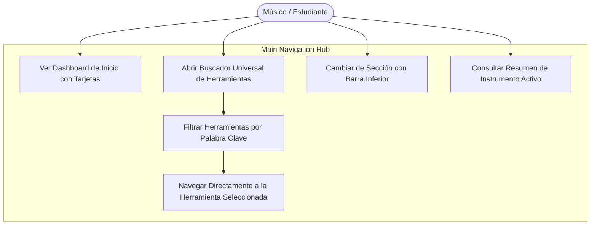
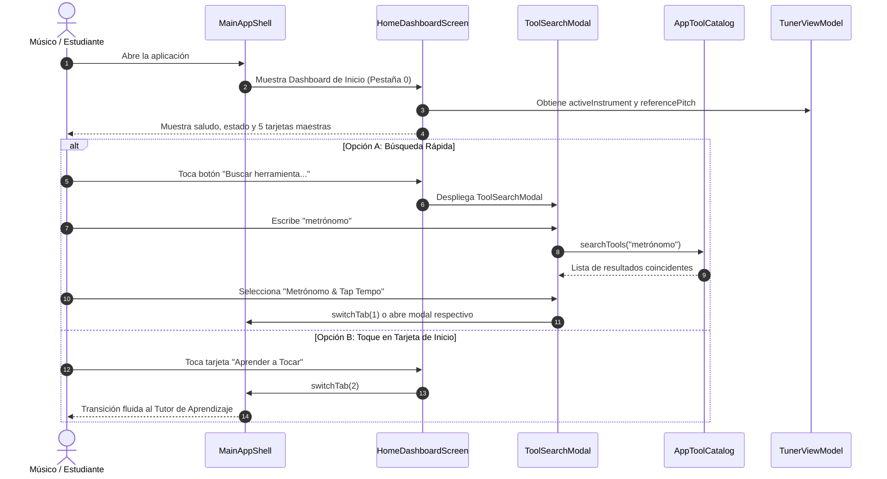

# Caso de Uso 46: Dashboard Principal de Navegación y Buscador Universal de Herramientas

## Metadatos
- **ID:** `UC-46`
- **Nombre Canónico:** `Navegación Intuitiva Mediante Dashboard Principal de Tarjetas y Buscador Universal de Herramientas`
- **Fase:** Fase 3 (Educación Musical Universal y Monolito Modular)
- **Actores:** Músico / Estudiante (Primario), Catálogo de Herramientas (Sistema), Shell de Navegación (Sistema)
- **ADR Relacionado:** `docs/04_adrs/0042_main_dashboard_navigation_and_universal_search.md`
- **Plan de Implementación:** `docs/05_implementation_plans/plan_main_dashboard_navigation_and_tool_search.md`

---

## 1. Descripción
Proporciona una experiencia de navegación centralizada, amigable y moderna en **Tunner** mediante un **Dashboard Principal (Home Hub)** con tarjetas de gran formato y un **Buscador Universal de Herramientas (Spotlight Search)**.

Permite al músico:
1. Acceder de inmediato a las áreas fundamentales de la aplicación sin perderse en una pantalla única sobrecargada de botones técnicos.
2. Buscar por texto libre cualquier función (ej. *"afinador"*, *"guitarra"*, *"metrónomo"*, *"lecciones"*, *"grabar"*, *"autotune"*, *"temperamento"*, *"canciones"*) y abrirla con un solo toque.
3. Alternar entre las vistas principales (Inicio, Afinador, Tutor de Aprendizaje, Estudio de Grabación, Biblioteca) a través de una barra de navegación inferior persistente.

---

## 2. Diagrama de Casos de Uso (Mermaid)

---

## 3. Diagrama de Secuencia (Mermaid)

---

## 4. Flujo de Trabajo Detallado

### 4.1 Precondiciones
1. La aplicación inicia en cualquier plataforma soportada (Móvil, Tablet o Desktop).
2. El `TunerViewModel` está instanciado y conectado al árbol de widgets.

### 4.2 Flujo Principal (Happy Path)
1. El usuario abre la app y observa la pantalla de **Inicio (Dashboard)** con bienvenida amigable y el instrumento musical seleccionado.
2. Observa tarjetas visuales grandes:
   - 🎯 **Afinador de Precisión:** Con botón directo para iniciar afinación inmediata.
   - 🎓 **Aprender a Tocar:** Acceso al tutor interactivo y lecciones adaptadas.
   - 🎙️ **Estudio de Grabación & Práctica:** Registro de tomas, comparador espectral y métricas.
   - 🎼 **Biblioteca de Canciones & Partituras:** Acceso a repertorio curado, importador MusicXML y descompositor.
   - 🔬 **Laboratorio Acústico:** Drones armónicos, temperamentos históricos y autotune.
3. El usuario puede tocar cualquier tarjeta o usar la **Barra de Navegación Inferior** para cambiar de módulo al instante.
4. Si necesita una función específica, toca el buscador superior, escribe lo que busca y la app lo lleva directamente a dicha función.

### 4.3 Flujos Alternativos y Excepcionales
- **FA-1 (Búsqueda sin coincidencias exactas):** Si el término ingresado no coincide, el buscador muestra sugerencias populares (Afinador, Metrónomo, Calibración de Micrófono, Biblioteca).
- **FA-2 (Acción directa desde la búsqueda):** Si la herramienta buscada es un modal (ej. *Calibración de Micrófono* o *Selector de Temperamento*), se abre el modal directamente sin desorientar al usuario.

---

## 5. Criterios de Aceptación y DoD
1. Inicio limpio y despejado con tarjeta de bienvenida y estado del instrumento.
2. Buscador universal funcional con indexación de al menos 15 herramientas y funciones del sistema.
3. Barra de navegación inferior fluida con cambio instantáneo de pestañas sin recargar streams ni Isolates.
4. Cero frame drops (60/120 FPS).
5. Cobertura de pruebas automatizadas al 100% y 0 lints.

---

## 6. Runbook de Pruebas Manuales (QA Checklist)

| Paso | Acción de Prueba | Resultado Esperado | Estado |
| :---: | :--- | :--- | :---: |
| **01** | Abrir la app desde cero | Se muestra la pantalla de Inicio con tarjetas grandes y resumen del instrumento | [ ] |
| **02** | Tocar la barra de búsqueda superior | Se despliega el modal de búsqueda con foco en el teclado | [ ] |
| **03** | Escribir "metrónomo" o "micrófono" | La lista filtra los resultados en tiempo real | [ ] |
| **04** | Seleccionar un resultado de la lista | Se abre la herramienta o se navega a la sección correspondiente | [ ] |
| **05** | Usar la barra de navegación inferior | Se alterna de forma instantánea entre Inicio, Afinador, Tutor, Grabación y Canciones | [ ] |
