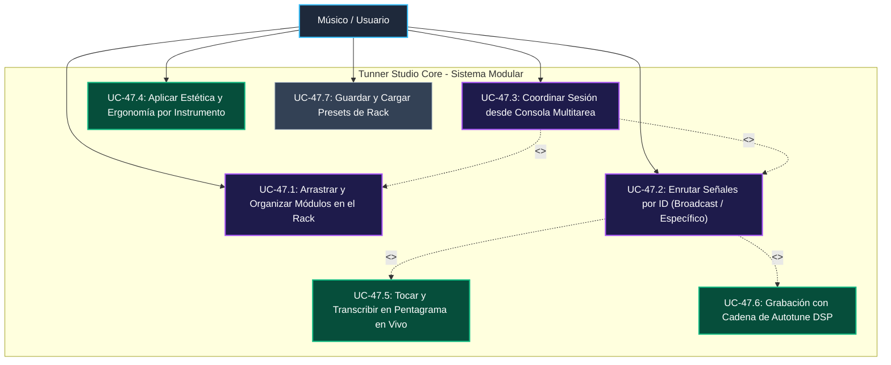
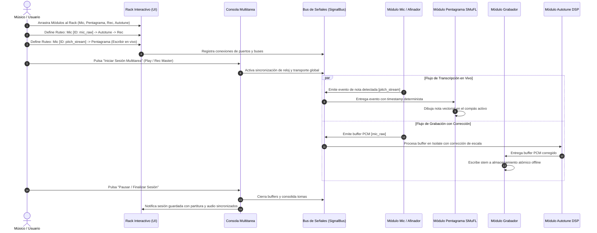

# Caso de Uso 47: Consola Multitarea y Rack de Estudio Modular Interactivo con Estilos por Instrumento

---

## 1. Metadatos del Caso de Uso

- **ID del Caso de Uso:** `UC-47`
- **Nombre:** Consola Multitarea Central y Rack Modular Interactivo con Enrutamiento por IDs y Skins por Instrumento
- **Fase Asociada:** Fase 4 (Estudio de Producción, Usabilidad y Orquestación de Alto Rendimiento)
- **Actores:** Músico Instrumentista, Vocalista, Estudiante de Conservatorio, Productor Musical
- **Complejidad:** Alta (Orquestación multihilo, enrutamiento dinámico de señales, UI reactiva 60/120 FPS y personalización visual)

---

## 2. Descripción General y Propósito

El presente caso de uso formaliza la transformación integral de la experiencia de usuario (UX) de **Tunner**, evolucionando de una interfaz fragmentada de pantallas aisladas y menús modales a un **Rack de Estudio Modular Interactivo (Modular Studio Rack)** gobernado por una **Consola Multitarea Central**. 

El sistema permite al músico:
1. Arrastrar y organizar libremente en pantalla los módulos que requiere para su sesión (Afinador Estroboscópico, Pentagrama en Vivo, Grabador, Autotune, Metrónomo, Dron Armónico, Lecciones).
2. Interconectar módulos entre sí mediante un sistema formal de **IDs de Señal y Buses (Signal Bus / Port IDs)**, admitiendo transmisiones punto a punto (específicas) o difusión global (broadcast).
3. Personalizar la estética visual de cada módulo adaptada al **instrumento activo y su estilo físico/acústico** (p. ej., veteado y perillas analógicas para guitarras, marfil y latón para vientos y piano, diapasón sin trastes para cuerdas frotadas, y estética vocal de estudio con curvas de formantes).
4. Sincronizar y coordinar todas las tareas en ejecución sin desfasaje temporal desde la **Consola Multitarea**.

---

## 3. Diagrama de Casos de Uso (Mermaid)

---

## 4. Diagrama de Secuencia y Flujo de Interconexión (Mermaid)

---

## 5. Especificación de Flujos de Trabajo

### 5.1 Precondiciones
1. Permiso de micrófono concedido en el sistema operativo local.
2. Motor de audio e Isolates de reloj y DSP inicializados en reposo.
3. Al menos un instrumento musical seleccionado (por defecto Flauta de Concierto en C o Guitarra Estándar en E).

### 5.2 Flujo Principal (Happy Path)
1. El usuario visualiza el Rack de Estudio y la Consola Multitarea en el encabezado o dock inferior.
2. El usuario abre la bandeja de módulos (`Rack Drawer`) y arrastra los módulos deseados al lienzo:
   - Módulo 1: *Afinador Estroboscópico de Alta Precisión*.
   - Módulo 2: *Pentagrama Vectorial en Tiempo Real (Mic to Score)*.
   - Módulo 3: *Grabador de Audio & Autotune DSP*.
3. El usuario configura la interconexión mediante la Consola Multitarea:
   - Selecciona el puerto de salida de afinación (`pitch.master`) y lo asigna a la entrada de transcripción del Pentagrama.
   - Conecta la salida de audio del micrófono al procesador de Autotune y su salida al Grabador.
4. El usuario selecciona el estilo visual de instrumento (p. ej., *Vintage Wood & Brass* o *Modern Studio Carbon*). La UI adapta colores de acento, texturas de tarjeta, indicadores de posición de digitación y diales de control.
5. El usuario pulsa `Iniciar Sesión` en la Consola Multitarea.
6. Todos los módulos inician su ejecución sincronizada: mientras el usuario interpreta su instrumento, el afinador muestra la desviación, el pentagrama escribe las figuras rítmicas y el grabador captura el audio con autotune sin latencia perceptible ($\le 10\text{ ms}$).
7. El usuario detiene la sesión; la consola consolida las pistas y la partitura generada queda lista para edición o exportación.

### 5.3 Flujos Alternativos y Excepciones
- **A1: Desconexión o Cambio de Ruteo en Caliente (Hot-Swapping):** El usuario desconecta un cable o cambia un ID de bus mientras se ejecuta la sesión. El `SignalBus` desacopla el consumidor de forma segura sin caídas de frame ni pérdidas de buffer PCM.
- **E1: Silencio o Ruido Ambiental por debajo del Noise Gate:** Los módulos que consumen eventos de tono no reciben datos fantasma; el pentagrama descansa (escribe silencios musicales coherentes con el tempo).
- **E2: Sobrecarga en Dispositivos de Recursos Limitados:** Si el cómputo de autotune en vivo más el renderizado SMuFL supera el umbral de 16 ms por frame, la Consola Multitarea degrada dinámicamente la tasa de refresco del espectrograma secundario, priorizando la precisión del audio y la estabilidad del reloj de grabación.

---

## 6. Postcondiciones y Criterios de Éxito
- **Postcondición Exitosa:** El rack mantiene el estado interactivo, el audio grabado conserva sincronía exacta con las notas transcritas y el usuario puede guardar la disposición completa como un Preset personalizado.
- **Métrica de Rendimiento:** Latencia de visualización y ruteo entre módulos $\le 10\text{ ms}$; fluidez de renderizado a $60/120\text{ FPS}$; cero bucles de espera activa (*zero busy-waiting*).
