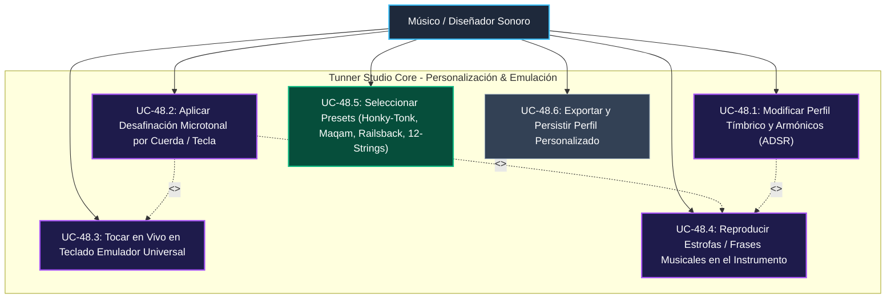
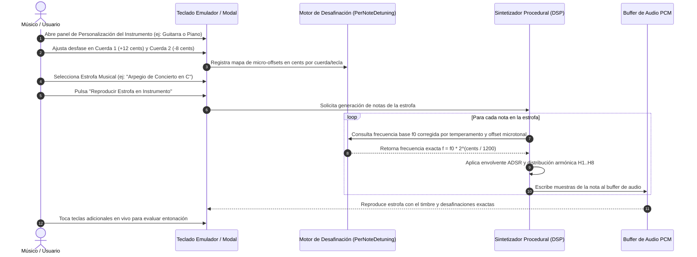

# Caso de Uso 48: Personalización Acústica Microtonal por Instrumento y Teclado Emulador de Estrofas

---

## 1. Metadatos del Caso de Uso

- **ID del Caso de Uso:** `UC-48`
- **Nombre:** Personalización Tímbrica, Desafinación Microtonal Individual por Tecla/Cuerda y Teclado Emulador de Estrofas Musicales
- **Fase Asociada:** Fase 4 (Estudio de Producción, Orquestación y Emulación Universal)
- **Actores:** Músico Solista, Luthier Virtual, Diseñador Sonoro, Estudiante de Conservatorio
- **Complejidad:** Alta (Cálculo microtonal en coma flotante, síntesis procedural determinista en tiempo real, secuenciador de estrofas y UI polifónica)

---

## 2. Descripción General y Propósito

El presente caso de uso faculta al usuario para personalizar en profundidad cualquier instrumento musical registrado en el catálogo universal:
1. **Calibración Tímbrica & Tonal:** Ajuste de armónicos $H_1 \dots H_8$, curva de envolvente ADSR (ataque, decaimiento, sostenimiento, apagado) y brillo acústico.
2. **Afinación Base y Temperamentos:** Tono de referencia $A_4$ ($415\text{ Hz}$ a $466\text{ Hz}$) y aplicación de temperamentos históricos (Igual, Pitagórico, Justo, Mesotónico, Werckmeister, Valotti).
3. **Desafinación Microtonal por Tecla o Cuerda (Per-Key / Per-String Detuning):** Modificación micrométrica en cents ($\pm 50.0\text{ cents}$) de cuerdas individuales (ej. Drop D, afinaciones abiertas, desafinación chorus de 12 cuerdas) o teclas específicas de piano (afinación estirada de Railsback, pianos desafinados tipo Honky-Tonk o escalas microtonales Maqam de cuartos de tono).
4. **Teclado Emulador Universal y Secuenciador de Frases / Estrofas:** Teclado interactivo polifónico de grado conservatorio que permite tocar notas en vivo o reproducir secuencias melódicas estructuradas (estrofas, arpegios, escalas y temas canónicos) aplicando en tiempo real todas las personalizaciones y desafinaciones configuradas.

---

## 3. Diagrama de Casos de Uso (Mermaid)

---

## 4. Diagrama de Secuencia y Flujo de Emulación (Mermaid)

---

## 5. Especificación de Flujos de Trabajo

### 5.1 Precondiciones
1. Instrumento universal activo seleccionado en la sesión (ej. Guitarra Clásica, Piano de Cola, Violín, Marimba).
2. Motor de audio procedural inicializado.

### 5.2 Flujo Principal (Happy Path)
1. El usuario abre el panel de **Personalización de Instrumento** desde la Consola Multitarea o el encabezado del módulo.
2. El usuario ajusta los parámetros tímbricos (ataque, brillo de armónicos).
3. El usuario ajusta la afinación microtonal:
   - Para instrumentos de cuerdas: visualiza la lista de cuerdas con su nota nominal y sliders de cents ($\pm 50.0\text{ cents}$) para desafinar individualmente una cuerda.
   - Para teclados/láminas: visualiza las teclas cromáticas con opciones de temperamento histórico y desafinación tecla a tecla.
4. El usuario abre el **Teclado Emulador Universal**.
5. El usuario puede:
   - Tocar teclas individuales o acordes; el sintetizador calcula al vuelo la frecuencia con el micro-offset exacto de esa tecla o cuerda.
   - Seleccionar una **Estrofa Musical** del catálogo (ej. *Preludio Clásico*, *Melodía Andina*, *Línea de Bajo*, *Cadencia Barroca*) y pulsar `Reproducir Estrofa`.
6. El instrumento emula la frase musical con los parámetros sonoros y la afinación/desafinación exacta definida por el usuario.

### 5.3 Flujos Alternativos y Excepciones
- **A1: Presets Rápidos de Desafinación:** El usuario selecciona presets inmediatos como *Honky-Tonk Detune* (desafinación aleatoria de $\pm 10\text{ cents}$ en unísonos de piano), *Efecto 12 Cuerdas* (coro de octavas con ligera desafinación) o *Escala de Cuartos de Tono Árabe (Bayati / Rast)* donde el $E$ o $B$ se bajan exactamente $-50\text{ cents}$.
- **E1: Desafinaciones Fuera de Rango:** El sistema acota matemáticamente los offsets microtonales entre $-100.0$ y $+100.0\text{ cents}$ para evitar inversiones aberrantes de semitonos adyacentes.

---

## 6. Postcondiciones y Criterios de Éxito
- **Postcondición Exitosa:** El usuario puede emular cualquier nota o frase con la afinación y timbre personalizados, y el perfil se guarda atómicamente para futuras sesiones.
- **Rendimiento:** Latencia de síntesis y respuesta táctil $\le 10\text{ ms}$; cálculo de offsets en tiempo constante $O(1)$.
