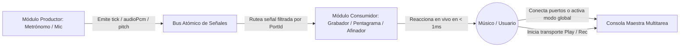
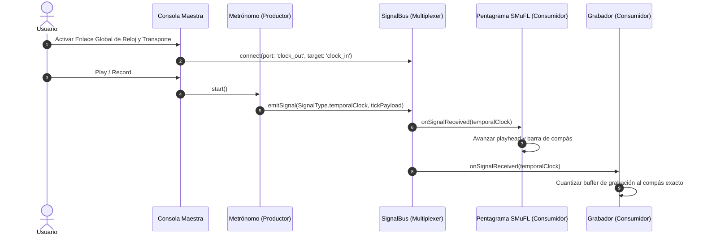

# Caso de Uso 49: Interoperabilidad Atómica y Sinergia de Herramientas de Estudio

## 1. Descripción
Permitir que cualquier herramienta o módulo del Rack de Estudio interactúe de forma atómica y sinérgica con las demás mediante el envío y recepción de eventos tipados a través del `SignalBus` maestro, garantizando sincronización rítmica, propagación de afinación, ruteo de audio PCM y control de transporte sin dependencias directas entre módulos.

---

## 2. Diagrama de Casos de Uso (Mermaid)

---

## 3. Diagrama de Secuencia (Mermaid)

---

## 4. Precondiciones
1. Al menos dos módulos deben estar instanciados en el `ModularRackViewModel`.
2. El `SignalBus` debe estar inicializado en memoria.
3. Los módulos destino deben tener activado el estado `isPoweredOn = true`.

---

## 5. Flujo Principal
1. El usuario abre la matriz de conexiones o la consola multitarea.
2. El usuario establece una conexión entre un puerto emisor (ej: `metronome.clock_out`) y uno o varios puertos receptores (ej: `score.clock_in`, `recorder.clock_in`).
3. El módulo emisor genera un evento atómico de dominio (`AtomicSignalEvent`).
4. El `SignalBus` valida los tipos de datos compatibles (`SignalType`) y entrega el evento al flujo de los suscriptores en $< 1\text{ ms}$.
5. Los módulos receptores actualizan su estado interno y renderizan la respuesta visual o procesan la señal de audio sin bloquear el hilo principal.

---

## 6. Flujos Alternativos y Excepciones
- **Módulo Destino Apagado (`isPoweredOn = false`):** La señal se descarta silenciosamente para ese módulo específico sin afectar a los demás suscriptores.
- **Incompatibilidad de Señal:** Si se intenta conectar un puerto `audioPcm` a un puerto `temporalClock`, el sistema rechaza la conexión con `SignalMismatchException` y notifica al usuario visualmente.
- **Desconexión en Caliente:** Si un módulo es eliminado del rack, todas sus suscripciones y conexiones en el `SignalBus` se cancelan de inmediato sin memory leaks.
