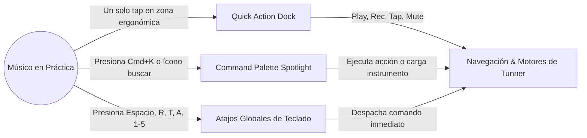
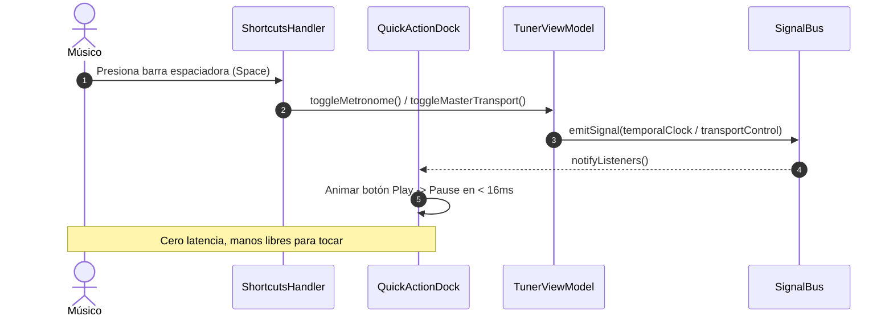

# Caso de Uso 50: Atajos Rápidos, Quick Action Dock y Command Palette Profesional

## 1. Descripción
Permitir al músico controlar las funciones críticas de Tunner (Play/Pause de transporte, grabación rápida de tomas, tap tempo, cambio de instrumento y afinación) con fricción operativa cero mediante un Dock de acción rápida flotante ergonómico, atajos de hardware/teclado y un buscador de comandos estilo Spotlight (`Cmd/Ctrl + K`).

---

## 2. Diagrama de Casos de Uso (Mermaid)

---

## 3. Diagrama de Secuencia (Mermaid)

---

## 4. Precondiciones
1. La aplicación se encuentra en ejecución en cualquier pantalla.
2. Los modelos de estado (`TunerViewModel`, `ModularRackViewModel`) están inicializados.

---

## 5. Flujo Principal
1. El usuario presiona un botón del Dock flotante (ej: `REC` o `TAP`) o presiona una tecla de atajo (ej: `R` o `T`).
2. El sistema detecta el comando instantáneamente sin necesidad de cambiar de pantalla.
3. El motor de audio reacciona en $< 10\text{ ms}$ (inicia conteo, graba toma o calibra tempo).
4. El Dock actualiza visualmente su estado mediante una animación fluida con el tema visual activo.

---

## 6. Flujos Alternativos y Excepciones
- **Foco en un Campo de Texto:** Si el usuario está escribiendo un nombre de canción o nota en un campo de texto, los atajos de teclado de un solo carácter se desactivan para permitir la escritura normal.
- **Modo Pantalla Completa / Partitura:** El Dock cuenta con un botón para ocultarse/minimizarse y no tapar notas en compases inferiores si el usuario lo prefiere.
