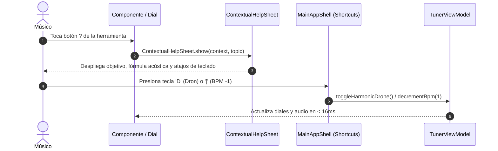

# Caso de Uso 51: Atajos de Grado Photoshop y Sistema de Ayuda Contextual (?)

## 1. Descripción
Permitir el control total y sinérgico de cualquier herramienta de Tunner mediante teclas nemotécnicas directas de una sola tecla (estilo Adobe Photoshop / DAWs profesionales) y brindar soporte de aprendizaje inmediato mediante botones interactivos de ayuda contextual ("?") en cada componente.

---

## 2. Diagrama de Casos de Uso (Mermaid)

```mermaid
flowchart LR
    User((Músico / Usuario))
    ShortcutsEngine[Motor de Atajos Photoshop-Grade]
    HelpSystem[Sistema de Ayuda Contextual (?)]
    ToolCard[Herramienta en Pantalla]
    TransportBus[Bus de Transporte & Audio]

    User -->|Presiona tecla: A, M, S, R, D, V, F, C, L, K| ShortcutsEngine
    User -->|Toca el botón ? en cualquier dial o módulo| HelpSystem
    ShortcutsEngine -->|Enfoca, alterna o modifica parámetro| TransportBus
    HelpSystem -->|Muestra fundamento acústico y teclas rápidas| ToolCard
```

---

## 3. Diagrama de Secuencia (Mermaid)



---

## 4. Precondiciones
- La aplicación se encuentra en ejecución en cualquier dispositivo o escritorio.
- El usuario puede interactuar vía pantalla táctil, ratón, teclado físico o pedalera.

---

## 5. Flujo Principal
1. El usuario presiona una tecla nemotécnica (ej: `D` para Dron o `[` para bajar tempo).
2. El sistema despacha la acción sin necesidad de abrir menús.
3. El usuario puede tocar cualquier icono `?` en un módulo para entender de inmediato qué hace la herramienta y qué teclas la controlan.
