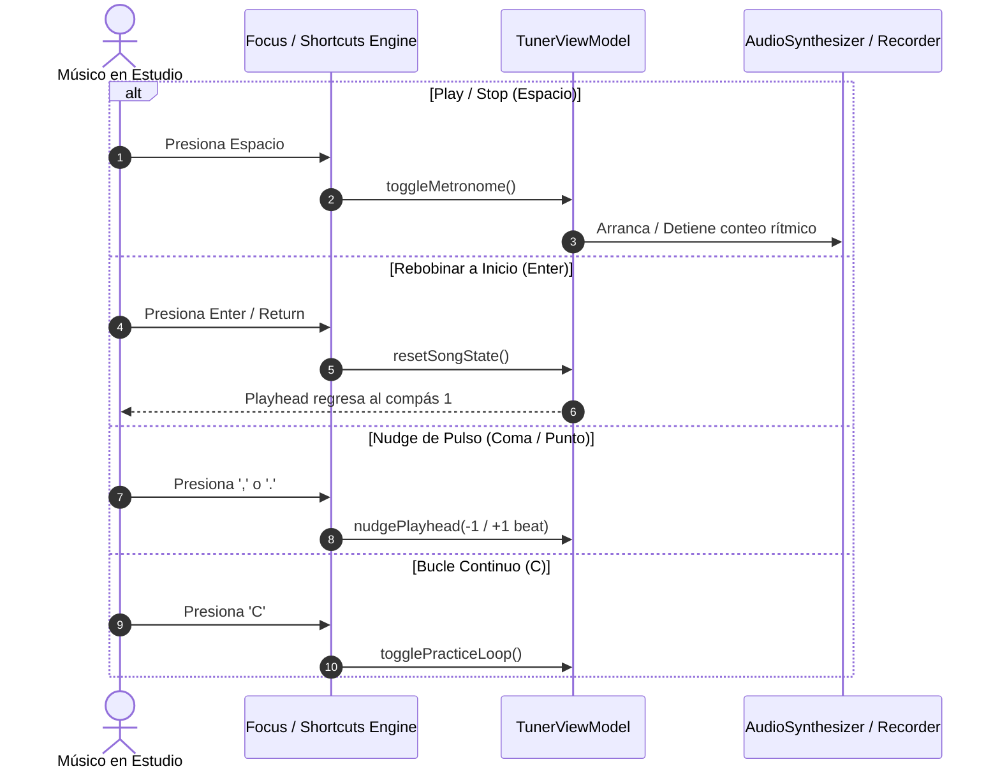

# Caso de Uso 52: Integración de Atajos Globales de Memoria Muscular (Ableton/Logic/Pro Tools)

## 1. Descripción
Proporcionar a los músicos y productores un conjunto completo de comandos rápidos basados en las convenciones universales de transporte, edición y selección de herramientas de las mejores DAWs de la industria (Ableton Live, Logic Pro, Avid Pro Tools y Photoshop), logrando velocidad operativa máxima con cero fricción cognitiva.

---

## 2. Diagrama de Flujo / Secuencia de Control de Transporte (Mermaid)

---

## 3. Precondiciones
1. La aplicación Tunner está activa y con foco en cualquier pestaña.
2. Los controladores de teclado o pedales Bluetooth envían eventos de teclado estándar del sistema operativo.

---

## 4. Flujo Principal
1. El usuario presiona una tecla de transporte estándar (`Espacio`, `Enter`, `C`, `R`, `,`, `.`).
2. El despachador de atajos en `MainAppShell` intercepta la tecla y ejecuta la acción atómica correspondiente en el `TunerViewModel`.
3. La interfaz visual y el motor de sonido responden en tiempo real ($< 16\text{ ms}$).
