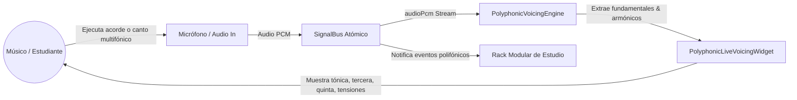
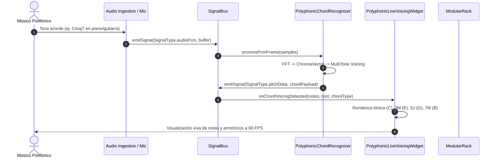

# Caso de Uso 53: Visualizador Polifónico Armónico y Descomposición de Armónicos en Tiempo Real

## 1. Descripción
Permitir a los músicos, instrumentistas polifónicos (pianistas, guitarristas, cuerdas) y vocalistas observar en tiempo real la descomposición física y teórica de acordes complejos y espectros armónicos ($H_1 \dots H_8$), integrando el análisis cromático (`ChromaVectorCalculator`), detección multitonos y representación gráfica continua tanto en el mástil/teclado como en la matriz de sinergia del `SignalBus`.

---

## 2. Diagrama de Casos de Uso (Mermaid)

---

## 3. Diagrama de Secuencia (Mermaid)

---

## 4. Precondiciones
1. La aplicación Tunner se encuentra activa con permisos concedidos para captura de audio local.
2. El motor de análisis polifónico (`ChromaVectorCalculator` / `PolyphonicChordRecognizer`) está inicializado y conectado al `SignalBus`.

---

## 5. Postcondiciones
1. La interfaz visual actualiza el desglose exacto de notas simultáneas y el nombre del acorde armónico sin superar los 10 ms de latencia acumulada.
2. Los eventos polifónicos quedan disponibles en el `SignalBus` para ser consumidos por el grabador o el pentagrama interactivo.

---

## 6. Flujo Principal
1. El músico selecciona el módulo o vista de Visualización Polifónica (vía atajo, dock o menú).
2. El usuario ejecuta un acorde o conjunto de notas polifónicas en su instrumento acústico o electroacústico.
3. El micrófono captura el bloque PCM y lo transmite al reconocedor polifónico.
4. El algoritmo calcula el vector cromático y detecta los picos fundamentales filtrando resonancias armónicas secundarias.
5. El componente `PolyphonicLiveVoicingWidget` representa gráficamente cada nota con su intervalo relativo (Tónica, 3ª, 5ª, 7ª, tensiones 9ª/11ª) con codificación de color armónica.
6. El usuario visualiza la estabilidad de cada voz y afina individualmente las cuerdas o notas que presenten desvío en cents.

---

## 7. Flujos Alternativos y Manejo de Errores
- **Nivel de Señal Insuficiente (Bajo el Umbral de Ruido):** El visualizador permanece en modo de reposo elegante ("Esperando señal polifónica...") sin disparar cálculos espurios.
- **Señal Monofónica o Nota Simple:** El sistema identifica la fundamental única e indica visualmente "Voz monofónica detectada", sugiriendo tocar más notas para completar el acorde.
- **Acorde Disconforme / Microtonal:** El visualizador marca las frecuencias con su desvío en cents respecto a la escala temperada para permitir afinaciones no estándar o temperamentos históricos.
