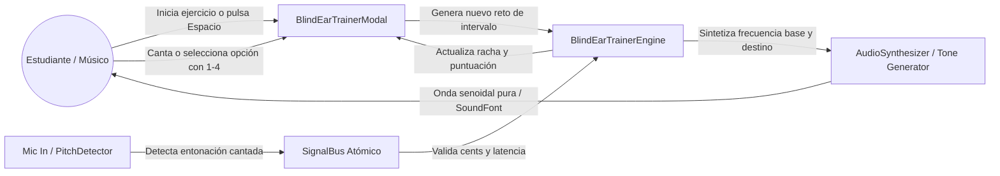
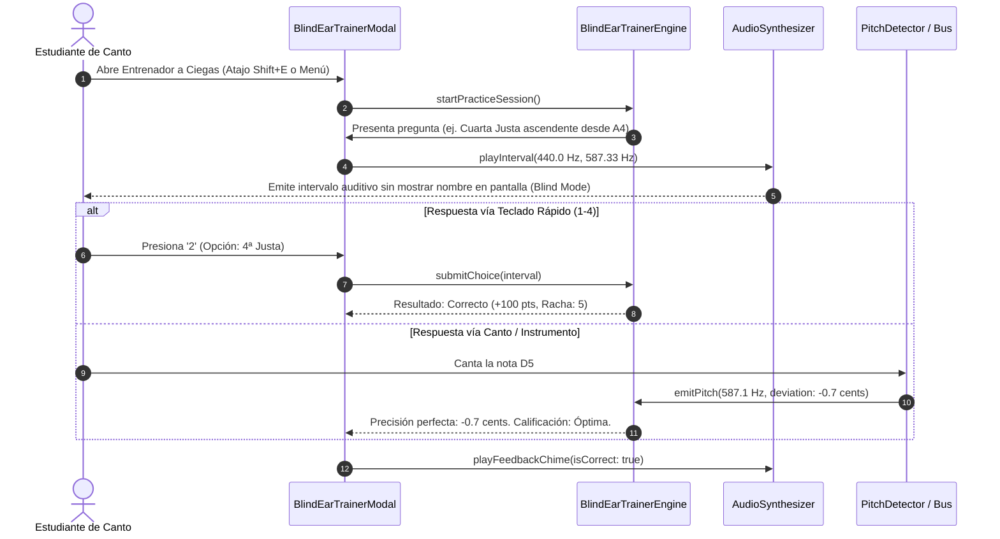

# Caso de Uso 54: Entrenador Auditivo a Ciegas y Gamificación de Intervalos (Blind Ear Pitch Trainer)

## 1. Descripción
Permitir a estudiantes de conservatorio, cantantes e instrumentistas perfeccionar la discriminación de intervalos musicales, afinación relativa y reconocimiento tímbrico sin muletas visuales (Modo "A Ciegas"), mediante síntesis pura de frecuencias de referencia, captura de respuesta vocal o instrumental en tiempo real, medición de precisión en cents y atajos ergonómicos de teclado (`1-4`, `Espacio`, `C`).

---

## 2. Diagrama de Casos de Uso (Mermaid)

---

## 3. Diagrama de Secuencia (Mermaid)

---

## 4. Precondiciones
1. La aplicación Tunner está ejecutándose y los motores de síntesis de audio (`AudioSynthesizerService`) y detección de tono están disponibles.
2. Los atajos de teclado primarios están activos en el shell de la aplicación.

---

## 5. Postcondiciones
1. Las métricas de desempeño pedagógico (racha de aciertos, desvío promedio en cents, tiempo de respuesta en milisegundos) se registran en la sesión del usuario.
2. El estudiante recibe retroalimentación inmediata auditiva y visual (revelando la respuesta una vez contestada).

---

## 6. Flujo Principal
1. El estudiante activa el Entrenador Auditivo a Ciegas utilizando el atajo de teclado o seleccionándolo en la barra de herramientas.
2. El sistema configura el modo "Pantalla Oculta / Blind Canvas", donde las pistas visuales de frecuencia se apagan temporalmente.
3. El motor sintetiza el intervalo musical objetivo (e.g. Segunda menor, Tercera mayor, Quinta justa, etc.).
4. El usuario puede volver a escuchar el estímulo pulsando la tecla `Espacio`.
5. El usuario responde seleccionando una de las 4 opciones aleatorizadas mediante las teclas numéricas `1`, `2`, `3` o `4`, o bien entonando la nota en el micrófono.
6. El motor valida la respuesta y entrega el desglose teórico (semitonos, relación matemática de frecuencias $f_2/f_1$, desvío en cents).
7. La sesión continúa fluidamente al siguiente ejercicio garantizando cero tiempos muertos.

---

## 7. Flujos Alternativos y Manejo de Errores
- **Repetición del Estímulo Auditivo:** Si el estudiante no identificó el intervalo al primer intento, la barra espaciadora (`Espacio`) repite el tono inmediatamente sin penalización.
- **Cambio de Rango Vocal:** Si el usuario no puede entonar una frecuencia aguda, puede cambiar el registro base (Bajo, Barítono, Tenor, Contralto, Soprano) para centrar los intervalos en su tesitura.
- **Salida o Pausa:** El usuario puede pulsar `Escape` en cualquier momento para pausar o cerrar el ejercicio y retornar al panel general conservando su estadística de sesión.
