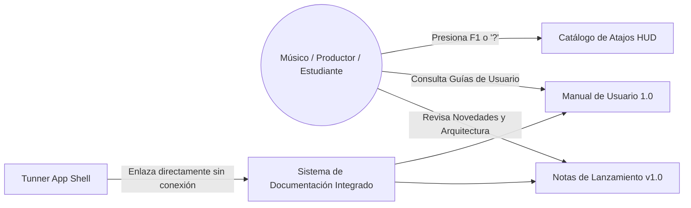
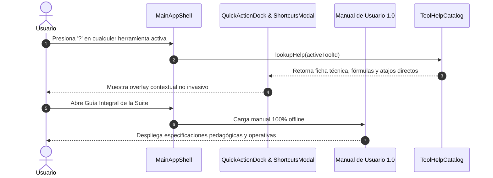

# Caso de Uso 55: Suite de Lanzamiento 1.0, Manual de Usuario y Notas de Versión Multiplataforma

## 1. Descripción
Consolidar el lanzamiento formal de la versión 1.0 de Tunner como una suite acústica y pedagógica de grado profesional y conservatorio. Proporcionar documentación integral de usuario, manual exhaustivo de referencia para todos los módulos y herramientas, catálogo unificado de atajos de teclado y notas de lanzamiento detallando la cobertura completa de los 55 casos de uso de la arquitectura.

---

## 2. Diagrama de Casos de Uso (Mermaid)

---

## 3. Diagrama de Secuencia (Mermaid)

---

## 4. Precondiciones
1. La aplicación Tunner se encuentra empaquetada o ejecutándose en modo local.
2. Todos los archivos de documentación técnica, manuales y notas de versión están integrados en el árbol del proyecto sin enlaces externos que requieran internet.

---

## 5. Postcondiciones
1. El usuario tiene acceso instantáneo y fuera de línea a la documentación operativa completa de Tunner 1.0.
2. Cada herramienta dispone de ayuda contextual integrada accesible con una sola pulsación (`?`).

---

## 6. Flujo Principal
1. El usuario navega por la interfaz de Tunner en su plataforma (Linux, macOS, Windows, Android, iOS o Web).
2. Para conocer las capacidades avanzadas de una herramienta, el usuario pulsa el ícono de ayuda `?` o el atajo `F1`.
3. El sistema despliega el modal interactivo con la descripción funcional, el fundamento acústico, los casos de uso sugeridos y la lista completa de atajos de teclado compatibles con DAWs estándar.
4. El usuario puede acceder al Manual de Usuario 1.0 completo para profundizar en la teoría de armónicos, afinación histórica, entrenamiento de oído y exportación MusicXML/PDF.

---

## 7. Flujos Alternativos y Manejo de Errores
- **Visualización en Pantallas Pequeñas (Mobile):** La documentación y el catálogo de atajos se adaptan de forma reactiva a formato modal scrollable con tipografía responsive.
- **Acceso Directo por Paleta de Comandos (`Ctrl+K` / `Cmd+K`):** Si el usuario busca "Manual", "Ayuda" o "Notas de Versión", la paleta de comandos lo conduce inmediatamente a la sección correspondiente.
