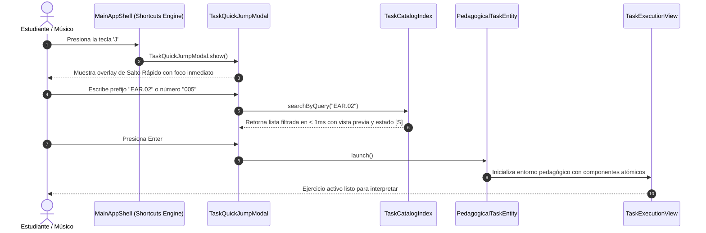

# Caso de Uso 56: Sistema Canónico de Taxonomía de Tareas (TTC) y Salto Rápido ("Jump to Task")

## 1. Descripción
Proporcionar a los músicos, estudiantes y docentes de conservatorio un sistema formal de catalogación universal (`TaskTaxonomyCode`), indexación en memoria con tiempo de acceso $O(1)$ y un mecanismo de navegación ultrarrápido activado por teclado (tecla `J` o `Cmd+J`) para localizar, filtrar y ejecutar cualquier ejercicio o lección dentro de un catálogo masivo sin fricción cognitiva.

---

## 2. Diagrama de Casos de Uso (Mermaid)

```mermaid
flowchart LR
    Usuario((Músico / Estudiante / Docente))
    JumpModal[TaskQuickJumpModal]
    CatalogIndex[TaskCatalogIndex]
    CommandPalette[ProCommandPalette]
    TaskEngine[PedagogicalTaskEngine]
    TaskUI[TaskExecutionView]

    Usuario -->|Presiona 'J' o 'Cmd+J'| JumpModal
    Usuario -->|Escribe código TTC o búsqueda| JumpModal
    Usuario -->|Busca tareas en Spotlight| CommandPalette
    JumpModal -->|Consulta prefijos O(1)| CatalogIndex
    CommandPalette -->|Consulta tareas indexadas| CatalogIndex
    JumpModal -->|Selecciona tarea con Enter| TaskEngine
    TaskEngine -->|Despliega interfaz atómica| TaskUI
```

---

## 3. Diagrama de Secuencia (Mermaid)



---

## 4. Precondiciones
1. La aplicación Tunner está activa en cualquier pestaña o espacio de trabajo.
2. El catálogo de tareas `TaskCatalogIndex` ha sido cargado e indexado en memoria al arrancar la sesión.

---

## 5. Postcondiciones
1. La tarea seleccionada se despliega en pantalla con su configuración de instrumento, tempo, clave y tolerancia en cents.
2. La clave de historial de la tarea se actualiza con la fecha y hora del último acceso.

---

## 6. Flujo Principal
1. El usuario pulsa la tecla `J` (o `Cmd+J` / `Ctrl+J`) desde cualquier vista.
2. El sistema despliega de forma instantánea el modal flotante de Salto Rápido con el cursor enfocado en el campo de búsqueda.
3. El usuario ingresa un código taxonómico (ej: `EAR.01.INTV.001`), un dominio (`RHY`), un nivel (`03`), una palabra clave (`síncopa`) o un número secuencial (`012`).
4. El motor `TaskCatalogIndex` devuelve en tiempo real los resultados ordenados por coincidencia exacta y cercanía jerárquica.
5. El usuario navega con las flechas $\uparrow / \downarrow$ y pulsa `Enter`.
6. El modal se cierra y el entorno ejecuta la tarea seleccionada.

---

## 7. Flujos Alternativos y Manejo de Errores
- **Código No Encontrado:** Si el usuario ingresa un código que no existe (ej: `PCH.09.XYZ.999`), el sistema muestra: *"Código no encontrado. ¿Quisiste decir PCH.04 o buscar por palabra clave?"* ofreciendo los 3 resultados más afines.
- **Cancelación Inmediata:** Si el usuario pulsa `Escape`, el modal se cierra devolviendo el foco exacto a la herramienta que estaba activa antes del salto.
