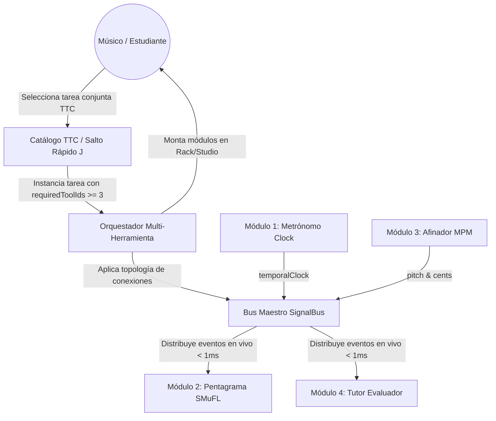
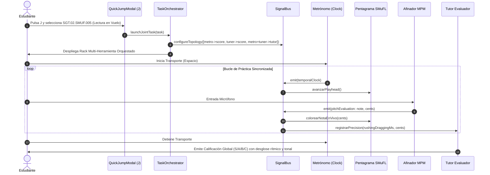

# Caso de Uso 57: Tareas Conjuntas Multi-Herramienta y Orquestación Atómica de Señales

## 1. Descripción
Permitir la ejecución de tareas pedagógicas y técnicas complejas que orquestan sincrónicamente tres o más herramientas de Tunner (`strobe_tuner`, `metronome`, `score_notation`, `practice_recorder`, `harmonic_drone`, `spectrogram`, `chord_analyzer`, `guided_lessons`, `master_keyboard`). El sistema configura automáticamente la topología de cableado virtual en el `SignalBus`, distribuye los eventos de reloj temporal y audio PCM, y presenta un tablero unificado de ejecución.

---

## 2. Diagrama de Casos de Uso (Mermaid)

---

## 3. Diagrama de Secuencia (Mermaid)

---

## 4. Precondiciones
1. La tarea seleccionada debe ser una instancia de `PedagogicalTaskEntity` con `requiredToolIds.length >= 3`.
2. Las herramientas requeridas deben estar registradas en el catálogo de herramientas del sistema.
3. El motor de audio y el `SignalBus` deben estar inicializados sin bloqueos.

---

## 5. Flujo Principal
1. El usuario selecciona una tarea conjunta mediante el catálogo TTC, la consola de navegación o el atajo `J`.
2. El sistema reconoce la bandera `isMultiTool == true` y extrae la topología de conexiones requerida.
3. Se inicializan y montan las herramientas requeridas en la vista de práctica multi-herramienta.
4. El `SignalBus` activa las suscripciones cruzadas entre puertos de reloj, tono y audio.
5. El usuario inicia la sesión de práctica; cada herramienta recibe y transmite sus señales de forma reactiva sin busy-waiting.
6. Al finalizar el ejercicio, se consolida la evaluación pedagógica multidisciplinaria.

---

## 6. Flujos Alternativos y Excepciones
- **Micrófono sin permisos:** Si una de las herramientas requiere entrada acústica y no hay permisos de grabación, el sistema alerta amigablemente y permite practicar en modo emulación o con entrada MIDI/Teclado.
- **Rendimiento degradado del dispositivo:** Si la tasa de refresco cae por debajo de 60 FPS durante la multitarea, las herramientas visuales no críticas reducen su muestreo FFT sin alterar la precisión del reloj temporal del metrónomo.
