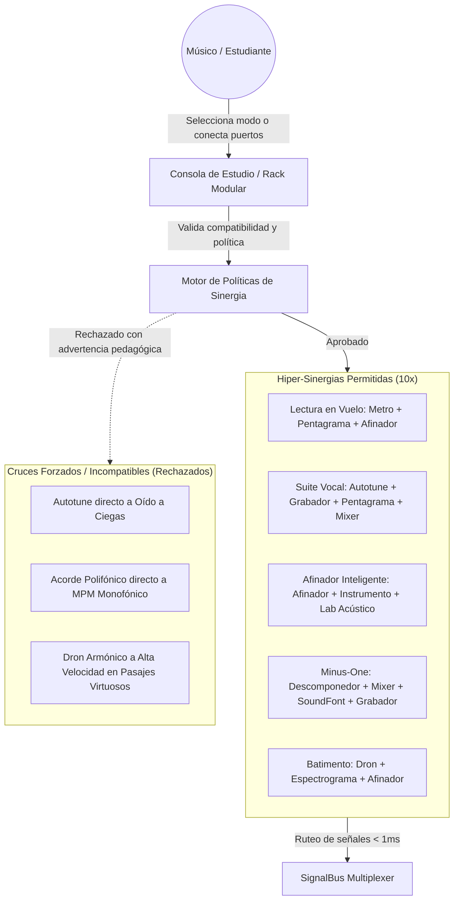
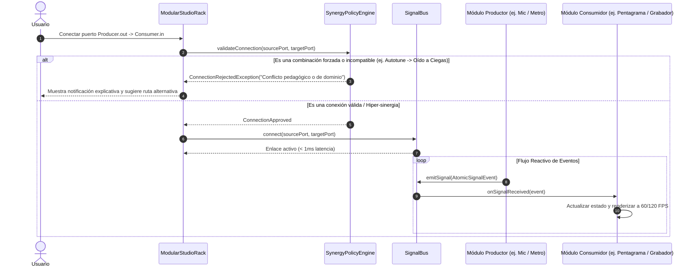

# Caso de Uso 58: Sinergia Integral Inter-Herramientas, Detección de Fricción y Orquestación Modular

## 1. Descripción
Formalizar el protocolo por el cual las herramientas de Tunner intercambian eventos estructurados mediante la matriz del `SignalBus` maestro, garantizando la activación de hiper-sinergias de alto impacto (Lectura en Vuelo, Afinador Inteligente, Suite Vocal Autotune, Descomponedor Minus-One) y previniendo de forma determinista los cruces forzados o incompatibles (ej. Autotune en Entrenador a Ciegas, sobrecarga polifónica directa a detectores monofónicos MPM).

---

## 2. Diagrama de Casos de Uso (Mermaid)

---

## 3. Diagrama de Secuencia (Mermaid)

---

## 4. Precondiciones
1. Las herramientas participantes deben implementar el contrato `InteroperableModuleNode`.
2. El `SignalBus` maestro debe estar instanciado y operativo en memoria.
3. Los módulos involucrados deben contar con sus puertos tipados definidos en el dominio.

---

## 5. Flujo Principal
1. El usuario o una tarea TTC selecciona un flujo multi-herramienta.
2. El `SynergyPolicyEngine` valida que el enlace pertenezca a una topología acústicamente válida.
3. Se configuran las suscripciones en el `SignalBus` para los tipos de señal correspondientes (`temporalClock`, `pitchEstimate`, `audioPcm`, `scoreData`).
4. Los productores emiten eventos en tiempo real sin bloquear el hilo de interfaz.
5. Los consumidores reaccionan de inmediato con feedback auditivo o visual en los CustomPainters.

---

## 6. Flujos Alternativos y Manejo de Excepciones
- **Intento de conexión de cruce forzado:** Si el usuario intenta rutear una señal incompatible (ej. audio polifónico directo a la entrada monofónica del afinador MPM), el sistema bloquea el enlace con advertencia técnica y ofrece interponer el módulo de descomposición polifónica (*Polyphonic Multi-Tone Splitter*).
- **Sobrecarga de búfer o caída de FPS:** Si la multitarea combinada satura el procesador, las herramientas no críticas (como el renderizado del espectrograma) bajan su tasa de refresco a 30 FPS, manteniendo el reloj del metrónomo con jitter $< 1\text{ ms}$.
