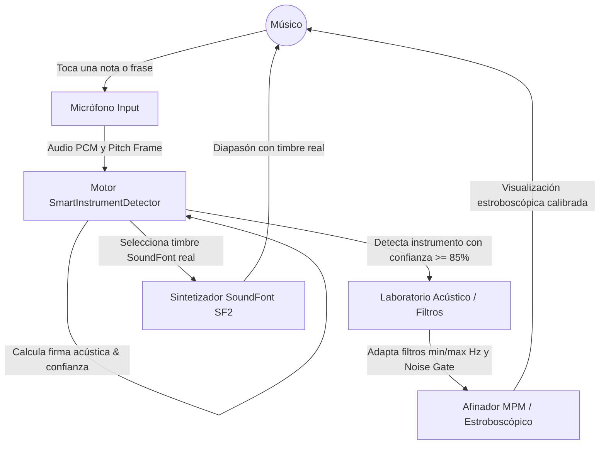
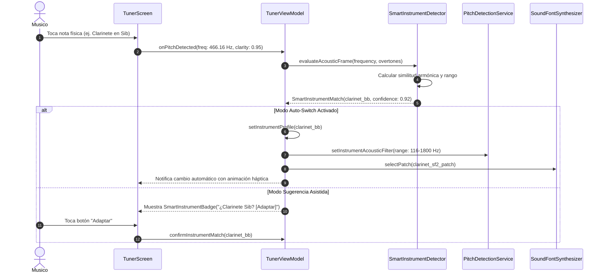

# Caso de Uso 59: Afinador Inteligente por Reconocimiento Tímbrico y Adaptación Acústica

## 1. Descripción
El Afinador Inteligente monitorea de forma pasiva la entrada del micrófono, extrayendo la frecuencia fundamental y la distribución de armónicos $H_1-H_8$. Mediante el algoritmo de clasificación acústica multivariada, identifica automáticamente el instrumento musical en uso, reconfigura los filtros pasa-altos y de supresión de ruido del micrófono, y ajusta la emisión del diapasón acústico para utilizar el timbre real del instrumento.

---

## 2. Diagrama de Casos de Uso (Mermaid)

---

## 3. Diagrama de Secuencia (Mermaid)

---

## 4. Precondiciones
1. La entrada de micrófono debe estar activa y calibrada.
2. El modo de Afinador Inteligente debe estar habilitado en la configuración o ViewModel.
3. El sonido entrante debe superar la compuerta de ruido básica del sistema.

---

## 5. Flujo Principal
1. El usuario emite un sonido con su instrumento musical.
2. El `SmartInstrumentDetector` analiza la frecuencia fundamental y la distribución de armónicos $H_1-H_8$.
3. El sistema calcula la similitud espectral con los perfiles acústicos de la base de datos de Tunner.
4. Al obtener un match con confianza $\ge 0.85$, se sugiere o actualiza automáticamente el perfil de instrumento activo.
5. El filtro acústico del afinador MPM se ajusta al ancho de banda exacto del instrumento.
6. El sintetizador SoundFont asigna el patch timbral del instrumento para la reproducción del diapasón.

---

## 6. Flujos Alternativos y Excepciones
- **Confianza insuficiente (< 0.70):** Si el sonido es ambiguo (ej. un tono senoidal o ruido ambiental), el sistema mantiene el perfil instrumental previamente configurado sin cambios intempestivos.
- **Instrumento no catalogado:** Si el instrumento no está en la base de datos, el sistema clasifica por familia general (Vientos Madera, Vientos Metal, Cuerdas, Percusión Afinada) y aplica filtros genéricos de familia.
